# Open Relay Portal

[](LICENSE)
[](https://python.org)
[](https://github.com/dustinm16/portal/releases)

A self-hosted, encrypted communication and infrastructure gateway. One server gives you everything — live streaming, encrypted chat, voice calls, remote access, and file management — all under your control, on your hardware, with zero third-party dependencies.

> **Your server. Your data. Your rules.** No accounts on someone else's platform. No content policies you didn't write. No subscription fees. Just your hardware running your portal.

> **Dev/example instance:** [https://portal.dddvm.xyz](https://portal.dddvm.xyz) — a live development server running the latest build.

## Why This Exists

Most of the tools people use every day for communication, streaming, and remote access are run by someone else. That means someone else holds your messages, your files, your audience, and your access credentials. If they change their terms, raise prices, or shut down — you lose everything.

Open Relay Portal puts all of it on a server you own. One installation gives you a complete communication platform, a streaming server, remote access to all your machines, and a file manager — with everything encrypted and under your control.

### For communities that want independence
- **Content creators** who want to own their platform, their audience, and 100% of their revenue
- **Organizations** that need secure internal communication without trusting their data to a third party
- **Friend groups and gaming communities** who want a private space they fully control

### For people in restrictive or dangerous environments
- **Journalists** in countries where press freedom is under attack — encrypted chat and streaming that no corporation can be compelled to hand over
- **Activists and organizers** who need communication infrastructure that can't be censored or monitored by outside parties
- **Aid workers and NGOs** operating in conflict zones where commercial services are blocked, unreliable, or under surveillance
- **Anyone in a region** where centralized infrastructure is destroyed — a single server (even a small VPS anywhere in the world) can restore communication

### For infrastructure operators
- **Homelab enthusiasts** who want a single portal to manage their entire setup from anywhere
- **Small businesses** that need remote access to internal services without maintaining a VPN
- **IT teams** who want browser-based SSH, VNC, and database access with centralized authentication

## What You Get

### Live Streaming
Broadcast video to your community — like having your own private TV channel. Stream from OBS or any RTMP-compatible app, with support for hardware-accelerated encoding (NVENC, AMF, x264). Viewers watch in their browser over HLS. Every stream is automatically recorded as VOD clips and uploaded to your own storage. Relay your stream simultaneously to Twitch, YouTube, Kick, or any custom RTMP destination. You keep full control — no platform cut, no algorithm deciding who sees your content, no surprise policy changes.

Streams are private unless you make them public. The chat of a stream that is not public can be read, joined and written to only by its owner and the admins, and its channel is left out of everyone else's channel list. **Rotate Share Link** in the stream settings replaces the viewing link, so old links, embeds and open watch pages stop working; making a public stream private rotates it for you. Private means private for the video as well: the playlist, segments, thumbnail, WebRTC playback and the info route all use one rule. The owner and the admins may always watch, a signed-in member may watch a public stream, and somebody who is not signed in may watch only a public stream whose **Allow unauthenticated access** switch is on, with its current share key. Everything else answers the same "Stream not found", so a private stream's existence and live state are not revealed. Viewing keys never appear in notifications, webhooks, cards or logs. **Allow unauthenticated access** is a separate switch that shows the video on the public live page and lets the share link play without a login.

**Following and go-live notices.** A member follows a stream from the streams page, the watch page or the bell beside a stream channel in chat, and can follow only a stream they may watch. Who follows whom is private: you see your own follows, the owner of a stream sees only a number of followers, and no one, admins included, gets a list of names. Making a stream private removes every follow of it. When a stream goes live, the owner's **Who is told** setting decides the audience: **followers** (the default for a new stream) or **everyone** who may watch it. Members in the audience get an in-portal notification, never the streamer. A stream is announced once per 10 minutes, however often the encoder reconnects, and the owner can write a **go-live message** of up to 200 characters with `{streamer}`, `{title}` and `{url}`; empty uses "{title} just went live".

**Cards and the live strip.** A go-live also posts a card (the streamer, the title and a Watch button) into the stream's own chat. An admin can pick one **announce channel** (Admin > Settings > User Permissions) that receives the card of every public stream; it must be a channel every member can read. A card is removed from every channel when its stream becomes private, and is never posted for a private stream into a channel members can read. The chat page has a **Live now** strip above the messages with the streams that are live and that you may watch. Go-live notices to the outside (the `stream.live` webhook) carry the watch address and message but no stream key.

**Viewer counts, title and game.** The number of viewers on a stream card, in the live list and on the watch page is counted by the portal: a member is a viewer while their player passes the portal's playback check, and one account is one viewer however many tabs or devices it uses. Nothing is kept about who is watching, only a number. Somebody who reads the stream straight from the RTMPS or RTSP port is not counted. When a stream ends, its owner sees the highest count and the number of different viewers of that session as "Last session" in the stream settings; nobody else gets those figures. A stream can have a **game** of up to 60 characters, set when you create the stream or in its settings, with suggestions from the games you used before and those of public streams. It is shown with the title on cards, on the watch page and in go-live cards, and can be used as `{game}` in the go-live message. If you change the title or game while you are live, the watch page, the streams page player and the Live now strip update without a reload.

**Chat controls on the watch page.** A stream owner can appoint up to 20 **stream mods** in the stream settings (Chat Moderators). The owner and the mods carry a Streamer or Mod badge and, in that stream's chat only, can pin a message (it shows as a banner above the chat, with an Unpin button for them), time out a member, delete messages, start and close polls, ban and unban, and set **slow mode** (off, 5, 15 or 30 seconds, from a selector in the chat header; they are not held back by it). A mod cannot act on the owner, another mod or site staff, and the owner cannot act on site staff. Appointing a mod does not let that person watch or read a private stream. A member who is banned from a stream can no longer watch it while signed in: playback answers "Stream not found" and the watch page says they are banned. Anybody who may read the chat can vote in its polls. Every one of these actions is written to the audit log.

### Encrypted Chat
Message your team or community in real time — all messages are encrypted on the server so only your portal can read them. Organize conversations into channels, reply to specific messages, start threads, react with emoji, @mention people, share images, embed links and videos, and pin important messages. Scroll up to read older messages of a channel, 50 at a time, and jump from a reply, a pin, a search result or a mention straight to that message in context; a **Jump to present** bar brings you back to the newest messages. History reaches back as far as the chat retention keeps messages (7 days by default, set under Data Retention). Search across everything with Ctrl+K. Every channel has a **bell menu** (hover the channel): choose All messages, Mentions only, Nothing or the default, or mute it for 1, 8 or 24 hours. The choice is kept on the server, is private to you and follows you to every browser. Channels you have not opened show an unread badge that updates live, a short tone can play for the channels you set to All and for mentions (with quiet hours that you set in your own browser), and desktop alerts reach you when the tab is in the background. Write `@everyone` or `@here` to notify a whole channel, in the channels where the sender is allowed to (staff, stream owners, and every member of a channel where staff switched it on), with a limit of one a minute for ordinary senders. A private channel, a direct message or the chat of a stream that is not public never shows its name or activity to anyone who may not read it. It's a full-featured chat system that lives entirely on your hardware.

### Direct Messages
Have private conversations with one person or a small group (up to 10 people), all encrypted on the server. Supports reactions, replies, message editing, typing indicators, unread badges, and muting — everything you'd expect from a modern messaging experience, delivered instantly over WebSocket. If someone is offline, they'll see a notification when they return.

### Phone Notifications
Get a notice on your phone or in your browser when a direct message, a mention or a stream you follow needs you, even with the portal closed. Switch it on per device under **User settings > Phone notifications**, choose which of the three kinds you want, see your devices and remove any of them. On an iPhone or iPad install the portal to the home screen first (iOS 16.4 or later); on Android and in desktop browsers the browser's own permission prompt is all it needs. A push is sent only when you have no portal tab open, never carries message text, a sender's name or a stream title ("New direct message", "You were mentioned in #channel"), and is encrypted to your device; an anonymous poster is never named. It travels through the push service of your browser's maker (Google, Mozilla, Apple or Microsoft), which can see that a notification was sent to your device and when, and how big it was, but not what it says. Administrators can switch the feature off, add a push service, send a test push to their own devices and replace the push key in **Admin > Settings > Push notifications**. Nothing is sent to anyone who has not enabled it. Details and what an administrator should know before upgrading are in the [notes for 1.19.0](#upgrade-notes-for-1190).

### Message Search
Find anything across your channels and DMs with full-text search (the Search button or Ctrl+K). Narrow it with operators: `from:name`, `in:channel`, `has:link`, `has:file`, `has:image`, `is:pinned`, `before:2026-11-01`, `after:2026-11-01` and "quoted phrases"; `from:` and `in:` can be negated with a leading `-`. Suggestion chips under the search box offer the operators, channel names and people in the room. A search made only of operators lists up to the 200 newest matches, and clicking a result opens that message in context.

You only find what you are allowed to read. A private channel you are not in, a stream chat you may not read and other people's DMs never match, and they look exactly like channels that do not exist. A search never reveals who wrote an anonymous post. Messages older than the chat retention are deleted and cannot be found.

### Voice Chat
Talk to people in real time with encrypted audio. Choose between push-to-talk or automatic voice detection. Audio travels directly between participants using WebRTC — it never passes through or gets stored on the server. True peer-to-peer, end-to-end encrypted voice.
A dropped connection (a Wi-Fi change, a brief outage) keeps your seat in the call for 20 seconds so you can rejoin it without starting over; a second tab of the same account cannot take it over.
The voice settings window (the Voice settings button next to the voice controls in chat) lets you pick your microphone and, in browsers that allow it, your speaker, shows a live level meter with the voice-detection threshold on it, can play your own microphone back to you as a test, and can keep the microphone open for a moment after you release the push-to-talk key. These choices stay in your own browser.
Right-click or long-press a name in the voice bar or the online list to set that person's volume (0 to 200%) or mute them for yourself. Like the voice settings, this is stored only in your own browser and never sent to the server.

### Private Search
Search the web without the trackers. Portal can run [SearXNG](https://github.com/searxng/searxng) — a privacy-respecting metasearch engine that aggregates results from 70+ engines while stripping the profiling — as an optional managed service, reachable at `/search/` by logged-in users. No search history, no cookies handed to upstream engines, no ads. The SearXNG UI is re-skinned to your portal theme and carries the portal navbar, so it feels like a native page. The dashboard has a unified search bar with a **Portal** / **Internet** toggle — Portal searches your indexed chat history, Internet runs a private web search. It's a normal managed service: enable it from the Services panel to turn it on, disable it and the portal carries on exactly as before (the search bar quietly drops the Internet option). A JSON API (`/search/search?q=...&format=json`) is available for automation; scripts authenticate with a personal API key (`Authorization: Api-Key portal_...`), and any valid key can search.

### Remote Access
Control other computers from your browser — no special software needed on your end. Connect to SSH terminals, VNC desktops, SPICE consoles, databases, and more — all through a secure WebSocket connection. 75 connection types are supported across 17 categories, each with a setup guide. A Quick Add bar lets you create common connections (SSH, VNC, MySQL, PostgreSQL, Proxmox, HTTP Proxy) with one click.

On a phone or tablet the web terminal shows a **key bar** above the on-screen keyboard: Esc, Tab, sticky Ctrl and Alt (tap once, then type the next key), arrow keys, `|`, `~`, `/`, Paste and text size buttons. Pasting more than one line asks for confirmation first, and when the browser will not let the page read the clipboard a text box takes the paste instead. The bar is shown by default only on touch screens; the keyboard button in the terminal header turns it on or off and the choice is remembered in the browser.

SSH and SFTP connections verify the remote server's host key. The first time you connect, Portal shows the key's fingerprint (SHA256) instead of connecting; compare it with the server's, then choose **Accept this key**. If the key later changes, the connection is refused until the connection's owner accepts the new one. Portal sends a remote host only the credentials stored on the connection, never the server account's own SSH keys or agent. The connection form has a **Do not verify host key** option; it is off by default and not recommended.

For web-based services, Portal includes a built-in embedded browser with tabbed browsing and keyboard shortcuts (Ctrl+T for new tab, Ctrl+W to close, Alt+arrows for back/forward). Browse web dashboards, admin panels, or any website through Portal's secure proxy. Every user gets a default **Web Browser** connection; its home page is Portal's own private search (SearXNG) when that service is enabled, otherwise DuckDuckGo. From the private-search home, clicking a result opens it in a new tab *inside* the embedded browser (multi-site connections) or in a real browser tab (single-site connections). The embedded browser is session-aware — log out anywhere and any open browser window returns to the login page. Add it from the connection form's **Web Browser (private search)** preset. No VPN required — if you can reach your portal, you can reach everything behind it.

### Sharing Access
Give another Portal user access to a connection you set up — click **Share** on the connection card, type their username (multiple people allowed), and they'll see it on their own dashboard and can use it through the embedded browser, web shell, xterm or VNC. They can't edit or delete it, and access is revoked the moment you remove them: their open sessions on it are closed too. A share can end by itself: the dialog asks how long it lasts (30 days preselected; 1 hour, 8 hours, 1 day, 7 days, 90 days or until you revoke it), the card shows the time left, and **All my shares** lists every share with who gave it, when and until when. Admins can likewise grant a non-admin user the ability to **start / stop / restart**, **view logs**, or (for Portal-deployed game servers) **browse and edit the server's files and download backups** — jailed to that server's own directory tree — for a single managed service — no full admin rights needed, and a grant can carry an end time just like a share (an admin sees every grant and share on the portal under **All grants on the portal**). Every action they're allowed shows as a labelled button on that service's card on their own dashboard.

An SSH connection with a password can **store the password** (the connection form's "Store password", with "Prompt each time" turned off). The password is kept encrypted, is never shown again to you or to anyone you share the connection with, and is used without asking by the web shell and the file browser, so a person you share it with opens a shell as that account in one click, **without knowing the password**: the share dialog warns you of that. It is sent only to a host whose key you have accepted, and changing the connection's host, port or username removes it. With "Prompt each time" (the default) the terminal asks every time, as before.

### File Management
Browse, upload, download, and edit files on your server or on remote machines through the web. The file manager works with your server's local filesystem (for admins) and with any SFTP connection you've set up. When you have multiple SFTP connections, a dual-pane commander-style view lets you move files between remote machines side by side.

### System Monitoring
See what's running on your server at a glance — active processes, systemd services, network interfaces, and open ports. Start, stop, or restart services. Kill runaway processes. All integrated directly into the admin panel as a tab, so you don't need to open a terminal for routine server management. Portal also watches managed services: after three failed health checks in a row a service counts as down, and after two good ones as up again. A service you stopped on purpose, or a game server stopped for an update, stays quiet. Starting, stopping and restarting from the panel is written to the audit log.

You can also promote any installed systemd unit — a game server, a database, a file share — to a **managed service** of type `systemd`. Portal then shows it alongside MediaMTX and SearXNG with the same start/stop/restart controls, health, and (journal) logs, and reflects the unit's state even when it's changed outside Portal. Portal only ever stops such a unit when you explicitly click Stop — never on its own restart or when you remove the entry.

### Game Servers
Deploy dedicated game servers straight from the admin panel. The **Game Servers** tab has a searchable catalog of ~85 games (Palworld, Valheim, Project Zomboid, Rust, ARK, CS2, Team Fortress 2, Arma 3, DayZ, Satisfactory, 7 Days to Die, and many more — admins can add their own entries too); pick a game, name the instance, and Portal runs the SteamCMD install, generates a systemd unit, and registers it as a managed service. From there you get start/stop/restart, live journal logs, a one-click **SteamCMD update** (with an "already up to date" check), an **editor for the launch arguments and stop signal** (no shell runs them — arguments reach the game verbatim), and a **commander-style file browser** jailed to that server's own directory tree — click the server's card to open it. Navigate the install dir (and, for games like Project Zomboid that store config elsewhere, the config/saves dir), sort the list by name, size, or modified date, right-click a file for a context menu to edit, download, rename, or delete it, upload new files (multi-select or drag-and-drop), or pull a full `.tar.gz` **backup** of the config and save/world files. The editor has syntax highlighting for the config formats you'll actually run into (INI/CFG, JSON, XML, YAML, TOML, Lua, properties). The game's known settings files are pinned at the top for quick access. Everything runs under the same unprivileged account as a hand-rolled setup would — and, as of the same tab's **Storage Locations** card, more than one disk: register additional directories, pick which one new deploys default to, or point an individual deploy at a specific one. No `.env` edit or restart needed to add a second disk once the first is configured.

Each server is a managed service, so you can **grant** a non-admin user `Control`, `Logs`, and/or `Files` — every action they're allowed shows up as a clearly-labelled button on that server's card on their own dashboard (start/stop/restart, view logs, edit config, download a backup), and nothing else. Already running servers via hand-rolled systemd units can be adopted onto this machinery without a reinstall.

Servers with no Linux build, such as Enshrouded, run under Wine in their own prefix. A deploy detects a Windows-only game and sets this up itself, including installing Wine on Debian-based hosts. Only some of these games have been tested; see [Windows-only game servers](docs/WINDOWS-GAME-SERVERS.md) for the limits.

### Device-Wide Metrics
The Metrics tab keeps a persisted, whole-host history — not just Portal's own traffic. Every 60 seconds Portal samples CPU and memory per service/process, every listening port and the connections sitting on it, and which remote IPs are talking to the box (with the ports they're hitting and the process serving them). Charts cover anywhere from 6 hours to 14 days; history survives restarts. Retention is configurable under Settings → Data Retention (default 14 days). Counts are point-in-time samples, so a connection that opens and closes between ticks won't appear.

### Data Retention
Set policies for how long chat messages, DMs, notifications, activity logs, security events, and expired tokens are kept. Automatic cleanup runs on a schedule (default every 6 hours) with optional database compaction. Run cleanup on demand anytime from the admin panel.

### Visual Theming
Twenty-eight built-in themes — switch with the palette icon in the navbar. The core set: **Dark** (navy, default), **Black** (OLED), **Grey**, **Slate**, **Light**, and **High Contrast**; accent hues **Blue**, **Purple**, **Cyan**, **Green**, **Red**, **Rose**, **Orange**, **Amber**; developer palettes **Nord**, **Dracula**, **Solarized** (dark & light), **Gruvbox**, **Tokyo Night**; light readers **Sepia** and **Nord Light**; vibrant **Synthwave**, **Matrix**, **Cyberpunk**; and three animated gradients — **Aurora**, **Nebula**, **Ember** (which hold a static mid-blend under `prefers-reduced-motion`). Your preference persists across sessions via localStorage and applies before the first paint so there's no flash. The theme follows you everywhere — the login page, every public page, and the SearXNG search UI, which is re-skinned to the active portal theme and wears the portal navbar.

### Administration
Manage users with a clear role hierarchy — Super Admin, Admin, Moderator, and User. Create invite codes to let people register (daily rotating, single-use, or time-limited). Require two-factor authentication. Issue API keys for automation, scoped to what the script needs, expiring after 90 days by default and optionally bound to the networks they are used from. Manage SSH keys, monitor traffic patterns, and scan for vulnerabilities. All administration happens through the admin panel in your browser.

### Moderation and Anonymous Posting
Moderators and admins can give a channel a **slow mode** of 5, 10 or 30 seconds, or 1, 2 or 5 minutes, from its context menu; staff are exempt, and editing a message does not count as sending one. In a stream's own chat the slow mode is set from the watch page instead, to 0, 5, 15 or 30 seconds, by the stream owner, its mods and staff. **Stream mods.** In a stream's own chat the owner and the **stream mods** the owner appointed (see Live Streaming) moderate with the same tools, in that chat only: pin, time out (from the watch page for 1 minute up to a day), delete, ban, unban, polls and slow mode. A stream mod has no power in another stream's chat or in a general channel, and a refused action always gets the same "Not allowed" answer. Moderators and admins keep their site-wide powers, and an administrator can lift any stream ban, including one on staff.

**Auto-moderation** rules (Admin > Auto-Mod) filter words (contains, exact word or regex), links (a block list of domains, or all links), excessive capitals and mention spam. A matching message is blocked and its author is told which rule stopped it; a rule can also time the author out or mute them. Edited messages are checked too, regex rules run in a separate time-limited process, and staff are stopped by a rule but never timed out or muted by it. Every trigger is recorded in the Auto-Mod action log (View Action Log).

Members can switch on **Hide my username** in the chat sidebar to post anonymously. Ordinary members never receive the account, role, nickname or avatar behind an anonymous post: not in history, search, reactions, reply previews, polls or webhooks. Moderators, admins and the author still see who wrote it, so anonymous does not mean unaccountable, and a stream owner, a stream mod or staff can ban or time out an anonymous author by message, without being shown who it is.

### Sessions
**Dashboard > Profile Settings > Sessions** lists every browser login and token of your account with the browser and system (read from the User-Agent by a small local parser, nothing is looked up online), when it was signed in and last used, and its last IP address. Sign out one device, or choose **Sign out other devices**; a signed-out session loses its chat, voice call and proxied downloads at once. API keys are listed separately and are not touched. Admins can sign a user out everywhere from Manage Users, within the role hierarchy.

### API Keys
Scripts and integrations sign in with a personal **API key**, made in the dashboard's **API Keys** window (shown once, stored only as a hash). The key window asks for what the key may do and where it may be used from, so a key can be as small as the script needs:

- **Scopes.** A scope picker lists every scope the portal checks (`*`, `admin`, `services:read`, `access:*`, plus any a service requires, for administrators). A member who is not an administrator always gets `services:read,access:*`. A key with `*` and no expiry shows a warning.
- **Expiry.** A new key expires in 90 days by default; choose 30, 90, 180 or 365 days or Never (the API takes `expires_days`, 1 to 3650, or `"never"`). An expired key stops working and is cleaned up with the other expired keys.
- **Address binding.** A key can be limited to up to 10 addresses or networks (for example `203.0.113.0/24`). From any other address it answers the same `401` as a wrong key, and the refusal is a security event. Binding relies on the portal seeing real visitor addresses: check that Admin > Overview shows no Proxy Trust warning first.
- **Where it was used.** The key list shows the address the key was created from and the address it was last used from, and gives an administrator's own keys a **Stale** badge when they have not been used for 90 days.
- **Only a sign-in creates keys.** A request authenticated with an API key cannot create another key, so a bound or expiring key cannot be used to make an unbound one.

See the [notes for 1.18.0](#upgrade-notes-for-1180) before upgrading: a script that made keys without an expiry now gets 90-day keys.

### Security Events and Audit Trail
A **security event log** records sign-ins and failures, two-factor events, logouts and session sign-outs, API key, password, role, user and invite changes, IP blocks and unblocks, SSH host key accepts, rate-limit trips and changes to the log's own settings. Each row stores the IP address and user agent it came from. Passwords, codes, tokens and keys are never recorded, and a failed login for a name that is not an account does not store the typed name. Only a superadmin can read it (Admin > Audit Log, with Security and Auth filters and CSV or JSON export), and it is kept 180 days by default (Data Retention). Floods from outsiders are aggregated per source and minute, so they cannot fill the database.

The moderation **audit log** next to it records what staff do: moderation actions, service control, backup downloads and settings changes.

### Address Blocking
Admins can block IP addresses, permanently or for a time. Automatic blocks (the optional scanner blocking) are lockout-safe: they skip loopback, private networks, this host's own addresses, trusted proxies, Cloudflare and a **never-ban list** you edit in Admin > Settings (or set with `NEVER_BAN_CIDRS`), and they never override a manual block. If you lock yourself out, stop the portal and run `server.py unblock <ip>` or `clear-bans`. **Failed sign-in blocking** is optional and off by default (Admin > Settings > Failed sign-in blocking): when turned on, an address that fails 20 sign-ins in 10 minutes is blocked for 15 minutes, doubling on a repeat within 7 days up to 24 hours, never permanently. Blocks are stored (they survive a restart) and show in the block list with a Kind column (`login` or `probe` for an automatic block, a dash for one made by hand) and their expiry. A failure from an address that any account signed in from within the last 30 days is not counted, whichever account it names, so only the general rate limit of 100 requests a minute per address slows guessing from such an address; the never-ban list applies as above. Scanner (probe) blocks do not have the sign-in exemption: only the never-ban rules protect an address from them. A **logged-out request limit** (Admin > Settings > Logged-out request limit, on by default, 5 to 600 requests a minute, 30 by default) answers `429` to a client with no valid sign-in that sends too many requests to `/proxy`, `/search` or `/browser`; it blocks nothing and never touches `/login`. A weekly job refreshes the built-in Cloudflare range list (on by default, can be switched off, sends no portal data); a list that fails the safety checks is held for a superadmin to approve or dismiss, and **Use the built-in list** undoes it. The portal also warns when `TRUSTED_PROXIES` looks wrong.

### Backups and Restore
Daily backup archives are on by default (the newest 7 are kept). An archive holds a consistent copy of the database, the files needed to read it and a manifest of hashes; you can add an extra destination directory, run **Back Up Now**, and download an archive (superadmin, browser login only). `server.py restore-archive` verifies an archive and unpacks it into an empty directory. Every update takes a backup first and does not start if it fails. Treat an archive like root access to the portal. Details are under [Backups and Rollback](#backups-and-rollback).

### Notifications and Alerts
Besides signed generic JSON, outgoing webhooks can send to **ntfy, Gotify, Discord and Slack**. A superadmin can create **system webhooks** (Admin > Webhooks) and subscribe them to fourteen kinds of alert, plus a notice sent whenever alerts were held back by the limits: failed sign-in bursts, two-factor turned off, API key created, role changed, IP blocked, update available, service health changes, certificate expiry and renewal failure, game server crashes, backup success and failure, moderation actions and automod triggers. Each alert can also appear as an in-portal notification for admins. When a stream you follow (or, if its owner chose everyone, any stream you may watch) goes live you get an in-portal notification with the owner's go-live message, linked to the stream. The `stream.live` webhook goes to the hooks subscribed to it for a public stream, and only to system webhooks (generic format) for a private one; its payload carries the watch address and message and no stream key.

The defaults are cautious. **No alert leaves the machine until a superadmin creates a system webhook and picks alert events**; `*` never includes an alert. A message to ntfy, Gotify, Discord or Slack carries a title, a one-line summary and the portal name, and no message text, IP address or token. IP addresses, user agents and rule names are added only when a hook's **include_details** switch is on (off by default). `message.created` goes to such a hook only when listed by name, and never for private channels, DMs or non-public stream chats. An anonymous post is sent with its author shown only as "Anonymous". Credentials are stored encrypted and never shown again, and a hook cannot be aimed at private or loopback addresses unless a superadmin allows it for a self-hosted ntfy or Gotify. Alerts are rate-limited, and a notice says what was held back. The formats were tested against local test receivers only, so press **Test** on a new hook before relying on it.

## Usage Examples

Here are a few ways people use Open Relay Portal:

- **"My friend needs help with their computer."** Open a VNC connection in your browser and see their screen in real time — walk them through the fix or take control directly.

- **"I need a file from my home server while I'm traveling."** Log into your portal from any browser, open the file manager, and download what you need. No VPN setup, no special app.

- **"Our team needs a private group chat with voice."** Create channels for different topics, invite your team with an invite code, and use voice chat when you need to talk. Everything stays on your server.

- **"I want to stream for my friends without a public platform."** Go live from OBS to your portal's RTMPS address. Your friends open your portal URL in their browser and watch. Recordings are saved automatically.

- **"I manage a home server with several services."** Add each service as a connection in Portal — Proxmox, Home Assistant, Grafana, Pi-hole, whatever you run. Access all of them through one authenticated dashboard in your browser, from anywhere.

- **"Our organization needs secure communication that we fully control."** Deploy Portal on your own infrastructure. All messages are encrypted at rest, voice never touches the server, and no third party can access your data — even if compelled.

## Screenshots

All pictures are taken from a throwaway demo instance with made-up members and addresses.

### Overview

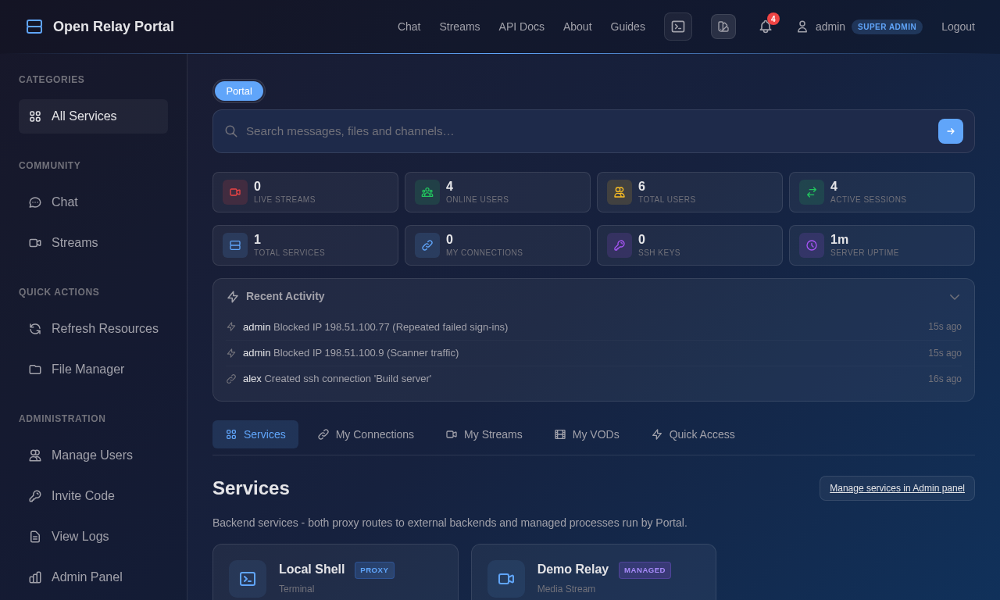
*Dashboard — services, connections, streams, recent activity and system stats*

<table>
<tr>
<td valign="top" width="50%">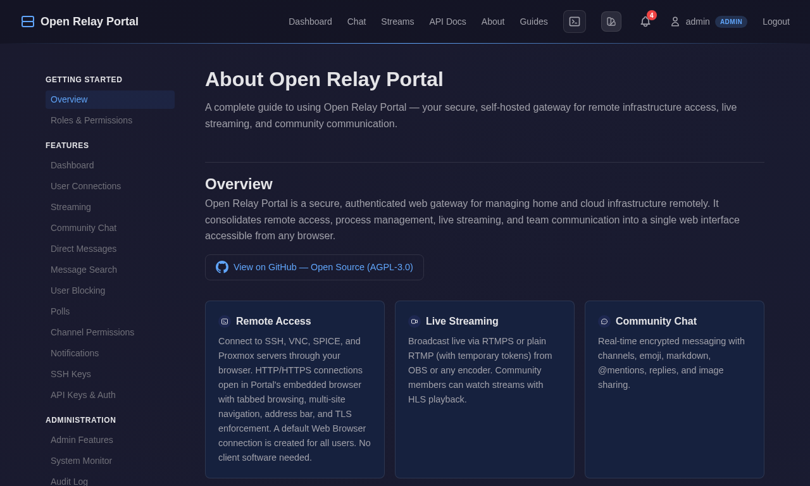<br><em>Feature guide and documentation</em></td>
<td valign="top" width="50%"><br><em>Sign-in page with TOTP two-factor support</em></td>
</tr>
</table>

<table>
<tr>
<td valign="top" width="50%">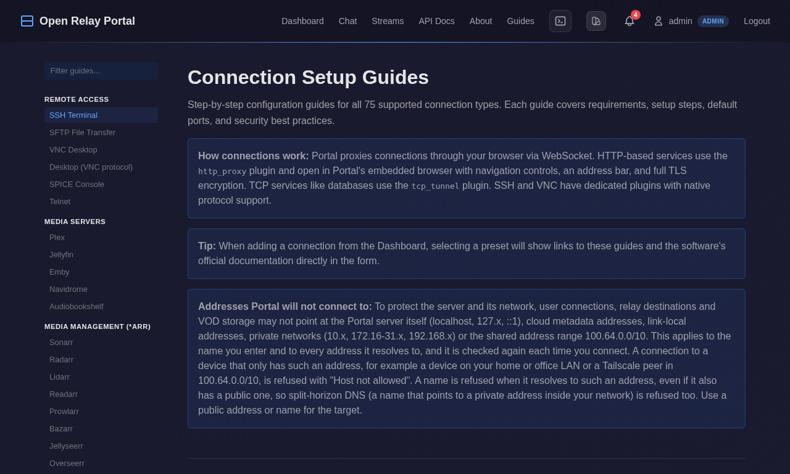<br><em>Connection setup guides — step-by-step documentation for all 75 connection types</em></td>
<td valign="top" width="50%"><br><em>Guide detail — requirements, setup steps and security advice per type</em></td>
</tr>
</table>

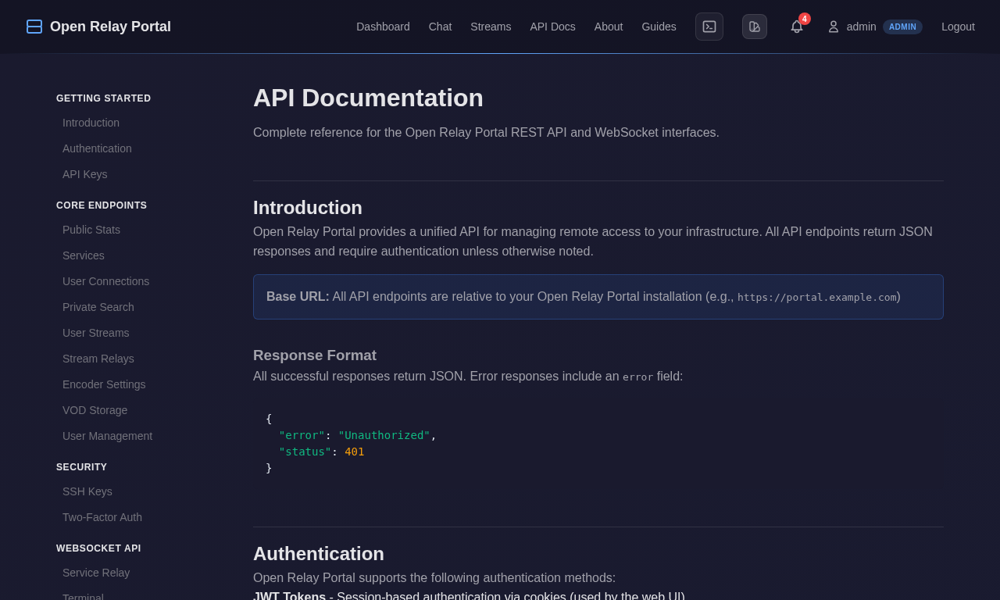
*API Documentation — interactive endpoint reference*

### Chat and voice


*Encrypted Chat — channels, polls, pinned messages and online users*

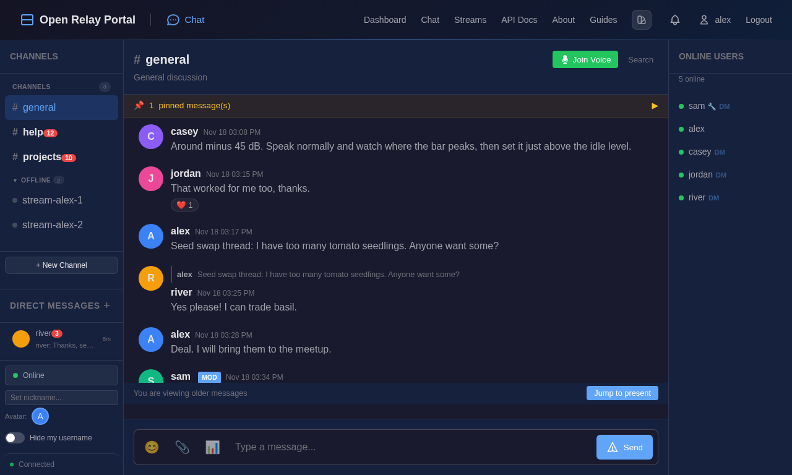
*Scrollback — reading older messages with a Jump to present bar*

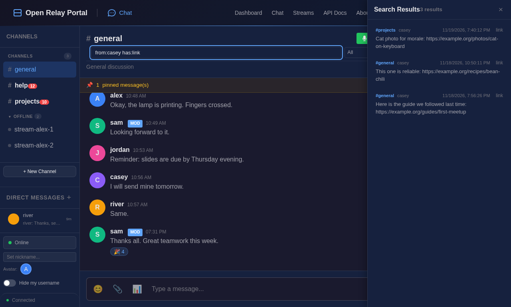
*Search operators — `from:casey has:link` with link badges on the results*

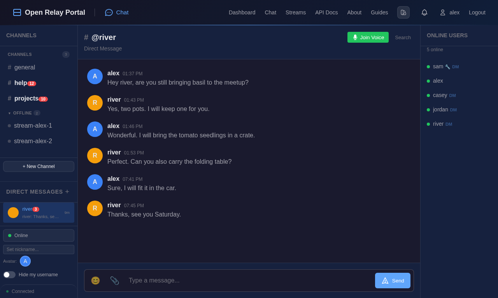
*Direct Messages — private 1:1 and group conversations with encryption at rest*

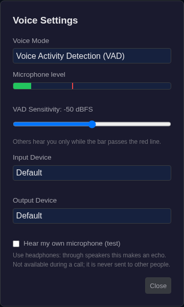

*Voice Settings — voice detection mode, live level meter with the threshold line, sensitivity, and input and output pickers*

### Notifications


*Chat bell menu — a notification level or a timed mute per channel, with a live unread badge on a channel that is not open*

<table>
<tr>
<td valign="top" width="50%"><br><em>User settings > Phone notifications — the switch for this browser, the three kinds and the list of your devices</em></td>
<td valign="top" width="50%">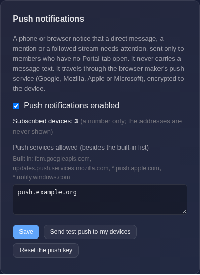<br><em>Admin > Settings > Push notifications — feature switch, device count, extra push services, test push and key reset</em></td>
</tr>
</table>

### Streams


*Community Streams — public streams with their game under the title and a Follow toggle on each stream that is not yours, two of them live with the viewer count on the thumbnail*

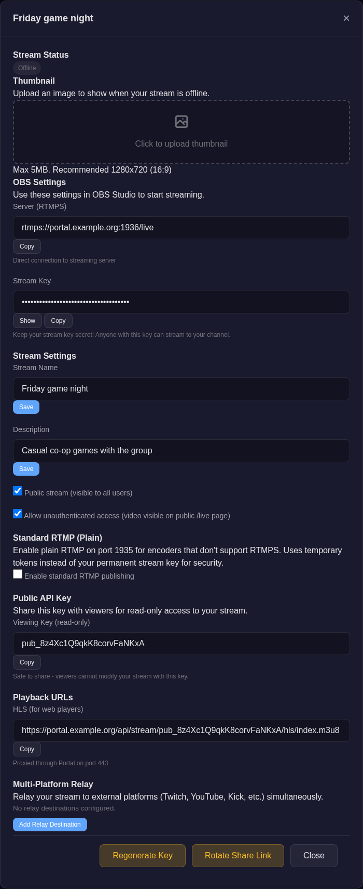

*Stream settings — OBS server and masked stream key, the game field, the go-live message and who is told when you go live (followers or everyone), public and unauthenticated switches, viewing key, playback URL, the Chat Moderators list with the member search, and Regenerate Key and Rotate Share Link*

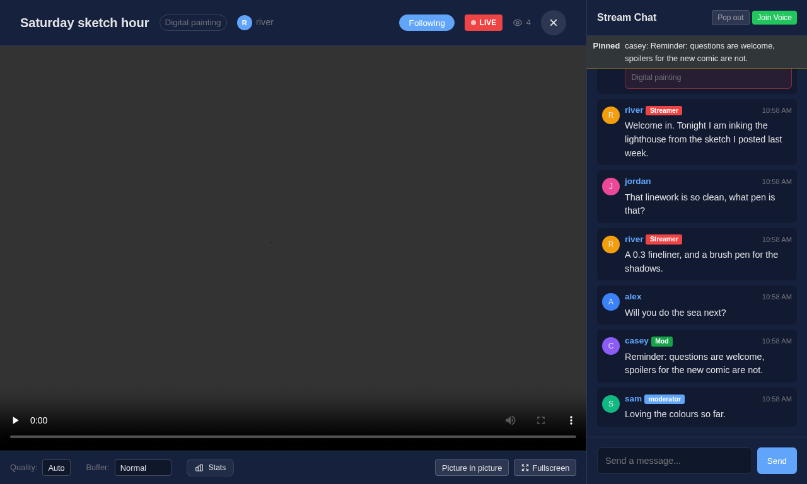
*The watch page of a live stream: the game next to the title, the viewer count, the Streamer and Mod badges in the chat and a pinned message banner above it*


*Go-live cards in the announce channel, the Live now strip above the messages, and live streams in the channel list*

### Remote access

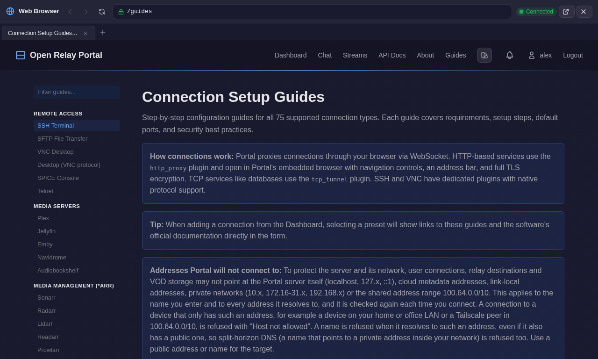
*Embedded Browser — tabbed browsing with address bar, navigation controls and multi-site proxy*


*File Manager — remote files over SFTP*

<table>
<tr>
<td valign="top" width="60%"><br><em>Host key check — the fingerprint is shown and must be accepted before the first connection</em></td>
<td valign="top" width="40%"><br><em>Mobile terminal — key bar with Esc, Tab, Ctrl, Alt and arrows</em></td>
</tr>
</table>

<table>
<tr>
<td valign="top" width="30%">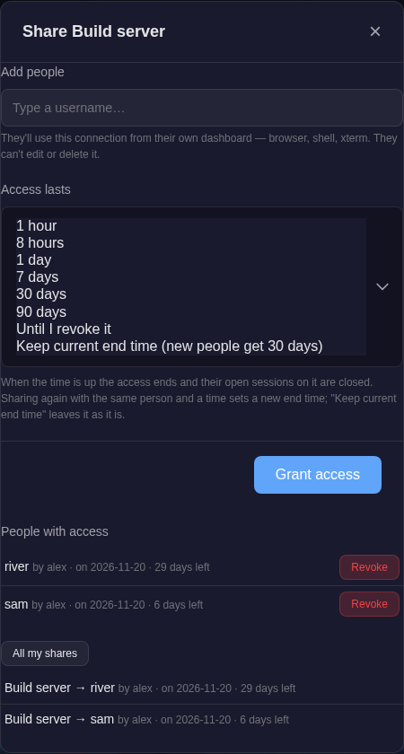<br><em>Share dialog — the Access lasts list, who has access with the time left, and All my shares</em></td>
<td valign="top" width="70%"><br><em>API keys — scope picker, expiry and the addresses a key may be used from, with where each key was created and last used and a Stale badge</em></td>
</tr>
</table>

### Administration and security


*Admin Panel — server statistics, traffic, community stats and resource gauges*

<table>
<tr>
<td valign="top" width="50%"><br><em>System resources — CPU, memory and disk gauges</em></td>
<td valign="top" width="50%"><br><em>Managed Services — start, stop and restart with health and logs</em></td>
</tr>
</table>


*Auto-Mod — word, caps, link and mention rules*


*Audit Log, Security filter — sign-in failures, blocks and list changes with source addresses*

<br>
*Admin > Settings — Failed sign-in blocking (off by default) and the Logged-out request limit*

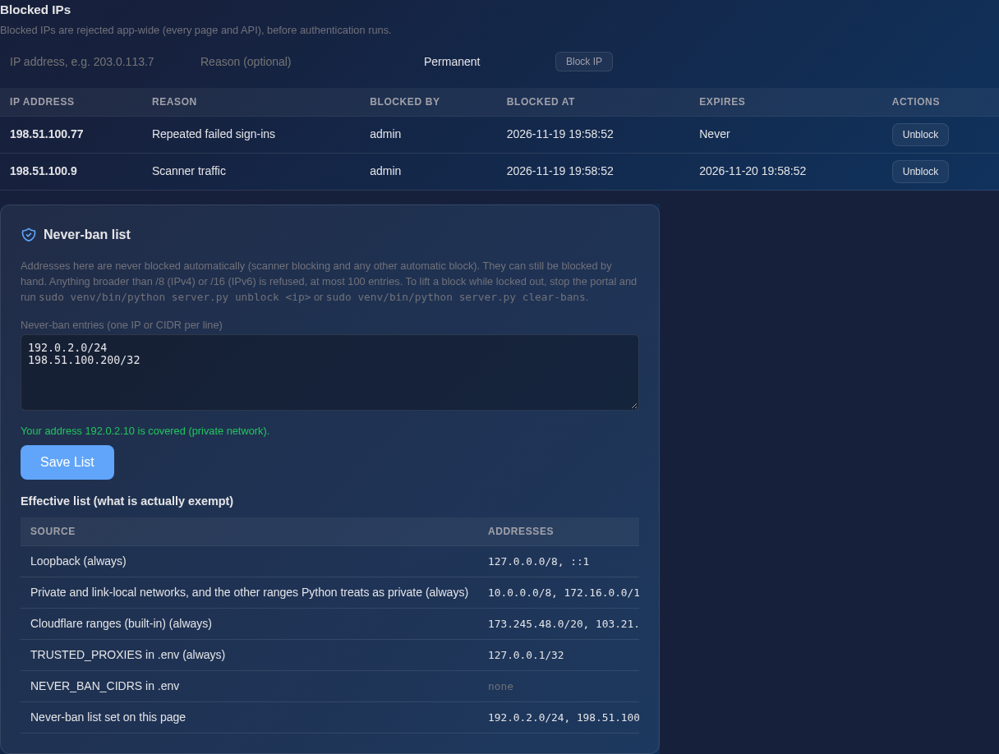
*Blocked IPs with the never-ban list and the effective list*

<table>
<tr>
<td valign="top" width="50%">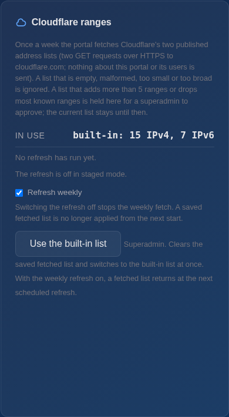<br><em>Cloudflare ranges — built-in list, weekly refresh switch and reset</em></td>
<td valign="top" width="50%"><br><em>Edit system webhook — format, events, include details and private-address switches</em></td>
</tr>
</table>

<table>
<tr>
<td valign="top" width="50%"><br><em>Sessions — your devices, with Sign out other devices</em></td>
<td valign="top" width="50%">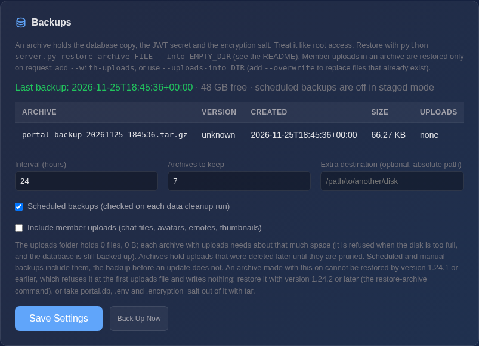<br><em>Backups — archives, schedule, extra destination and Back Up Now</em></td>
</tr>
</table>


*System webhooks — generic, ntfy, Gotify, Discord and Slack destinations, and the alert events*

### Themes


*Theme Switcher — 28 built-in themes (core, accent hues, developer palettes, light readers, vibrant and animated gradients)*

<table>
<tr>
<td valign="top" width="50%"><br><em>Light Theme — full light mode with dark text and blue accent</em></td>
<td valign="top" width="50%">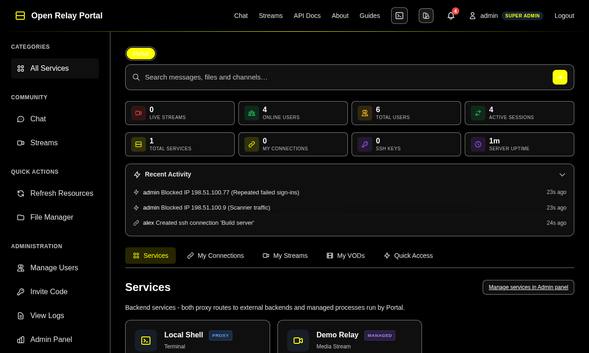<br><em>High Contrast Theme — maximum readability with yellow accent on pure black</em></td>
</tr>
</table>

## Quick Start

```bash
git clone https://github.com/dustinm16/portal.git
cd portal
sudo python3 server.py setup
```

That's it. The setup wizard handles everything automatically:
1. Creates a virtual environment and installs all dependencies
2. **Auto-generates a self-signed TLS certificate** (server starts immediately)
3. Generates a JWT secret and writes `.env` configuration
4. **Downloads MediaMTX** streaming server (for RTMPS/HLS live streaming)
5. Creates the database and initial admin user
6. Installs and starts a systemd service

Open `https://your-hostname` in a browser. Self-signed certs show a warning — click "Advanced" > "Proceed" to continue. Switch to Let's Encrypt or a custom certificate later via the Admin Panel or by re-running setup.

### Manual Setup

```bash
# Create virtual environment and install dependencies
python3 -m venv venv
source venv/bin/activate
pip install -r requirements.txt

# Configure (or copy .env.example and edit)
cp .env.example .env
chmod 600 .env
# Edit .env: set JWT_SECRET, HOSTNAME, SSL_CERT, SSL_KEY

# Generate a self-signed cert if you don't have one
python -c "import cert_manager; cert_manager.generate_self_signed_cert('localhost', 'certs')"

# Install MediaMTX for streaming (optional, Linux amd64)
sudo python server.py install-mediamtx

# Install fail2ban with an SSH jail (optional host hardening, Debian/Ubuntu)
sudo venv/bin/python server.py install-fail2ban --ignore-ip <your-ip>

# Install SearXNG for private web search (optional, Debian/Ubuntu)
sudo ./install-searxng.sh
# then, in the admin Services panel: add a managed service of type "searxng" and enable it

# Initialize database and create admin user
python server.py init

# Run (port 443 requires root)
sudo venv/bin/python server.py serve
```

### Requirements
- Python 3.11+
- Linux (systemd for service management features)
- Port 443 (HTTPS) — requires root, or use a higher port in `.env`

## Architecture

```
Python/aiohttp backend ──── SQLite database (FTS5 search)
       │                         │
       ├── WebSocket relay ──── Plugins (SSH, VNC, SPICE, ...)
       ├── HLS streaming ────── MediaMTX (managed process)
       ├── Private search ───── SearXNG (optional managed process)
       ├── Chat engine ──────── Fernet encryption at rest
       ├── Direct messages ──── Encrypted 1:1 & group DMs
       ├── Message search ───── FTS5 full-text index
       ├── Voice signaling ──── WebRTC P2P (no server-side audio)
       ├── File manager ─────── Local + remote SFTP
       ├── System monitor ───── psutil + systemd
       └── Data retention ───── Configurable auto-cleanup
```

Single binary. No Docker required. No microservices. No external databases. One Python process, one SQLite file, one `.env` config.

## Security

- **HTTPS only** — TLS 1.2+ with HSTS preload, no HTTP fallback
- **Encryption at rest** — Chat messages, connection configs, stream keys, TOTP secrets all encrypted (Fernet/PBKDF2)
- **Machine-bound keys** — Encryption keys derived from hardware ID + random salt; cloning the repo cannot decrypt data
- **Argon2id** password hashing
- **Zero-knowledge voice** — WebRTC DTLS-SRTP, audio never touches the server
- **Path traversal protection** — File manager validates all paths with `Path.resolve()`
- **Input validation** — All user input sanitized, no shell injection vectors
- **Upload content security** — Uploaded files sanitized: only safe types (images, video, audio, PDF) render inline; HTML/JS/SVG forced to download to prevent stored XSS
- **API credential redaction** — Passwords and keys never returned from API endpoints
- **Stream key encryption** — SHA-256 hashed for lookups, encrypted at rest
- **Opaque connection IDs** — URL-safe tokens replace sequential integers, preventing enumeration
- **Proxy isolation** — Embedded browser strips session cookies and auth headers from upstream requests; sandboxed iframe
- **Rate limiting** — Per-IP throttling on sign-in, registration, token creation, incoming webhooks and relay WebSocket connections; per-member limits on chat messages, search and history paging; a logged-out client is held to about 30 requests a minute on `/proxy`, `/search` and `/browser` (admin setting, on by default)
- **Trusted proxies** — `CF-Connecting-IP` / `X-Forwarded-For` are honoured only from Cloudflare and `TRUSTED_PROXIES` (add `127.0.0.1,::1` for a reverse proxy on the same host); direct-to-origin clients cannot spoof their address
- **Lockout-safe blocking** — Every automatic block skips loopback, private networks, this host's own addresses, trusted proxies and Cloudflare, `NEVER_BAN_CIDRS` from `.env` and an admin-editable never-ban list (Admin > Settings > Never-ban list, which shows the effective list). An automatic block never shortens or overwrites a manual or permanent one. `sudo venv/bin/python server.py unblock <ip>` and `sudo venv/bin/python server.py clear-bans` lift blocks with the portal stopped
- **Scanner blocking (optional)** — Set `PROBE_BLOCK_STRIKES=3` to block non-browser clients for an hour (`PROBE_BLOCK_SECONDS`) after repeated requests for `.env`, `.git/config`, `*.php` and similar. A block is stored (it survives a restart) and a repeat within 7 days lasts longer, up to 24 hours. Off by default because blocks are per IP and shared by everyone behind one NAT
- **Failed sign-in blocking (optional)** — Admin > Settings turns on temporary, stored bans for an address that keeps failing to sign in (off by default; the never-ban rules apply). See the [notes](#upgrade-notes-for-1180)
- **API key limits** — Keys can carry only the scopes a script needs, expire (90 days by default) and be bound to addresses; only a sign-in can create a key ([notes](#upgrade-notes-for-1180))
- **Restart-safe terminal sessions** — Each local web-terminal shell runs in its own systemd scope, so `tmux`/`screen` sessions started from it survive a portal restart (`TERMINAL_OWN_SCOPE`)
- **Security headers** — HSTS, X-Frame-Options, X-Content-Type-Options, CSP on every response
- **SSH host key verification** — Every SSH and SFTP connection pins the remote host key on first use and refuses a changed key until the owner accepts it; the portal's own SSH keys and agent are never offered to remote hosts ([notes](#upgrade-notes-for-1110))
- **Security event log** — Sign-ins, failures, session sign-outs, key, role and block changes are recorded with IP address and user agent, readable by a superadmin only and kept 180 days by default ([notes](#upgrade-notes-for-1130))
- **Sessions** — Members can see and sign out their own sessions; signing out closes the sockets, voice call and proxied downloads opened with it ([notes](#upgrade-notes-for-1130))
- **Closed chat and anonymity** — One access check decides every read of a channel (history, search, pins, notifications, voice), so a private channel or a non-public stream chat answers like a missing one. Ordinary members never receive the real author of an anonymous post ([notes](#upgrade-notes-for-1140))
- **Cautious notifications** — No alert leaves the machine until a superadmin creates a system webhook; payloads are minimal unless a hook turns on `include_details`; webhook credentials are stored encrypted and never shown again; private and loopback destinations need an explicit superadmin opt-in ([notes](#upgrade-notes-for-1150))

See [ARCHITECTURE.md](docs/ARCHITECTURE.md) for the full security model, and
[SECURITY-AUDIT-2026-09.md](docs/SECURITY-AUDIT-2026-09.md) for the most recent
audit (releases v1.7.0 → v1.10.3, RCE / host-access focus).

## Backups and Rollback

```bash
sudo venv/bin/python server.py backup-archive            # backups/archives/portal-backup-<UTC time>.tar.gz
sudo venv/bin/python server.py restore-archive /path/to/portal-backup-<time>.tar.gz --into /path/to/empty-dir
sudo venv/bin/python server.py backup-db                 # database copy only: backups/portal-db-<timestamp>.db
sudo venv/bin/python server.py backup-db --out /path/to/copy.db
```

**Backup archives.** An archive is a `.tar.gz` with a `manifest.json` (portal version, schema marker, sha256 and size of every file), a consistent copy of the database made through the SQLite backup API (safe while the portal runs, integrity-checked), and the files needed to read it: `.env` (JWT secret), `.encryption_salt` and `.invite_code` when present. Without the salt and the JWT secret, encrypted chat messages, connection configs and two-factor secrets in the database cannot be read.

Because of that, an archive is as sensitive as root access to the portal. Archives are written owner-only (0600) into `backups/archives/` (0700), through a temporary name that is renamed when complete. Nothing is written when less than twice the database size is free; the refusal is logged and shown in the Backups card. Keep copies on storage you trust.

- **Schedule**: on by default, once a day, keeping the newest 7 archives. Change it in Admin > Settings > Backups (superadmin only): enabled, interval in hours (1 to 720), number to keep (1 to 100), and an optional extra destination directory. The scheduled job runs from the data cleanup loop, so it is checked every "cleanup interval" hours (Data Retention, default 6, at most 168); with a long cleanup interval a daily backup runs no more often than that. The due check also runs once about two minutes after the server starts, so an install that restarts more often than the cleanup interval still gets its backups; the first scheduled backup of a new install happens at that check. Use Back Up Now for an immediate one. Scheduled backups are skipped in staged test mode, Back Up Now still works.
- **Extra destination**: after each archive, a copy is written there (0600, renamed into place) and older copies beyond the keep count are removed from that directory, only files named like portal archives. The directory must exist, be absolute, and not be writable by group or others unless it has the sticky bit. Directories under `/tmp`, `/var/tmp` and `/dev/shm` are refused: the service runs with PrivateTmp, so a copy written there would be invisible to the host and deleted on every restart. The destination may not be the installation directory or anything under it, nor inside a directory the portal serves or exposes: a file-manager root other than `/`, a game-server storage root, `RECORDINGS_DIR` or the VOD temp directory; this is checked when the setting is saved and again before every copy. Changing the extra destination needs the superadmin's browser login session (like a download); lowering the number to keep needs it too, the other settings also work with an API key or token, and an extra destination that is left unchanged is not checked when saving, so an unmounted disk does not block editing them. A failed extra copy is reported and logged, the archive in `backups/archives/` is still kept.
- **Download and delete** are in the same card and need a superadmin logged in with the browser cookie; API keys, bearer tokens and `?token=` links are refused for download. Every download is written to the audit log. Archives are never served to anyone else.
- **Every update** (Apply in Admin > Updates, or `server.py update`) takes a backup archive first and does not start if the backup fails.
- **Alerts**: a superadmin can subscribe a system webhook to `backup.ok` and `backup.failed` (off by default, see [notes for 1.15.0](#upgrade-notes-for-1150)); a failed extra copy sends `backup.failed`.

**Restore.** `restore-archive` verifies the manifest hashes of every file, then unpacks into a directory that is empty (or does not exist yet). It refuses a directory that has anything in it and never reads or writes the live installation. If anything is wrong, nothing is left in the target. To bring a portal back from the unpacked files:

1. Stop the damaged portal, or prepare a new host. Check out the same portal release as the manifest's `portal_version` (the command prints it) into a fresh directory with its virtual environment.
2. Copy `portal.db`, `.env`, `.encryption_salt` and `.invite_code` from the restored directory into it. Keep the files owner-only (`chmod 600`).
3. Edit `.env`: `DATABASE_PATH` and `RECORDINGS_DIR` must point inside the new directory (otherwise it opens the original database), and `SSL_CERT`, `SSL_KEY`, `HOSTNAME` and `PORT` must suit the new host. The command prints a warning for each of these that points outside the target.
4. Start the portal. Users, encrypted chat, connection configs and two-factor secrets work again because the JWT secret and the salt came with the database.

`backup-db` takes a consistent copy of the database only and runs an integrity check on it. It never overwrites an existing file, writes the copy owner-only (0600), needs free space of about twice the database size, and refuses a destination directory that other accounts can write to (a sticky directory such as `/tmp` is accepted).

Update snapshots (`backups/snapshots/`) are owner-only and contain the code plus an integrity-checked copy of the database. A rollback restores the code only: it does not restore the database, `.env`, the virtual environment or `backups/`, and it logs the `restore-archive` command and the newest archive instead of restoring anything. Rollback refuses to run if the snapshot or the backup directories are owned by another account or writable by group or others; fix the ownership and modes (`chown` to the portal's account, `chmod 700`) and retry.

The upgrade notes below explain each release in detail, including how to go back: [1.11.0](#upgrade-notes-for-1110) (backups, host keys), [1.13.0](#upgrade-notes-for-1130) (security events, sessions, blocking), [1.14.0](#upgrade-notes-for-1140) (history, search) and [1.15.0](#upgrade-notes-for-1150) (alert channels).

### Upgrade notes for 1.10.8

- Accounts with two-factor authentication must send `totp_code` (a TOTP or backup code) with `POST /api/token`, or use an API key.
- Share links of private streams are replaced once on the first start. Send viewers the new link from the stream's details. Private streams send no go-live notification.
- Connection, relay, webhook and VOD storage targets are checked against the address they resolve to. Names that resolve to private, loopback, link-local or shared (100.64.0.0/10) addresses are refused with "Host not allowed".
- Media stream connections need an API URL and a WebRTC URL; user VPN bridge connections are SOCKS only.
- An admin password reset or a role change signs the user out everywhere, including API keys. A user changing their own password keeps their API keys.
- Tokens, stream keys and session values are redacted in the logs, so searching the logs for a key no longer finds it.
- WebRTC publish and playback sessions that were open across a restart are closed and have to reconnect.

### Upgrade notes for 1.11.0

- Existing SSH and SFTP connections, and admin SSH services, are refused until the owner (or an admin, for a service) accepts the host key once: connect, compare the fingerprint shown, and choose **Accept this key**. The `known_hosts` service setting is ignored. VOD storage is the exception: it is pinned automatically on its first connect and only prompts when the key changes.
- SSH agent authentication is removed, and user connections that name a key file path on the portal's disk are refused. Use a password or paste a private key into the connection.
- The portal no longer offers its own account's SSH keys or agent to remote hosts. Only credentials stored on the connection are sent.
- Terminal recordings are private (owner-only files in `RECORDINGS_DIR`), capped in size, and recordings older than 30 days are deleted at the first cleanup after the upgrade. The age is the `retention_recordings_days` data retention setting; set it to 0 to keep all recordings. Recordings are no longer copied into update snapshots or replaced by a rollback. A `RECORDINGS_DIR` that is a dangerous location or holds files other than `*.cast` is refused at start, left untouched, and recording stays off.
- Daily backup archives are on by default, keeping the newest 7 (Admin > Settings > Backups). Every update takes a backup archive first and does not start if that fails; it waits up to ten minutes for a backup that is already running.
- Desktop connections use the VNC protocol and default to port 5900. A Windows host needs a VNC server installed; RDP is not supported.
- Chunks of a VOD recording that are waiting to upload are staged in `data/vod_tmp` (private, kept across restarts and rollbacks) instead of `/tmp/portal_vods`. Chunks left in the old folder are moved there at the first start.

### Upgrade notes for 1.12.0

- Chat uploads are removed with their messages. Retention, clearing a channel and deleting a message now delete the image or attachment file too, unless another message still uses it, either in its image or attachment or by pasting the upload link into its text, a poll, a status message, a channel topic or description or a stream name or description (message text is decrypted for this check; if any message cannot be decrypted, no file is removed and the manual cleanup result and the admin page say so). Uploaded files of messages deleted before the upgrade are not removed. A daily sweep lists upload files that no message refers to (log lines starting `[Retention] Orphan chat uploads`, and `chat_orphan_sweep` in the manual cleanup result) but deletes nothing in this release. Files of a deleted channel, user or DM conversation also stay until the sweep is switched on in a later release. Deleted uploads are not in backup archives.
- Logging out, or revoking a session or an API key (also an admin revoking a member's session), now closes the sockets, voice call and in-flight proxied downloads opened with it. The account's other sessions are not affected.
- Proxied apps now receive `X-Forwarded-Proto` and the real client address (`X-Forwarded-For`, `X-Real-IP`); forwarding headers sent by the client are dropped. `X-Forwarded-Host` and `X-Forwarded-Prefix` are sent only to connections that have the new **Send Forwarded Host and Prefix** option (`forwarded_host`) on; it is off for every existing connection. A `?token=` parameter that authenticated a proxied request is no longer passed on to the upstream.
- Cookies in the embedded browser are scoped per site, so members may need to sign in to sites again.
- The connection `timeout` is now an idle timeout for downloads: a download continues as long as data keeps arriving, and only a silent upstream gives `504`. Rewritten HTML, CSS, JavaScript and JSON responses still must arrive within it in total.
- Automod now checks edited messages, and an edit passes the same ban, timeout, mute and rate-limit checks as a new message (slow mode does not apply to edits). Regex rules are length-limited and time-bounded, and an enabled rule that fails the new validation is shown as not enforced in the rule list (a disabled rule is not flagged, and a `spam_filter` rule is always shown as not enforced because nothing applies it).
- Regex rules see only the first 2000 characters of a message; text after that is not checked by them. A message or edit whose regex check runs over its 0.25 second budget is rejected for its author with a "could not be checked" error, with no penalty and no notice to others, and the pattern is tried again for the next message. The rule list shows the number of such timeouts in the last hour as "slow pattern".
- Proxied web interface connections follow at most 5 redirects (up to 10 before), and connecting to the upstream is limited to 10 seconds (it used the whole `timeout` before). An app that needs longer to answer a connection, for example a NAS that wakes up slowly, now gives `502` or `504`.
- A password or admin reset from the command line (`server.py init`, which resets the admin password, and `server.py set-admin` or `portaladmin grant` / `revoke`) revokes the sessions and API keys from a separate process. That process cannot close the sockets, voice calls and proxied downloads that the running portal already has open for them, so restart the service afterwards to end those at once.
- Cookies that the embedded browser stored before the upgrade are not scoped per site: they stay shared by all sites opened in that connection until they expire or are cleared. Clear the site data of the Web Browser connection (or ask members to) to remove them.
- Chat upload files are deleted with their messages; the orphan sweep only reports.
- ffmpeg (thumbnails, relays, recordings) runs at lower priority, and a thumbnail that cannot be captured answers 503 with `Retry-After`.
- A voice call is held for 20 seconds when its connection drops, so it can be resumed. Making a channel private removes the call members who may not stay.
- Member uploads (`static/uploads`: chat files, avatars, emotes, stream thumbnails) are no longer copied into update snapshots or replaced by a rollback, the same as recordings and the VOD staging folder. Older snapshots that still contain the folder do not restore it either. Upload files are therefore not part of any snapshot; back up `static/uploads` yourself if you need a copy.

### Upgrade notes for 1.13.0

Voice

- Voice calls have a per-person volume (0 to 200%) and a local mute. Right-click or long-press a name in the voice bar or the online-users list (the watch page has the voice bar only) to open it; with the keyboard, focus the name and press Enter (voice bar) or the context-menu key or Shift+F10. The settings are stored in each member's own browser (`localStorage`, one entry per account) and are never sent to the server, so nothing changes on the server, in the database or in the API, and they do not follow a member to another browser or device. Deafen still silences everyone. On iPhone and iPad the slider stops at 100%, and Safari there may ignore element volume, so below 100% only **Mute for me** is certain to work (the popover says so when the device refuses a volume).
- `voice.js` is now `?v=9` (chat and watch pages) and `admin.js` `?v=37`; browsers pick them up on the next page load. A call that is already open on an older page keeps the old behaviour until that page is reloaded.

Security event log

- A new security event log (table `security_events`, created at the first start) records sign-in and credential events together with the **IP address and user agent** of each one: logins and failures, 2FA required, passed, failed, throttled and backup-code use, logout, session sign-outs (a single session, "sign out other devices" as one event with the number ended, and an admin's sign-out of a user with actor and target), 2FA enable and disable, API key create, revoke and delete, password change and reset, user create and delete, role change, invite create and deactivate, manual IP block and unblock (also the `unblock` / `clear-bans` commands, recorded with the source `cli`), automatic scanner-probe blocks, rate-limit trips, SSH host key accepts, never-ban list changes (counts only, and the audit log entry `never_ban.update` holds counts only too, because moderators can read the audit log and the list is for superadmins) and the result of each Cloudflare range refresh (counts, or the reason it failed), a reset to the built-in list, and every change that weakens the log itself: a changed retention for the security events (old and new value), a manual cleanup run that deleted security events (the count) and the Cloudflare refresh being turned on or off. It is separate from the moderation audit log (which has no row for an unknown-user failure), and its rows are kept when an account is deleted. Backup runs, downloads, deletes and settings changes were already in the audit log and are not repeated there.
- **Retention is 180 days by default.** Only a superadmin can read the log, in Admin > Audit Log (extra buttons **Security**, every event, and **Auth**, sign-in and session events only, with filters and **Export CSV** / **Export JSON**). Change the retention with `retention_security_events_days` (Admin > Settings > Data Retention; `0` keeps everything). Existing installs get the default, and rows older than that are removed at the first cleanup after they exist. Each export is itself recorded, and the export answers GET only (a HEAD request is refused with 405). CSV cells that start with `=`, `+`, `-` or `@` get a leading apostrophe. The IP filter also finds the aggregated row of an IPv6 address when you type the full address, and a typed /64.
- Events an outsider can trigger (wrong passwords, bad 2FA codes, probe blocks, rate-limit trips) are counted in memory and written as one row per source address, event and minute with a `count`, at most every few seconds, so a flood does not become a flood of database writes; a write that fails is retried without counting anything twice. An IPv6 source is counted as its /64 network (shown as `2001:db8:1:2::/64`), because one subscriber can rotate through that many addresses. A minute creates at most 300 such rows however many sources send; once they are used, rows for further sources in that minute are added to one shared row per event and result with the address `*` and no user name or agent, so a flood cannot grow the table without bound. Rows for the same source and minute keep the first user name and user agent seen. Events written at once (sign-ins, sign-outs, key and role changes) are limited to 30 rows per minute for each account (or address, when there is no account) and event; the rest of that minute is counted in one aggregated row, so a signed-in member who loops sign-ins or sign-outs cannot flood the table. Control characters, zero-width characters and bidirectional override characters are removed from user names and user agents before they are stored. A failed login or registration records the typed name only when it is an existing account; for an unknown account the row says `(unknown account)` and the warning log line says "an unknown account", because people paste passwords into the user name box. Passwords, 2FA and backup codes, tokens, API keys and invite codes are never recorded.

Sessions

- New **Sessions** section in User Settings (Dashboard > Profile Settings): every browser login and every token made through `POST /api/token` of your account, with device (browser and system read from the User-Agent by a small local parser, nothing is looked up online), when it was signed in, when it was last used, its last IP address, a "This device" badge, and **Sign out** for one device or **Sign out other devices**. The current session cannot be signed out from the list (use Log out). API keys are not sessions and stay under API Keys; signing out other devices does not revoke them.
- **Sessions now store the IP address and user agent** they were created with (and the last IP address they were used from): the tokens table gains `ip`, `user_agent` and `last_ip` columns, added automatically at the first start (a second start changes nothing). Sessions that exist at the upgrade show "Unknown device" and no signing-in address until they are next used; the last IP fills in at the next request. The User-Agent is stored cut to 200 characters. The Sessions list shows these values only to the account that owns the session; the sign-in address and agent are also in the security event log, which only a superadmin can read.
- Admins (admin role and above, judged from the database role, with a full-scope credential) get **Sign out** on each manageable user in Manage Users (`POST /api/users/{id}/sessions/revoke`), subject to the same role hierarchy as password resets and written to the audit log (`sessions_revoke`). It revokes browser sessions and tokens only, not API keys. On the admin's own account it keeps the session in use.
- Signing a session out closes the sockets, voice call and in-flight proxied downloads opened with it at once (close code 4001); the account's other sessions are not affected.
- Stream keys and API keys, including narrowly scoped ones, get `403` from the sessions routes; only a browser session or an all-scope (`*`) credential can list and sign out sessions.
- The last-used time (and last IP) of a session, and the last-used time of an API key, are now written at most once a minute per session or key (the portal wrote them on every request before). They are kept in memory between writes, so after a restart the first request of each one writes again.

Blocking and trusted proxies

- Every automatic block now asks one exemption helper first. It always skips loopback, private and link-local addresses, this host's own addresses (those the configured host names resolve to and every interface address), trusted proxies and Cloudflare ranges, the networks in the new `NEVER_BAN_CIDRS` setting in `.env` (comma separated, works without the database) and the never-ban list saved on **Admin > Settings > Never-ban list**. **Scanner blocking (`PROBE_BLOCK_STRIKES`) is still off by default**; set it yourself to turn it on. This release only makes it lockout-safe. Rate limiting and the two-factor limiter are throttles, not blocks, and are not exempted.
- The never-ban list is edited by a superadmin only. It takes at most 100 addresses or CIDR networks, written strictly (`203.0.113.0/24`, no host bits set), and refuses `0.0.0.0/0`, `::/0`, any IPv4 prefix shorter than /8, any IPv6 prefix shorter than /16 and the IPv4-mapped range, so it cannot switch protection off. `NEVER_BAN_CIDRS` follows the same rules (a bad entry is skipped with a log warning). Saving the list tells you whether your own current address is covered, and drops scanner strikes and blocks already held for covered addresses. An exempt address can still be blocked by hand.
- The `blocked_ips` table gets a `source` column (`manual` or `auto`; existing rows become `manual`). An automatic block never overwrites or shortens a manual block, never shortens an automatic one and never turns a permanent block into a timed one; it can replace a block whose own expiry has passed. No automatic block is written to the database yet: the scanner-probe block lives in memory and clears on restart.
- Blocks are now stored and matched in canonical address form, so `2001:DB8::1` and `2001:db8::1` (and an IPv4-mapped address and its IPv4 form) are one block. At the first start existing rows are rewritten to that form; when several rows turn out to be one address they are merged into one, keeping the manual one and the longest expiry, so nothing is blocked for less time than before.
- To lift a block while locked out, stop the portal and run `sudo venv/bin/python server.py unblock <ip>` (every database block for that address, matched whatever its spelling) or `sudo venv/bin/python server.py clear-bans` (all of them). They open the database directly, run no migration, never create a missing database, print what they removed (with non-printable characters left out) and record the removal as a security event when the database already has the event table. A running portal keeps its block list in memory until it restarts.
- The portal now watches for a likely `TRUSTED_PROXIES` mistake: when most of the last 100 requests come from a loopback or private address that carries Cloudflare headers while that address is not trusted, it logs one warning and the admin Overview shows a Proxy Trust note (`GET /api/admin/proxy-trust`). It also logs a warning at start when the portal listens on loopback only but loopback is not trusted, and one for every `TRUSTED_PROXIES` entry broader than /8 (IPv4) or /16 (IPv6): such an entry exempts every address in it from automatic blocking and lets any of them choose the visitor address with forwarding headers. The portal never changes trust itself. Before adding an address to `TRUSTED_PROXIES` (for example `127.0.0.1,::1`, then restart), check that the peer really is your own proxy: a tunnel, VPN or other local program can send the same headers, and trusting a peer that is not a proxy lets anyone choose the address they are seen as.

Cloudflare ranges

- A weekly job (setting `cf_ranges_refresh`, on by default; **turn it off** with the switch under **Admin > Settings > Cloudflare ranges**, which stores `false`) fetches Cloudflare's two published lists, `https://www.cloudflare.com/ips-v4` and `https://www.cloudflare.com/ips-v6`, and replaces the built-in trusted list. This is the only scheduled outbound request this release adds. The two that already existed are not new: with deployed game servers a build check asks Steam every six hours, and the optional `portal-update.timer` asks GitHub once a day. The refresh sends no portal data: it is two GETs over HTTPS with certificate verification, a 10 second timeout, a 64 KB cap, no cookies, a generic user agent, redirects only within the same host, and nothing about the portal, its users or its address list. A list is refused (the current list stays, and the admin page shows the failure) unless every line is a network, there are at least 10 IPv4 and 5 IPv6 ranges, nothing is private, loopback or reserved, nothing is broader than the broadest built-in range of its family (/13 IPv4, /29 IPv6), at most 5 ranges per family are new compared with the list trusted now (the built-in list at the first refresh), and for each family it still covers at least half of the built-in ranges and at least half of the current ones. The same checks run when the saved list is loaded at start (except the count of new ranges), and a saved list that fails them is ignored. A good list takes effect at once without a restart and the last good list is kept in settings across restarts. The job checks about five minutes after each start and then every six hours, and fetches when no refresh has run yet or the last attempt is a week old (a failed attempt is retried after a day). It does not run in a staged instance. The `TRUSTED_PROXIES` entries are not affected. Every result is also a security event. **Way back to the built-in list:** with the refresh switched off the saved list is kept but not applied at the next start (the built-in list is used, and the panel says so); **Use the built-in list** in the same panel (superadmin, `POST /api/admin/cf-ranges/reset`) clears the saved list and switches to the built-in list at once, and `sudo venv/bin/python server.py cf-ranges-reset` does the same with the portal stopped (no migration, never creates a database; it takes effect at the next start). Each is recorded as a `cf_ranges_reset` security event (the button also as the audit log entry `cf_ranges.reset`; the command line writes no audit log entry, which needs an account as its actor).
### Upgrade notes for 1.14.0

Chat history

- Members can now read older messages of a channel. Scrolling to the top of a channel loads the next older page (50 messages) until the start; the page keeps what you were reading in place and never shows a message twice. Clicking a reply preview, a pinned message, a search result or a mention notification opens that message in context, even when it is hundreds of messages back (Shift-click on a reply preview still opens the thread panel, which the plain click used to open). While you look at an older part, new messages wait in a buffer and a **Jump to present** bar brings you back (sending a message from there brings you back too, and the jump marks the newest page as read; an edit, reaction or poll vote that arrives for a waiting message is applied to it). Messages loaded this way are not marked as read and raise no notification. Direct messages are unchanged (they already had their own paging), and so is the pop-out chat on the watch page.
- **Messages older than the chat retention are gone and cannot be scrolled back to.** The retention is one setting for all channels, `retention_chat_days` (default 7 days; Admin > Settings > Data Retention), not a per-channel setting. Pinned messages are kept by the cleanup as before.
- New WebSocket message `history_page` (answers `history_older` or `history_around`, or `history_error`) and new route `GET /api/chat/channels/{id}/messages` (`before_id`, `around_id`, `limit`; the page size defaults to 50 and is capped at 100). Both return 30 requests per minute per member at most, counted together over all of the member's sockets and the route (`429` with `Retry-After`, or a `history_error` with `rate_limited`). The join reply (`history`) still carries the newest 50 messages and now also `channel_id` and `has_more`. Details are in the API documentation.
- A message id (`before_id`, `around_id`) outside 1 to 9223372036854775807, and a channel id outside that range on the route, is refused (`400` or `history_error` with `invalid`; `404` for the channel id) instead of reaching the database. Before, such an id made the route answer `500` and made the member's own chat socket close.
- Reading older messages follows the same rules as joining a channel, from one shared check: a private channel needs membership (admins and superadmins read every channel, moderators do not), and a member banned from a stream's chat reads nothing. The check runs on every request, so a member removed from a private channel gets nothing on the socket they already had open. The route answers `404` for a channel the caller cannot read, the same as for one that does not exist.
- The chat of a stream that is not public can now be read, joined and written to only by the stream's owner and admins (the rule of the stream detail route); before, any member who knew the channel id could join it or page its history. Everyone else gets the answer for a missing channel, also when joining with a playback key. The thread route (`GET /api/chat/thread/{id}`) follows the same check (removed members, stream bans and closed stream chats now get `404`, not `403`, as for a missing message) and returns messages in the same shape as the history. Both routes now send `Cache-Control: private, no-store`. Streams are not public unless the owner makes them public, so this closes the chat of every such stream to ordinary members at the upgrade; making the stream public opens its chat again. Message search follows the same rule: the messages of such a chat are not found by other members (before, search returned their text). The channel is also left out of the channel list (`GET /api/chat/channels`) of everyone but the stream's owner and admins, so its name, stream, live state and owner are not shown to other members. Sockets that are already in the room when access is lost are put out at once: when the stream is made not public, a member is removed from a private channel, a member is banned from a stream's chat (in the chat or by the route) or a channel is made private, every socket in its room that can no longer read it is removed from the room, receives one `Channel not found` error and nothing more from the room (no messages, edits, reactions or typing), and its voice call in that room ends. A refused join leaves the socket in no channel (it has already left the old room), so a send that follows goes nowhere instead of into the room just left. On a socket whose channel was closed to the member after it joined, sending, editing, reactions, new polls, poll votes, closing a poll, typing, deleting, pinning and unpinning, timeouts, mutes and unmutes, are all refused too, and so is joining or resuming the channel's voice call (`voice_denied`, or `voice_resume_failed` for a resume).
- Anonymous posts stay anonymous on every older page: join, `history_page` and the route build their messages in one shared function, so ordinary members never receive an anonymous author's account id, role, nickname, avatar or name (including in reactions, reply previews, polls and edit markers), while moderators, admins and the author still get the id they need to edit or moderate.
- A reply preview now shows the nickname of the original author wherever the reply is loaded (it used to fall back to the account name when the original was not in the same 50 messages). Reply previews are looked up in the same channel only.
- A reader who has scrolled up is no longer pulled to the bottom by every new message; the page follows new messages only when you are near the bottom or wrote the message yourself.
- Database: one index, `idx_chat_messages_channel_id_id` on `chat_messages(channel_id, id)`, is created at the first start (`CREATE INDEX IF NOT EXISTS`, so a second start changes nothing). On a large chat table the first start takes a moment longer. SQLite already answered these queries from the older per-channel index, so the new index is not needed for speed today; it costs a little disk and write time. It can be dropped by hand without effect on the answers, but it is created again at the next start.
- `portal.js` is now `?v=45` on every page (the notification click needs it); browsers pick it up on the next page load. The scrollback code is in `chat.html`, which is not cached.

Search operators

- The chat search (**Search** button or Ctrl+K) now understands operators, parsed on the server: `from:name` and `-from:name` (account name or nickname), `in:channel` and `-in:channel`, `has:link`, `has:file`, `has:image`, `is:pinned`, `before:2026-11-01` and `after:2026-11-01` (UTC dates; `before:` and `after:` together cover every message), and `"quoted phrases"`. A search made only of operators is allowed: newest first, at most 200 results (the panel says so). **Load more** keeps paging through all 200 (25 at a time) and disappears after the last one. Suggestion chips under the search box offer the operators, the loaded channel names and the people in the room list; they use only what the page already has loaded. Clicking a result opens that message in context, the same jump as from a reply or a pin.
- An unknown operator, an unknown `has:` or `is:` value or a bad date is refused with `400` and a message. A word such as `12:30` or an address such as `https://example.com` is still searched as text; to search for another `name:value` literally, put it in double quotes. `-` works only before `from:` and `in:`. The separate `from`, `has`, `before` and `after` request parameters still work and are checked the same way. `GET /api/chat/search` answers `has_more`, `capped`, `terms`, `index_complete` and, per channel result, the same masked author fields as history (see the API documentation); the search limit stays 10 per minute per member.
- Access: a channel is searched only when the member may read it, by the same check as joining and scrolling back. A private channel the member is not in, or a stream chat they are banned from, matches nothing and looks exactly like a channel that does not exist (`in:` with its name is not an error). This also closes two gaps of the old search: the stream-chat ban was applied to nobody (a banned member could still search that chat, and admins searched every channel with no filter at all), and an error while looking up a member's channels searched without any filter. The search now fails closed: if the member's readable channels cannot be worked out, the route answers `503` and searches nothing, and a search with no read check of its own that cannot look them up finds no channel messages.
- Anonymous posts: a positive `from:` never matches an anonymous post for an ordinary member (not even their own), a negated `-from:` never removes one, and results use the history masking, so no operator and no count shows who wrote an anonymous post. Moderators, admins and superadmins, who already receive the author's id, can match it.
- What the index stores: nothing new. As before, the full-text index holds the words of every message in plaintext tokens next to the encrypted text (the existing design, listed in the API documentation); this release adds only three yes/no flags per message (`has_image`, `has_file`, `has_link`). The author filter reads the account name and nickname from the user table; no author name is copied into new places.
- Attachment-only posts (an image or a file with no text) are now indexed, so `has:image` and `has:file` find them. `has:image` now means an image or an image attachment; `has:file` any other attachment. Editing a message no longer loses its attachment flags.
- **Backfill.** Messages written before the upgrade have no link or file flags and attachment-only posts are missing from the index. A one-time background task starts about 20 seconds after each start until it has finished: it reads all stored messages (channels, then DMs) in batches of 200, decrypting each; each batch is read, written, committed and its position stored in one uninterrupted step on the database connection (so a rollback or an edit elsewhere can neither undo a finished batch nor be overwritten with flags of the earlier text), pauses briefly between batches, stores its position in the settings `search_backfill_channel_last_id` and `search_backfill_dm_last_id`, and sets `search_backfill_done` to `1` at the end (it then never runs again). It can be interrupted by a restart and resumes where it stopped. It logs at most one progress line a minute (`Search index backfill: ...`). It is never part of a request (a background task beside the server, not something a search waits for), and it does not start in a staged instance. It adds index rows only for attachment-only posts, with no words; a message with text that has no index row is left to **Rebuild search index**. Until it is done a search answers `index_complete: false` and `has:` queries can miss old messages, and the panel says so. On a large database the first start decrypts every stored message in small slices on the same CPU; to run it again from the start delete the three settings rows. **Rebuild search index** (superadmin) writes the flags itself and marks the backfill done; it takes the backfill's lock, so a backfill never runs beside it, and while a backfill or another rebuild is running the route answers `409` at once instead of holding the request for minutes (try again when it has finished).
- A word search in the default `all` scope is now ordered newest first (it was ranked per source, then merged by date, so a later page could repeat results and leave others unreachable). **Load more** now continues exactly where the page ended. `scope=channels` and `scope=dms` still order by relevance.
- The search `offset` is limited to 2000 (a search reads `offset` plus `limit` rows from each source, so deep paging is expensive and no one pages that far); a larger value, including one past the 64-bit integer range (which used to answer an empty `200` and log a warning), is refused with `400` and the message `offset must not exceed 2000`. `has_more` is false for a page that ends beyond that limit (offset plus the number returned above 2000), although more matches exist, so a client that follows it is never sent to a page that would be refused. `channel_id` and `conversation_id` must be between 1 and 9223372036854775807; anything else, including `0` (which used to mean no filter), answers `400`, like an out-of-range id in the history routes. A search with `scope=dms` no longer looks up the readable channels. A refused request (a bad query, id or offset) does not count against the limit. **Load more** ignores a second click while its request is running.
- Database: four columns, `has_link` and `has_file` on `chat_fts_map` and on `dm_fts_map` (`ALTER TABLE ... ADD COLUMN`, skipped when they exist, so a second start changes nothing).
- The search needed no static script change: its code is in `chat.html`, which is not cached.
- Search can be slightly slower for the first minute or so after the upgrade while the backfill (above) runs its first batches on the same database.

Voice

- The voice settings window in chat is now a working setup panel (chat page only; the watch page has no settings window but uses the saved choices on its next join). There is no server change, no database change and no new API: nothing about it is sent to the server.
- **Input device**: the choice is used on the next join and switched at once during a call (the new microphone replaces the old one in every connection without dropping anyone, and the call is not left or rejoined). A device that has been unplugged since it was chosen falls back to the default with a message, and the choice is kept. A microphone that disappears during a call is replaced by the default one.
- **Voice detection (VAD) now really closes the microphone**: while nobody speaks the track sent to the others is disabled, and it opens when the level passes the threshold and stays open for 750 ms after the last loud moment. Before, the threshold only changed the speaking indicator. A disabled track sends silence; browsers may still send the small packets that keep the connection alive, so "no sound" is guaranteed and "no packets at all" is not. The first few tens of milliseconds of a word can be cut when the gate opens; lower the threshold if that bothers you. If the level cannot be read (the browser keeps the audio context suspended or does not support it) the microphone stays open instead of muting you.
- **Level meter** with a red threshold line in the settings window. During a call it reads the call's own microphone (no second device is opened); outside a call, opening the settings window opens the microphone, so the browser may ask for permission and show its recording indicator, and closing the window (button, backdrop or Escape) releases it.
- **Hear my own microphone (test)** is off every time the window opens, plays only through your own speakers, is not available during a call and is never sent to anyone. Use headphones, otherwise it echoes.
- **Output device** is offered only where the browser can set the speaker of an audio context (Chrome, Edge and other Chromium browsers); it is hidden where the browser does not offer it (as far as the portal can detect: Safari, iPhone and iPad and Firefox did not offer it when this was written, and the picker appears in any browser that adds it). A speaker that cannot be used falls back to the default with a message.
- **Push-to-talk release delay**, 0 to 1000 ms (default 0): the microphone stays open that long after the key is released, and pressing again within it cancels the close.
- A voice-detection threshold saved while it did nothing (the slider goes up to -20 dBFS, which is strict) now decides whether others hear you. If people cannot hear you after the update, lower the threshold (move the slider left) in the chat voice settings, where the meter shows your level against the red line; the watch page has no settings window. The saved value is kept, not changed. The first time the voice settings window is opened after the update with a saved threshold stricter than -35 dBFS (-34 to 0), the window says so in a short plain-text notice with how to lower it; it is shown once (a marker is stored in the browser, see below) and not again.
- The gate is read on a timer, and browsers may slow timers in a background tab, which could cut the start of words when chat is open in a hidden tab (during a game, for example). Try it that way; push-to-talk is not affected.
- Unmuting in push-to-talk mode no longer leaves the microphone open until the key is pressed.
- The choices (device ids, threshold, delay, mode and key) are stored in your browser's `localStorage` under `voice_prefs` (one entry per browser, as before), checked for type and range when read, and never sent to the server. A second entry, `voice_gate_notice_seen` (value `1`, no setting), records that the one-time threshold notice has been dealt with. Device ids are specific to a browser, so the choices do not follow you to another browser or device.
- `voice.js` is now `?v=13` (chat and watch pages); browsers pick it up on the next page load. A call already open on an older page keeps the old behaviour until that page is reloaded.
- A chat reconnect during a call no longer reloads the saved voice settings over the ones in use; a change made in another tab applies after the call ends, at the next page load or chat reconnect.
- The saved voice settings are read when the page loads, so changing one setting in the voice settings window before the chat connection is up no longer overwrites the others (threshold, delay, devices, key) with defaults.
- Clicking Join twice quickly (or changing the input device or opening the settings window while the first join waits for the microphone prompt) no longer opens the microphone a second time; the call uses the one microphone and the level meter reads it.
- Push-to-talk no longer stops working when a button has the focus unless the key is Space or Enter: with a push-to-talk key such as V or Control you can talk right after clicking a button. Space and Enter on a focused button still press that button (and do not transmit), and typing in a text field never transmits.

Streams

- Updating a stream's settings (`PUT /api/streams/{id}`) now takes only the fields the settings screen sends: `name`, `description`, `is_public`, `allow_unauthenticated` and `rtmp_enabled`. Server-owned fields in the request (`chat_channel_id`, `is_live`, `viewer_count`, `started_at`, `ended_at`) are ignored, and a request with none of the editable fields answers `400`. Before, a member could point their stream at another channel. A chat channel that is a default channel, or that more than one stream points at, is also never hidden by a stream binding and never deleted with a stream. After any update that leaves a stream not public, members who can no longer read its chat are put out of the room (before, only the change from public to private did that). A mention notification is sent only to members who can read the channel, and a socket handles at most one typing signal per second (the others are dropped).

- Stream settings are now checked by type, on create (`POST /api/streams`) and update: `is_public`, `allow_unauthenticated` and `rtmp_enabled` take only `true`, `false`, `0` or `1`, `name` must be a non-empty string of at most 100 characters and `description` a string of at most 2000 characters or `null`; anything else answers `400` before anything is written.
- A stream bound to a default channel or to a channel that another stream also uses no longer has power over it: its going offline does not clear the channel's messages, and the stream owner cannot ban, unban or list bans there over the chat socket (admins can). A non-default channel bound to several streams is closed to members unless every one of those streams is public (owners of any of them, and admins, still read it). After a stream settings update that leaves the stream not public, members who can no longer read its chat are put out of the room whether or not the request carried `is_public`. The chat error `Channel not found` now names its channel (`channel` field), and the chat page acts on it only for the channel it has open.

Rollback

- Version 1.13.0 runs on a database migrated by 1.14.0 (the added columns and the index are ignored by it). After going forward to 1.14.0 again, press **Rebuild search index** or delete the three `search_backfill_*` settings rows, so the flags of messages written meanwhile are filled in.

Security fixes carried from 1.13.0

- **Cloudflare ranges: a refused list is held, not lost.** A published list that only fails the automatic limits (more than 5 new ranges in a family, or too many built-in or current ranges dropped) used to be refused again every day. The limits are unchanged, but the refused list is now stored as a pending list with the reason, the fetch time and the exact added and removed ranges. **Admin > Settings > Cloudflare ranges** shows it, and a superadmin can **Approve** it or **Dismiss** it (`POST /api/admin/cf-ranges/pending/approve` and `POST /api/admin/cf-ranges/pending/dismiss`, which take `{"id": ...}` and need the superadmin's browser session; an API key or token is refused). Approving checks again the rules that cannot be overridden (every range public, none broader than /13 IPv4 or /29 IPv6, 10 to 100 IPv4 and 5 to 100 IPv6 ranges), applies the list at once and saves it; an approved list is loaded at the next start by those rules only. The same refused list fetched again writes no new failure event (one event per distinct list). A dismissed list is not held again. A fetched list identical to the saved list a superadmin approved (for example after a restart with the refresh off, then the refresh switched on again) is accepted at once and not held a second time; the saved list keeps its approval. The pending list and the dismissed one are kept in two settings keys, `cf_ranges_pending` and `cf_ranges_dismissed`, which do not exist until the first list is held or dismissed. Approval and dismissal are security events (`cf_ranges_approved`, `cf_ranges_dismissed`) and audit entries (`cf_ranges.approve`, `cf_ranges.dismiss`) that hold counts only. A list that fails a hard rule is still refused outright and cannot be approved. `server.py cf-ranges-reset` also clears a pending list.
- **Cloudflare ranges: a reset wins over a running refresh.** The result of a refresh that was fetching while **Use the built-in list** (or the reset route) ran is discarded. With the weekly refresh on, a fetched list returns at the next scheduled refresh, not at once. A refresh discarded this way is recorded as discarded (`discarded` in the last result) and shown as such in the panel, not as "Last refresh failed". The panel also says whether a saved list is ignored because the refresh was off when the portal started or because the list failed the checks then.
- **Security events: admin and configuration events keep every row.** Role changes, user deletes, admin password resets, never-ban changes, every Cloudflare range event, retention changes, manual cleanups, log exports and an administrator's IP block or unblock are no longer held to the 30 rows per minute or folded into the shared overflow row; they need a staff session. Sign-ins, sign-outs and key events keep the cap, and a capped row of a signed-in account that is folded into an overflow row keeps its account (the row for the address `*` is per account, not shared). Deleting a user is now also an audit log entry (`user_delete`).
- **Sign-in and registration.** A sign-in for a name that is not an account now runs the same password hash as one for a real account, so the answer time no longer tells the two apart. A refused registration (invite refused, address limit, account not created) writes "an unknown account" to the journal instead of the typed name; the name is logged only when the account was created.

### Upgrade notes for 1.15.0

Notification channels

- Outgoing webhooks gain a **format**: `generic` (what every existing webhook is and stays, still signed with HMAC-SHA256), `ntfy`, `gotify`, `discord` and `slack`. A webhook created by an older version behaves exactly as before after the upgrade.
- ntfy, Gotify, Discord and Slack hooks are not signed and need no secret (none is stored for them; switching a hook to `generic` creates one, to be read with the regenerate-secret route, and switching away from `generic` removes it). What leaves the machine in these formats is minimal by default: an event title, a one-line summary and the portal name (the `TOTP_ISSUER` name). No message text, no IP addresses, no email addresses and no tokens. A per-hook **include_details** switch (default off) adds a short allow-listed set of fields of the event (for example the stream title and streamer, or a member name); message text is cut to 200 characters. Discord and Slack text is cut to the services' limits and stripped of `@everyone`, `@here` and mention syntax; Discord payloads set `allowed_mentions` to none, and markdown link and formatting syntax in Discord text is shown literally (a message containing `[text](url)` does not render as a link).
- **Third parties see what you subscribe to.** In a non-generic format `message.created` is off unless the hook lists it by name (`*` does not include it; the same holds for `user.connected` and `user.disconnected`, which are also never sent for a member whose status preference is appear-offline), and it is never sent for a private channel, a direct message or the chat of a stream that is not public (anonymous posts are shown as "Anonymous" and never name the author). `stream.live` and `stream.offline` are sent only for public streams. The generic format keeps its old behaviour for every event, with two exceptions that hold in every format: `user.connected` and `user.disconnected` are sent to no hook for a member whose status preference is appear-offline, and the `message.created` and `message.deleted` payload of an anonymous post carries `user_id` (and `deleted_by` when the author deleted it) as `null`, never the real account. Apart from that, it means a generic hook receives full event payloads including the text of messages in private channels: point it only at a receiver you control (Admin > Webhooks says so under the format select). A user hook can subscribe only to the events on one allow-list (the seven documented ones), so an event added in the future is system-only until it is added there on purpose. A new hook in the Admin > Webhooks form starts with no events selected.
- Credentials (a Gotify application token, an ntfy token or login) and the destination of a non-generic hook (a Discord or Slack webhook URL is a credential; an ntfy topic is effectively a password) are stored encrypted and are never returned again by any route, shown in a log or written to a delivery record. The API shows only that they are set and the scheme and host of the destination. A failed delivery of such a hook records only a short reason without the URL. Delivery records of these hooks hold no payload and no response body.
- A `429` answer from a receiver is honoured: the portal waits for `Retry-After` (at most 10 minutes, at most 3 waits in all for one delivery, the later retries after a failure included), drops further deliveries to that hook while it waits (an alert event dropped this way is counted into the `alerts.suppressed` notice with the reason "receiver asked to slow down", so a receiver cannot swallow alerts unseen), and never counts a 429 toward the automatic disable after 10 failures. Other failures keep the old rules (retries after 10 s, 60 s and 5 minutes, 10 failures disable the hook). Redirects are not followed for the new formats (generic hooks still follow them, each hop checked). Before every resend after a wait the portal reloads the hook and applies the rules again: a hook that was switched off, deleted, re-aimed, unsubscribed, given new credentials, or whose channel became private gets nothing more.
- Stored credentials stay with the destination they were saved for. An edit that changes the scheme, host or port of a hook's URL (or switches `allow_private` off together with a URL change) and sends no `format_config` drops the stored token or login; for Gotify, which cannot work without its token, the request is refused with 400 and the token must be sent again. A change of the path alone keeps them. The admin form says so next to the URL field.
- At most the first 4096 bytes of a receiver's answer are read; the rest is never downloaded, so a receiver cannot make the portal pull a huge body.
- Switching a hook from a non-generic format to `generic` needs a new `url` in the same request (a generic hook's URL is shown by the API, so the stored Discord, Slack, ntfy or Gotify address is never carried over); without one the request is refused with 400.
- Credential scope on the webhook routes: a stream key is refused (403) on every user and system webhook route. Creating, changing or deleting a hook and a new signing secret need a browser session or an all-scope (`*`) token or API key, as the other account-changing routes do; a narrowly scoped key can only list, read, view the log of and test its own hooks, and acting on another user's hook needs the administrator role plus a credential with the `admin` or `*` scope.
- Every delivery, including redirect hops, goes through the same resolve-and-recheck host blocking as before, so a hook cannot be aimed at loopback, a private address, link-local or a cloud metadata address.

Reaching a server on your own network

- New per-hook flag **allow_private** (default off) lets a hook reach loopback and private (LAN) addresses, for a self-hosted ntfy or Gotify. **Only a superadmin using a browser login session can turn it on** (an API key, a bearer token or an ordinary admin gets `403`, even when the same request also carries a superadmin's cookie: the authority is read from the one credential the request authenticated with); any editor can turn it off at any time (turning it off alone is never re-checked against the address), and changing the URL or format of such a hook needs the same superadmin session. Link-local addresses, cloud metadata addresses (including 100.100.100.200 and fd00:ec2::254), the whole 0.0.0.0/8 block, multicast, reserved space and the 6to4 (2002::/16) and Teredo (2001::/32) tunnel ranges stay blocked, and so do the portal's own listening ports (the same port on another machine is allowed). This is checked when the hook is saved and again at every connection, so a name that later resolves elsewhere is still refused. Turning it on or off writes a `webhook_allow_private` security event and an audit entry (neither contains the URL or a token).
- With allow_private a plain `http://` URL is accepted only when every address it resolves to is private or loopback; `http://` to a public address is refused when the hook is saved and at every connection (use `https://` for a public host). A discord, slack, ntfy or Gotify hook whose allow_private was switched off after it was saved with a plain `http://` URL is not delivered at all until its URL is changed to `https://` (switching allow_private off is always allowed; the rule is applied at every delivery). Such a refusal sets the hook's last failure reason to a fixed text ("needs an https:// URL unless allow_private is on", no URL) so the admin list shows why the hook is silent, and counts toward the 10 failures at most once per hour, however many events it refuses. A hook is re-checked against the default policy only when it is created, when its URL or format changes, or when allow_private is switched on; saving it with the same URL and format (rename, disable, other events, allow_private off) is not a change of destination and is never refused for the address.
- A hook with allow_private may also reach public addresses. It can reach anything else that listens on this machine (other services bound to localhost), so give it only to a superadmin's own hook.

System webhooks and the admin section

- New **Admin > Webhooks** section (superadmins only): list, create, edit, enable or disable, delete, **Test** (shows the HTTP status the receiver answered), recent deliveries (status, event, time; no payloads) and a new signing secret for generic hooks. Routes are `/api/admin/webhooks` (see the API documentation).
- A **system webhook** has no owner: it is not removed when the account that created it is deleted, only superadmins can see or change it, and the per-user routes `/api/webhooks/{id}` treat it as missing. Events in the new system-only class (`webhook.test` and the alert events described under Alert events below) can be delivered to system webhooks only, never to a user webhook, not even through `*`. At most 20 system webhooks.
- The **Test** button (user and system hooks) now waits for the receiver and returns its status code, using the format of the hook; a 429 is reported at once.

Alert events

- Fifteen ops, security and moderation **alert events** (Admin > Webhooks groups them as Security, Operations and Moderation): `auth.login_failed_burst`, `2fa.disabled`, `apikey.created`, `role.changed`, `ip.blocked`, `update.available`, `service.health_changed`, `cert.expiring`, `cert.renewal_failed`, `gameserver.crashed`, `backup.ok`, `backup.failed`, `moderation.action`, `automod.triggered` and `alerts.suppressed`. **Nothing is subscribed after the upgrade: no alert leaves the machine until a superadmin creates a system webhook and picks events.** `*` never includes an alert, and a user webhook cannot subscribe to one.
- What an alert says: a title and a one-line summary. Account names may appear in the summary of an admin or moderation event (a role change, a block, a timeout); the failed-sign-in burst, 2FA and API key alerts name the account only in the details, so a brute-force target is not announced to a chat channel. IP addresses, user agents, reasons and rule names are sent only to a hook with `include_details`. A member who posts anonymously is never named in a moderation or automod alert (it says "an anonymous member"). A generic hook's body for an alert holds only these fields, so the details are absent unless that switch is on.
- Alert storms are bounded. Five failed sign-ins within a minute for one address (an IPv6 address counts as its /64) or one existing account (account names are case-sensitive, so 'Boss' and 'boss' are two accounts) send one alert, and that key then rests for ten minutes; automatic IP blocks are reported once a minute with a count; a service sends one `down` alert after three consecutive failed health checks (an enabled service that is stopped counts as failing, except one stopped on purpose through the portal's Stop button or already stopped when the portal started: that state is the baseline and sends nothing, and a later start that fails still alerts) and one `up` alert after two good ones, so a flapping service sends nothing; a certificate sends one alert at each of 14, 7 and 1 days left per certificate serial; an update is announced once per version; automod once per rule and member per minute; moderation actions once per moderator, member and action per minute. All alerts together are capped at 30 per 10 minutes, after which the rest are held back until the window has room, and an `alerts.suppressed` notice is due (it counts in the window too, so a window holds at most 30 alerts plus that notice). What a stranger or an ordinary member can set off has a smaller cap of its own in the same window, so it cannot use up the room of the other alerts: 5 failed-sign-in burst alerts and 5 automatic-block alerts per 10 minutes, 5 in all for the moderation alerts any signed-in member can set off (`moderation.action` and `automod.triggered` share that one cap), 3 `2fa.disabled` and 2 `apikey.created` alerts (each with a cap of its own, so a stream owner who bans raiders cannot silence the alert for a turned-off two-factor sign-in), which leaves room for at least 9 others. These caps bind only alerts caused by non-staff accounts: an alert whose actor is a moderator, admin or superadmin, one about a staff account (a failed-sign-in burst against a staff account name, 2FA turned off or an API key created on one) and every operations alert (service, certificate, backup, update, game server) bypasses them and is limited only by its own cooldown or transition rule and the global cap, and the global cap keeps a reserve of 10 of the 30 that an alert subject to a sub-cap can never use, so a member cannot use up the room an administrator's action needs. One exception, because a stranger can set it off by guessing staff account names: failed-sign-in bursts against staff account names may use at most 5 of the 10 reserved slots in a 10-minute window (they are held back once 25 of the 30 slots are used), so the other 5 slots stay for operations alerts and alerts caused by staff. Whenever anything is held back a notice is due, whatever the reason: the first is sent 30 seconds after the first refusal, then at most one per 10 minutes, so a member who keeps a limit tripped for hours cannot keep later refusals (a staff alert, an outage) from being reported. Each notice names every kind of alert held back since the previous notice with its count (the commonest first; kinds that do not fit in the summary are counted as "and N more kinds") and then clears those counts. It says which limit held them back: the global limit of 30 alerts in 10 minutes, the reserve of 10 slots, or a per-kind limit (per kind when the reasons are mixed). It is never held back by a cap itself and goes to every system hook that has any alert event subscribed, not only hooks that list it. `role.changed` rests 60 seconds per account and role change, so a second, different change of the same account (user to admin, then admin to superadmin) is still sent. An alert held back by a cap is lost to the hooks; the security event log still holds the event behind it. A failed-sign-in burst held back by its cooldown or a cap is still written to the security event log, once. Wrong second-factor codes count toward the burst like wrong passwords. A moderation or automod alert from a private channel, a conversation or the chat of a stream that is not public (whatever channel that stream's chat is bound to, a shared or default one included) says "in a private channel" in the non-generic formats (ntfy, Gotify, Discord, Slack) and leaves the channel or stream name out of their details; a generic hook still gets them. A backup whose extra copy failed sends `backup.failed` (the local archive was written, the extra copy was not), not `backup.ok`. `update.available` counts as announced only when a hook was sent it or the in-portal notice was raised, otherwise the next check tries again. If the certificate file cannot be read, the administrators get one in-portal notice a day (besides the log line). A game server stopped by the portal itself, for a SteamCMD update or because an administrator destroys it, is not reported as a crash. The counters are in memory and start empty after a restart.
- In-portal copy: each alert can also create a notification for every administrator (a per-event switch under Admin > Webhooks; default on for the security and operations alerts, off for `backup.ok` and the two moderation events). This stays inside the portal.
- The security event log records the failed-sign-in burst, the certificate alerts and the existing role, key, 2FA and block events; an alert never writes a second row for an event that is already logged.
- The daily certificate check reads the served certificate file (`SSL_CERT`) and sends nothing outbound; its first run is five minutes after start. `cert.renewal_failed` is sent when a Let's Encrypt certificate request through the portal fails, and (a heuristic, since certbot renews outside the portal) once per certificate serial when a Let's Encrypt certificate has less than 20 days left. `update.available` is raised whenever the update check runs (the Updates page) and by a daily check that runs only while a system webhook lists `update.available`, so the portal makes no new scheduled outbound request unless you ask for it. `gameserver.crashed` means a game server unit that was running ended in the failed state, or that systemd restarted on its own (the unit the portal writes has `Restart=on-failure`, so after a crash it is usually running again within ten seconds and never rests in the failed state; the portal reads systemd's restart count on each 30 second check), without a stop or restart asked for through the portal. A crash that is followed by a restart is reported at the next check, at most once per ten minutes per game server; systemd older than v235 does not report the count and only the failed state is seen.
- A staged instance (`PORTAL_STAGE_MODE`) sends alerts nowhere except to the loopback test receiver; it skips the daily certificate and update checks, and has a stage-only route and a `stage_health_interval` setting that tests use.

Upgrade

- Database: six columns are added to `webhooks` (`kind`, `format`, `format_config`, `include_details`, `allow_private`, `created_by`, defaults that leave every existing hook unchanged), and the table is rebuilt once so `user_id` can be empty for system webhooks. Ids, tokens and delivery records are kept; the rebuild is repeatable and runs inside a transaction. On a very large `webhook_logs` table it is quick (that table is not copied). Take a backup first as for any release.
- Static files: no script or style file changed (the admin section and the alert event groups are in `admin.html`, which is not cached), so no `?v=` number moved. No database change beyond the webhook columns above: alert state (the announced update versions, the certificate thresholds sent, the notification switches) is kept in the settings table.
- A staged instance (`PORTAL_STAGE_MODE`) still sends nothing to any outside address; the only exception is the loopback test receiver a smoke check sets up (the `stage_webhook_sink_port` setting, honoured only in stage mode and only for an allow_private hook aimed at 127.0.0.1 and that port).
- Rollback: 1.14.0 runs on a database migrated by 1.15.0 (it ignores the added columns), with some things to know before going back. A non-generic hook is stored with no signing secret, and 1.14.0 skips a hook without one, so it sends nothing to ntfy, Gotify, Discord or Slack hooks made or switched by 1.15.0 (a hook switched to generic has a secret and is sent every event it lists as a signed generic body). 1.14.0 does not know formats, so its webhook list shows the full destination URL of every user hook to any administrator, and for a Discord or Slack hook that URL is a credential; a system webhook is a hook with no owner and, if it is generic, is sent events as before. Every hook, system hooks included, shows its full destination URL to administrators in 1.14.0. And 1.14.0 has a regenerate-secret action for any hook: on a Discord or Slack hook it would give the hook a secret, after which 1.14.0 posts signed generic JSON bodies to that Discord or Slack address. Delete or disable the non-generic and system hooks, or rotate their credentials (a new Discord or Slack webhook URL, a new ntfy or Gotify token), before going back, or at least keep administrator access closed until you are on 1.15.0 again. The "write-only" credentials of 1.15.0 are a property of its API: nothing is returned by it, but the values sit in the database (encrypted with the portal's key) and an administrator with terminal access can read the database and the key.

Not tested: every format was exercised only against a local fake receiver. No real Discord, Slack, ntfy or Gotify service and no phone was used, so delivery to them, their rate limits and how a message looks on a phone are unproven. After upgrading, create one system hook, press Test and confirm the message arrives before relying on it. The certificate-expiry rule (14, 7 and 1 days, and the renewal-failure heuristic) is proven only with a fake clock, not with a real certificate close to its end.

### Upgrade notes for 1.16.0

**Breaking: a stream key authorises publishing only.** Until 1.15.0 a stream key (`live_`, sent as `X-Stream-Key` or `Authorization: Stream-Key`) was accepted as its owner on the stream management routes, so anybody holding it could list the owner's private streams with their `live_` and `pub_` keys, open them, rotate keys or delete them, and a narrowly scoped API key (for example `services:read`) could do the same. Now a stream key signs in on **no route at all**: this applies to EVERY route of the portal, not only the stream and VOD routes, and the request is not treated as signed in. A request that offers one (`X-Stream-Key` or `Authorization: Stream-Key`) as its credential is refused (`403` where the route reports why, otherwise `401`). Every route under `/api/streams` and `/api/me/follows` (list, create, read, update, delete, regenerate keys, RTMP token, thumbnails, relays, bans, follows, the live list and the public list) also needs a token or API key that carries the user's full scope (a browser session, or the all-scope `*`); **scoped API keys no longer work on the stream, VOD and follow routes** and get `403`. A stream key still works for what publishing needs: the MediaMTX publish hook, RTMPS, WHIP and the stream event calls. Scripts that used `X-Stream-Key` against `/api/streams`, or a scoped API key against the stream, VOD or follow routes, must change: an ordinary member, whose API keys are always scoped, scripts these routes with a bearer token from `/api/token`; administrators can use an API key made with `*`; a browser-session based tool works for both. The VOD routes (`/api/vods*`: storage settings, listing, download, delete) follow the same rule, because a stream key could otherwise repoint the owner's SFTP storage or read and delete recordings: they need a browser session or an all-scope credential, and a stream key or a scoped API key gets `403`.

Who may watch a stream

- **One rule decides every way of watching a stream**: the HLS playlist and segments (`/api/stream/{key}/hls/...`), the thumbnail, WebRTC playback (WHEP, and the calls that follow on its session), the info route and the read action of the MediaMTX authentication hook. The stream's owner and administrators (the `admin` and `superadmin` roles; a moderator is not an administrator) may always watch. Any other signed-in member may watch only a **public** stream. Somebody who is **not signed in** may watch only a stream that is public **and** has the open share link on (`allow_unauthenticated`), and only with that stream's **current** `pub_` key in the address. Before 1.16.0 a `pub_` or `live_` address was enough on its own, for any stream.
- **Everything else answers `404` with the same body (`{"error": "Stream not found"}`)**, never `401` or `403`: a private stream, a public stream's link without a login when it has no open link, a stream you may not see, an unknown key and a key that was rotated away are indistinguishable, so a private stream's existence and live state are not revealed. Scripts that checked for `403` on a bad key must now check for `404`.
- **Links that stop working after the upgrade**: (1) the `pub_` link of a **private** stream, for everybody except its owner and administrators signed in; (2) the `pub_` link of a **public stream without the open link** when the viewer is **not signed in** (a signed-in member still plays it); (3) **embeds and players on other websites** (another origin, an OBS browser source, a page that frames or fetches the link) for every stream except one that is public with the open link on, because a cross-site player does not carry the portal's session; (4) a `live_` key put in a viewing address (VLC, a player, a thumbnail embed): a stream key authorises publishing only, never watching, so this works only when the request also carries a portal session that may watch that stream; (5) a playback link used with a **scoped** API key or a stream key sent as `Authorization: Stream-Key`/`X-Stream-Key`: only the session cookie, or a token or API key with the all-scope `*` (administrators' keys; a non-administrator's API key cannot carry `*`), counts as a viewer's credential. What keeps working: a **public stream with the open link on** still plays logged out in VLC and in any player or page on any site with its current `pub_` link (these answers keep `Access-Control-Allow-Origin: *`); the watch page, the streams page and the live page of the portal itself (same origin, signed in or, on the live page, open streams); thumbnails on the portal's own pages; relays, the recorder and the thumbnail capture (see below).
- **No wildcard CORS any more except for open links.** `Access-Control-Allow-Origin: *` is removed from the answers for HLS, thumbnails, WHEP and its sessions, and the info route unless the stream is public with the open link on. Thumbnails and playlists of every other stream are marked `Cache-Control: private`, so Cloudflare and other shared caches no longer keep a private stream's thumbnail (an open link's thumbnail stays cacheable). The publishing routes (WHIP) are unchanged.
- **A change reaches viewers within 5 seconds, normally at once.** Decisions are cached for at most 5 seconds per credential and stream (so each segment request costs no database read); the cache is cleared the moment the owner changes the stream's visibility, the open link or either key, deletes the stream, or the viewer is signed out (logout, revoked session or API key, role change, password reset, account deletion). A viewer who loses access gets no new playlist or segment from then on. A stream made private also has its pub_ key rotated, as since 1.10.8. The live state in the info route and the thumbnail check can be up to 5 seconds old.
- **Internal consumers are not affected**: relays (`ffmpeg` reading `rtsp://127.0.0.1`), the VOD recorder (`rtsps://127.0.0.1`), the thumbnail capture (`ffmpeg` on MediaMTX's HLS port on loopback) and the portal's own HLS proxy all read MediaMTX directly on loopback and never use the public routes. MediaMTX still skips its authentication hook for reads (`authHTTPExclude`, unchanged) and binds its HLS, RTSP and WebRTC ports to loopback. The hook's read action follows the same rule if it is ever switched on: a reader on loopback (the portal's own) is let through, any other reader needs a full-scope API key as the password and the right to watch. Reading a stream through the externally reachable RTMPS port (1936) with a known `live_` key is a publisher's path and is not changed by this release.
- WebRTC media is not governed by this: once a WHEP session is established the media flows straight between MediaMTX and the viewer and keeps flowing after access was lost; the portal only stops answering that session's PATCH and DELETE calls and does not set up new ones. WHEP also works only where a client can reach MediaMTX's WebRTC port, as before.
- A `?token=` query parameter on a playback address still works as the viewer's credential for that one request, but it is no longer passed on to MediaMTX, and the playlist's own segment links do not carry it (use a cookie or a header for a player that has to fetch segments).
- The info route (`/api/stream/{key}/info`) returned a playback key without its `pub_` prefix, so the playback URLs it lists have never resolved; that is unchanged in this release.


Go-live announcements

- **One announcement per 10 minutes per stream.** A stream is announced (the in-portal notification and the `stream.live` webhook) the first time it goes live and not again for 10 minutes, however often it starts again: a retried MediaMTX hook, or an encoder restarted a few times, produces one announcement. The time of the last announcement is stored in the database, so a portal restart does not reset it. The check and the set are one database statement taken under the stream state lock, so two starts at the same moment cannot both announce. A `stream.offline` inside the 10 minutes is still sent; the live that follows it is not announced again. The chat's live/offline state frame is not held back (viewers still see the right state at once). The cooldown is fixed at 10 minutes (it is not a setting); a stream you deleted and made again starts fresh for the per-stream cooldown, but not for the streamer's broadcast slot described next.
- **A followers-audience stream with an announce channel uses the owner's broadcast slot.** When an announce channel is set, a public stream whose audience is `followers` still posts its card there, so it takes the per-streamer slot described next, exactly like an `everyone` stream.
- **One broadcast to everybody per 10 minutes per streamer.** Besides the per-stream cooldown above, a streamer may reach the whole membership once per 10 minutes, however many public streams they have or delete and recreate: the in-portal notification of a stream with the `everyone` audience and the card in the shared announce channel use one slot stored per streamer (table `golive_owner_cooldown`, not tied to a stream, so it survives the stream's deletion and a portal restart; it is removed with the account). While the slot is taken, a stream with the `everyone` audience tells only its followers, no card goes to the announce channel, and the card in the stream's own chat, the webhook and a followers-only stream's notice are unchanged (those stay per stream). Only a public stream uses the slot; a stream that is not public reaches administrators only and does not.
- **After a rollback to 1.15.0 and back:** a stream created under 1.15.0 after the rollback has the audience `everyone` (the column's default from 1.15.0 is `everyone`; new streams of 1.16.0 default to `followers`); its owner can change it in the stream settings.
- **A restart during a fan-out loses the rest of that announcement.** The notices are written in the background in batches; if the portal stops in the middle, the members not yet reached are not told later, because the announcement was already counted (per stream and per streamer) and the next one is allowed only after the 10 minutes.
- **A go-live message per stream.** The owner can set a message of at most 200 characters (a longer text is refused before any cleaning) in the stream settings (field `golive_message`, also settable through `PUT /api/streams/{id}`; empty means the default, `{title} just went live`). It is plain text. Only `{streamer}`, `{title}` and `{url}` are replaced, by literal text in a single pass; everything else, including `{0.__class__}` and `{0}`, is shown exactly as typed; braces around a placeholder stay and the placeholder inside is still filled in, so `{{title}}` shows as `{` followed by the title and `}` (there is no way to write a literal `{title}`); and a stream name that itself contains `{url}` is not replaced again. Control characters are removed (a tab or line break becomes a space). The message is the text of the in-portal notification, and the `message` field of the webhook payload; in the ntfy, Gotify, Discord and Slack formats it appears only for a hook with include details on (like the stream and streamer names), with mentions neutralised as for every other text.
- **The `stream.live` payload changed.** It now carries `streamer` (the owner's nickname, else username), `title` (the stream name), `url` (the logged-in watch page, `<base>/watch/<id>`) and `message`; `stream_id`, `stream_name` and `owner_username` are kept. **`public_key` is removed** from the payload: no announcement carries a `live_` key, a `pub_` key, an RTMP address or a path, and the URL never contains a share key (a viewer signs in to watch). The base URL is the new optional `PUBLIC_BASE_URL` in `.env` (`https://host[:port]`, no path), else `https://` plus `HOSTNAME`; it is never taken from a request's Host header. A malformed `PUBLIC_BASE_URL` gives no URL at all rather than a wrong one. A receiver that read `public_key` from `stream.live` must be changed to use `url`.
- **Who is told.** The in-portal notification goes only to members who may watch the stream (the same rule as playback) and, from the follow work below, only to the stream's audience: its followers, or every member (see "Following and go-live announcements"). A **private stream** is announced to the administrators who are in the audience, who may watch it (before 1.16.0 a private stream sent no notification at all; its owner is never notified of their own stream). The webhook for a stream that is **not public** goes only to system hooks (set up by an administrator) in the generic format, and to no member's own hook and no ntfy, Gotify, Discord or Slack hook. Before 1.16.0 a member's own generic hook was also sent a private stream's `stream.live` and `stream.offline` (with the stream name and owner); that is closed for both events.
- **Every way of publishing announces the same way.** The MediaMTX publish hook and the WHIP path (publishing from a browser) both go through one claim and the same background announcement, so a stream that arrives by both is announced once. (Before this release a WHIP publish announced nothing.) A claim that fails in the database is logged as a failure, not as a cooldown, and does not stop the stream. A stored announcement time in the future (a clock set back) no longer blocks announcements. On shutdown the portal cancels the announcements still running and waits for them before the database closes.

Following and go-live announcements

- **Follow a stream.** A member follows a stream from the streams page, the watch page or the bell beside a stream channel in chat (this replaces the old browser-only "alert me" setting for streams, which was kept in `localStorage` and is cleared; a member who used it follows nothing yet and has to follow again). `PUT /api/streams/{id}/follow` and `DELETE` do it for scripts, `GET /api/me/follows` lists a member's own follows. A member can follow only a stream they may watch (a public stream, or any stream for its owner and administrators); following a private stream, a stream that is not there and a stream that is not a number all answer the same `404`. At most 200 follows per member.
- **Who follows whom is private.** A member sees only their own follows. The owner of a stream sees a **number of followers** and never a name; administrators get no follower list either, and there is no route that returns one. A stream key (the `live_` key in an OBS configuration) is not a login as its owner: it gets no follow list and no `following` flag from `GET /api/streams/public` or `GET /api/streams/{id}`. (The database holds the rows, so someone with access to the database file can read them, like any other table.)
- **Making a stream private removes every follow of it** (administrators' follows included), so a later switch back to public does not bring old follows back unasked (switching to public clears whatever follows remained from the private period, for example those of an administrator who was demoted meanwhile). Deleting the stream or the member removes them too.
- **Audience per stream.** The owner chooses who a go-live is announced to in the stream settings (`golive_audience`): **followers** or **everyone** (every member who may watch it). A **new stream defaults to followers**. **Streams that exist before the upgrade stay on everyone**, so nothing changes for them until their owner switches; if you want the new default on an existing stream, change its setting. In both modes only members who may watch the stream at that moment are notified, and never the streamer. This replaces the old announcement to everyone for new streams.
- **The publish hook answers at once.** The announcement (webhook, cards and notifications) now runs in a background task after the hook has answered; notifications are written in batches of 100 and appear a moment after the stream goes live. It still honours the 10-minute cooldown: one announcement per cooldown, cards and notifications together.
- **Go-live cards in chat.** A card (message type `stream_card`, with a plain-text fallback for a client that does not know the type; the page shows the streamer, the title and a Watch button) is posted as a system post, through the normal encrypted insert, into the stream's own chat. It carries the streamer's display name, the title and the logged-in watch link: no key and no thumbnail. It is authored by the streamer's account and cannot be edited. It is not posted for a stream that is not public into any channel that ordinary members can read (a stream bound to a default channel gets no card there). Cards are chat messages: **the chat retention removes them** like any other message.
- **Announce channel.** An administrator can choose one channel (Admin > Settings > User Permissions, `stream_announce_channel_id`, none by default) that also receives the card **of a public stream**. The channel must be readable by every member (not private, not the chat of a stream); this is checked when it is set and again at every go-live. **When a stream becomes private its card is deleted from the announce channel** and from every other channel, whoever can read that channel (an announce channel that was made private later, or an earlier announce channel, with members in it included); only the card in the stream's own closed chat stays, for the owner and administrators. Deleting a stream deletes its cards everywhere. The webhook `message.created` is not sent for cards; `stream.live` already covers outside delivery.
- **Live now.** The chat page has a strip of the streams that are live and that the viewer may watch (`GET /api/streams/live`, no key in it), refreshed when a stream changes state and every 30 seconds.

Fixes made after review (the same release; none changes a setting)

- **The activity feed hides a non-public stream's events.** The go-live and offline lines of a stream that is not public are no longer shown to other members. New events of such a stream are logged under their own types, and rows stored earlier are filtered when the feed is read, so a stream made private later is covered too (the row carries only the stream's name, so a public stream of the same owner with the same name is hidden with it). Administrators still see everything.
- **HLS addresses are strict.** The HLS proxy forwards only one plain playlist or segment file name (`.m3u8`, `.mp4`, `.m4s`, `.ts`, `.aac`, `.m4a`, at most 128 characters); a folder, `..`, a backslash or an encoded form answers `404` like any other refusal.
- **Caching.** A thumbnail of an open link may be cached for at most 5 seconds. A full playback-decision cache drops its expired entries, then the oldest, instead of everything at once.
- **Ids and text.** A stream id too large for the database answers like an unknown one (`404`) instead of a server error. A stream name, description or go-live message with a lone surrogate code point is refused with `400` instead of failing later. The announce channel setting is validated before any other switch in the same request is saved.
- **Administrators and share keys.** `GET /api/streams/{id}` gives an administrator (by role, not by a scoped key) the `pub_` key of a private stream they may already watch; the publish key and the stored hashes are never shown to a non-owner.
- **Cards.** A card is stored under the owner's account username like any chat message; the display name is in the card data only. A stream created with a go-live message keeps it (as it already kept its audience). The `PUBLIC_BASE_URL` setting is in `.env.example`. The About page's automod actions section was corrected to describe what the actions do.

Upgrade

- Database: three columns are added to `user_streams` on the first start (`golive_message`, `golive_announced_at` and `golive_audience`, whose existing rows become `everyone`), plus two new tables, `stream_follow` and `stream_cards`; nothing else is rewritten. Static files: `streams.js` moved to `?v=43` (the go-live message field, which no longer cuts a message at a double quote, the audience choice and the follower count), no other script or style file changed (the follow toggle, the cards and the strip are in the pages themselves). Nothing new is sent to any outside address.
- Before you restart a production instance, tell your viewers which of the links above they use: after the upgrade the owner's streams page still shows the right link for each stream, but an old private or non-open link pasted somewhere else will answer `404`. To keep a link open to anyone, make the stream public and switch the open share link on; to keep it private, nothing is needed.
- Rollback: 1.15.0 runs on the same database (it ignores the new columns and tables; a card left in a channel shows as an ordinary message with its plain-text fallback). It restores the old behaviour (a `pub_` key alone plays any stream, with `Access-Control-Allow-Origin: *`) and announces every go-live without a cooldown, with `public_key` in the `stream.live` payload and a private stream's events sent to members' own hooks again.

Not tested: the rule and its cache were exercised with the portal's own handlers and a fake MediaMTX; real playback in VLC, OBS or a browser through MediaMTX, WebRTC media and Cloudflare in front of the portal were not tried here. After upgrading, open a private stream's link logged out (expect 404), the open link in VLC and the watch page as a member. Follows, the audience, the cards, the announce channel and the live-now list were exercised with the portal's own handlers and a staged instance over HTTP (real logins, the publish hook called from loopback); the toggle, the card and the strip were checked as text and by syntax only, not rendered in a browser, and a go-live to a community of hundreds was not tried (the batch size and the hook answering at once were tested with a slowed insert). A browser (WHIP) publish was tested only through the portal's own handler with a fake MediaMTX; no browser published. The README pictures come from a staged demo instance in a headless Chromium with made-up data and a stream marked live through the publish hook, so no video was played, no thumbnail of a live stream appears in them, and nothing was seen on a phone. After upgrading, follow a stream with a second account, go live and check the notification and the card, and check that a non-follower sees nothing. The go-live cooldown, message and payload were exercised by calling the portal's own publish hook concurrently and repeatedly, with webhook delivery replaced by a recorder; MediaMTX's real retry timing, OBS reconnecting, and a real Discord, ntfy or Gotify post were not tried. After upgrading, go live once and check the notification text and the watch link, then restart OBS and confirm nothing is announced a second time.

### Upgrade notes for 1.17.0

- **Viewer counts are kept by the portal.** The number shown on stream cards, in the live list and on the watch page is now the number of people who passed the portal's playback check lately, not the number of readers MediaMTX reports. That list also held the recorder, the relays, the thumbnail grabber and the portal's own proxy, and it missed streams published with an `rtmp_` token, so the old figure was wrong both ways. The portal no longer asks MediaMTX for readers, so **somebody who reads a stream straight from the RTMPS or RTSP port is no longer counted**: only people who pass the portal's playback check are.
- **Who is counted.** A viewer is noted after the playback check admitted the request: on an HLS playlist fetch (segments do not count), on a WHEP offer that MediaMTX answered and on the `PATCH` of that WHEP session (a viewer is then counted for 15 seconds; an external WHEP player has to call the heartbeat route, below, about every 10 seconds to stay counted), and on `POST /api/stream/{key}/viewer`, a heartbeat the watch page sends every 10 seconds while the video plays. The heartbeat goes through the same check as playback and a refused one answers the same `404`, so it counts nobody who may not watch and does not tell whether a private stream exists. It is limited to 300 requests per minute per client address (about 40 viewers beating every 10 seconds behind one address, such as an office or a mobile carrier's shared address), answering `429` beyond that, checked before the stream is looked up. A heartbeat that was refused with `404` is not charged to that allowance but to a separate one of 60 refusals per minute per address, so a banned member or a stale tab cannot use up the allowance of the others; once an address has used up its refusals, its heartbeats answer `429` for the rest of the minute. The limit tables are bounded (10000 addresses each): when full, expired entries and then the longest-quiet addresses are dropped, and a new address is never turned away because of that. The cap of 5 anonymous viewers per address (below) is unchanged and independent of this limit. A member who loses the right to watch (the stream is made non-public, the open link is switched off, a stream ban, the account is deleted or signed out) is dropped from the count at once, not after the 15 seconds, and a stream ban makes that member's WHEP session calls refuse from then on.
- **One person is one viewer.** A signed-in viewer is counted by account: a second tab, or a phone and a computer, count once. A viewer who is not signed in (an open-link stream) is counted by the `X-Viewer-Id` header (16 to 64 letters, digits, `-` and `_`; anything else is ignored) when the player sends one, or, when there is none, by a salted hash of the client address and browser string. The watch page makes such an id for each page load and sends it, but the watch page itself still asks for a sign-in, so in practice a logged-out viewer is a player on the open link (the streams page player or an external HLS player) that sends no id and is counted by the hash. Two logged-out viewers behind one address with the same browser and no id count as one.
- **Limits.** At most 5000 viewers are counted per stream at a time, and one address can hold at most 5 anonymous viewers on a stream, so random ids cannot fill the memory. A viewer who stops is dropped after 15 seconds (heartbeat) or 20 seconds (playlist polling); the count is refreshed every 5 seconds and written to the database only when it changes, so a viewer is gone from the count in 20 to 25 seconds.
- **Privacy.** The map is in memory only. No address or browser string is stored or logged, the hash uses a salt that is new at every start, and there is no list of who is watching, only a number. The number of a private stream reaches only those who may watch it, as before.
- **Peak and unique viewers.** The portal keeps the highest count and the number of distinct viewers of each live session (from going live until the stream goes offline; an encoder that reconnects within the grace period continues the same session) and writes them when the stream goes offline into the new columns `last_peak_viewers` and `last_unique_viewers` (nullable; added by an automatic, repeatable migration). The owner's stream detail shows them as "Last session"; other members and administrators who do not own the stream do not get them. A portal restart during a live session loses that session's figures (the columns keep the previous session's), and the unique figure stops growing at 20000.
- **Changed behaviour.** `viewer_count` of a stream with no viewer through the portal is now 0 even when somebody reads it straight from the RTMPS or RTSP port: external RTMPS and RTSP readers are not counted any more (see the first bullet). `total_views` still grows by the count shown when the stream ended. The peak also takes the count of the last moments before the stream goes to encoding, and a stream that goes live while the 5 second sync is reading its list keeps its fresh session.
- **Live title and game.** A stream has a new optional `game` (at most 60 characters; control characters are removed, a longer value, a lone surrogate or a non-string is refused with `400`, empty clears it). It is set in the Create Stream window and in the stream settings (a "Game" field in both, with the suggestions below) or with `game` on `POST /api/streams` and `PUT /api/streams/{id}`, and it is shown wherever the title is: the streams page and dashboard cards, the watch page header, the "Live now" strip and the go-live card. It is part of the allow-listed stream columns, so a member sees it exactly where they see the stream.
- **Changing it while live.** When the owner changes the name or the game of a live stream, the chat room's sockets receive a `stream_info` frame (stream id, name, game) and the watch page header, its tab title, the streams page viewer and the "Live now" strip update without a reload; the streams page cards refresh with their existing 30 second poll. The frame is judged per socket, by the chat read rule and the playback rule, so a stream that is not public (also one bound to the default channel) sends its new title and game only to its owner and administrators, and a member banned from the chat gets nothing. The frames are sent in the background, to all sockets at once, and the owner's save never waits for a slow socket (a socket that does not read is skipped after 2 seconds). At most one frame per stream is sent every 2 seconds: changes made inside that time are merged into one frame with the latest values, and it is judged from the stream as it is when it is sent (a stream made private in between sends nothing to members). Nothing is sent while the stream is offline or when the values did not change.
- **Go-live.** The game is in the `stream.live` webhook payload (`game`, an empty string when none), in the go-live notification data, on the go-live card (stored encrypted in the new `stream_cards.game` column; a card shows the game from the moment of the announcement, as it does the title) and in a new `{game}` placeholder of the go-live message. A stream without a game announces exactly as before.
- **Suggestions.** `GET /api/streams/games` fills the settings form's list: at most 50 distinct games, first those the member used before (a per-member history in the new table `stream_game_history`, at most 100 entries, plus the current game of their own streams), then the current game of streams that are public now. A stream that is not public never contributes its game, an administrator included, and nobody sees another member's history.
- **Stream chat controls (moderators).** One helper, `chat_mod_level(channel, user)`, decides what a member may moderate in a chat channel and is looked up on every call (nothing is cached across requests). Order: global staff (moderator, admin or superadmin role) above the owner of the stream the channel belongs to, above a stream mod (a `moderator` row of that same channel), above nobody. Owner and stream-mod powers exist only in a real stream chat, a channel the server bound to exactly one stream; a default channel, a channel several streams share and an ordinary channel give them nothing, so a mod of stream A has no power in stream B's chat or in a general channel. A member who can no longer read the chat (banned from the stream, or the stream turned private) has no power either, and appointing someone as mod does not let them watch or read a private stream. It replaces the scattered role checks for pin, unpin, timeout, stream ban and unban, deleting somebody else's message, starting a poll, closing a poll and the slow-mode bypass, on the chat websocket and on the HTTP ban routes.
- **Who may act on whom.** A stream mod acts only on ordinary members, never on the owner, another mod or global staff. The owner acts on ordinary members and on stream mods, never on staff. Global staff keep the existing role order (a moderator cannot act on an administrator or another moderator). Nobody times out or bans themselves. A refused target always answers the same text ("Not allowed") whatever the reason, so the refusal does not say who an anonymous author is; a timeout can name the target by `message_id` for the same reason. The owner can no longer ban an administrator (this was possible before). Changed behaviour: a global moderator can now ban and unban in a stream's chat (before only administrators and the owner could), and in a stream's own chat only the owner, its mods and staff can start a poll (before any member could; polls in every other channel are unchanged). A timeout of 0 seconds used to last for ever; the shortest is now one second. A new timeout replaces the member's earlier penalty in that chat, so an owner or a stream mod cannot set one over a mute, a site-wide penalty, an AutoMod penalty or a penalty placed by global staff, by the owner (for a mod) or by another stream mod; the same "Not allowed" answer is given and the earlier penalty stays. Only staff remove those (`unmute_user`).
- **Lifting a stream ban.** A ban placed before 1.17.0 can sit on a staff member, because 1.16.0 let the owner ban anyone but himself, and the rank rules above leave nobody else able to lift it. An **administrator or a superadmin** (and nobody else) lifts any stream ban: one on another administrator or superadmin, one on a moderator, and one on himself, over HTTP by account or by ban id and on the websocket (a banned administrator has no chat level, so the role decides). The owner and the stream's mods lift only bans on members they may act on, and a global moderator follows the role order, so none of them can lift a ban on staff. Placing a ban is unchanged: the owner can no longer ban an administrator.
- **Choosing mods.** `GET`, `POST` and `DELETE /api/streams/{id}/mods[/{user_id}]` (through the stream routes' full-scope check) for the owner and administrators; everybody else, and an unknown stream, gets the same `404`. At most 20 mods per stream; the target must be an existing member, not the owner and not banned from the stream, and the stream must have a chat of its own (`409` otherwise; removing is refused the same way, and the list is empty, so the moderator rows of a default or shared channel are neither shown nor removed). The list is shown only to the owner and administrators. The stream settings window has a "Chat Moderators" section to search a member, appoint and remove; the person's open chat page is told at once (a `mod_level` frame). The generic `/api/chat/channels/{id}/members` routes no longer let a channel moderator list, add or remove members of a stream's chat, and nobody can make a `moderator` row there through them: use the mods routes (administrators still manage plain members there).
- **Audit.** Appointing, removing and every moderator action (pin, unpin, timeout, delete of another member's message, ban, unban, poll, slow mode) write an audit entry with the actor, the target, the channel and the level the actor acted at (`staff`, `owner` or `mod`). HTTP bans and unbans were not audited before. Ending an appointment through the generic channel-member routes (adding the mod as a plain member) is audited and pushed to the member's sockets as well, and the anonymous mod's deletes are not named in the `message.deleted` webhook.
- **Slow mode.** A new websocket action `set_slowmode` with `seconds` 0, 5, 15 or 30 for the owner, the stream's mods and staff, in a real stream chat only; the channel's `slowmode_seconds` changes and the room gets a `slowmode_changed` frame. The existing HTTP guard that refuses to change a stream channel stays. Viewers wait between messages; the owner, the mods and staff are not held back. `channel_info` now also carries `slowmode_seconds`, `mod_level` (`none`, `mod`, `owner`, `staff`) and `stream_chat`, and chat messages of the owner and the mods carry `stream_role` (`owner` or `mod`), never on an anonymous post.
- **Watch page and its pop-out.** Message menu: Pin, and Time out author for those with power (a mod is not offered it on the owner, a mod or staff; the server decides anyway). A pinned message shows as a banner loaded on join (the latest pin, with a count and an Unpin button for mods). Polls are drawn in the chat and can be voted on, closed by their creator or a mod, and started from a Poll button that only the owner, mods and staff see. The owner and mods carry a "Streamer" or "Mod" badge. A slow mode selector is shown to those who may set it. Go-live cards, which showed as plain text on this page, are drawn as cards with a Watch button. The pinned messages sent on join carry no `pinned_by` or `pinned_by_username` (a mod or owner chatting anonymously could be named to every viewer there; the live pin frame already showed "Anonymous"), and an owner or mod with anonymous chat on is one fixed label in live frames and in ban lists, never their name or their `stream_role`.
- **Playback ban.** A signed-in member in the stream's ban list is refused by the one read decision (`_stream_read_allowed`) on HLS, the thumbnail, WHEP, the info route and the viewer heartbeat, and by the MediaMTX read hook, with the same `404` as every other refusal. The playback cache of that stream is cleared at every ban and unban (WebSocket and HTTP), so the refusal holds from the next request, not after the 5-second decision runs out. The stream detail route answers `403` with `{"banned": true}` to a banned member of a stream they could otherwise see, so the page can explain; for a stream they may not see it stays `404`, so a ban never confirms a private stream. The owner and administrators are never banned from viewing. A ban is a signed-in member's: an open-link stream can still be watched signed out, and the ban labels in the page say so. A banned member is also left out of follow, the live-now list and go-live notifications for that stream. WebRTC media already flowing is not cut (it goes straight to MediaMTX); only new requests are refused.
- **Database.** Added automatically and repeatably on the first start: `user_streams.last_peak_viewers` and `last_unique_viewers` (nullable), `user_streams.game`, `stream_cards.game` and the table `stream_game_history`. Mods are `channel_members` rows with the role `moderator` and bans are the existing `stream_bans` table, so the chat controls need no migration.
- **Static files.** `streams.js` is now version 48 (the heartbeat, the game field in the settings and in the Create Stream window, the stream settings' moderator section). `watch.html`, `streams.html`, `chat.html` and `index.html` changed; `watch.html` carries the heartbeat and the chat controls.
- **Existing data at the upgrade.** A stream ban placed under 1.16.0 was a chat ban; from the first start of 1.17.0 it also refuses that member's signed-in viewing of the stream. A `moderator` row that staff set earlier on a stream's own chat channel through the channel member routes becomes a stream mod of that stream. Check both lists (stream settings, Bans and Moderators) after upgrading if you used either.
- **Rollback and slow mode.** A slow mode set by an owner or stream mod stays in the channel after a rollback, and 1.16.0 then applies it to the owner and former stream mods as well; set it to 0 before rolling back, or have staff clear it afterwards.
- **Rollback.** Going back to 1.16.0 leaves the new columns, the table and the moderator rows unused and nothing needs to be undone. It brings back the MediaMTX-based viewer count and the old channel-member routes (a channel moderator row of a stream chat acts as before: nothing in the watch page, and those routes let it manage members again).
- **Not tested.** There is no browser, MediaMTX or OBS in the test environment. The playlist, WHEP (offer and session `PATCH`) and heartbeat paths run against a fake MediaMTX, the sync task against a real temporary database with a fake clock, the frames, the route and the go-live pieces against the real handlers and the chat websocket, the chat controls (a table of every action by every kind of actor, the cross-channel case, access lost on an open socket, slow mode timing, ban lifting, the join frame) against the real handlers with a temporary database, and the staged smoke check covers the heartbeat route, the count, the drop-off, the offline figures and the info route over HTTP. The pages are checked only by reading their source, a syntax check of the script and a small test of the rule that hides buttons. Not proven: hls.js and Safari actually sending the viewer id and the heartbeat, a real MediaMTX answering playlists, WHEP media flowing (and an external WHEP player keeping itself counted with the heartbeat), a stream published with a real `rtmp_` token (only the path mapping is exercised), counts under real audience sizes, 40 viewers behind one address or behind Cloudflare, the menu, banner, poll, badge, the game field with its datalist suggestions and the settings window rendering and working in a browser (and on a narrow screen), a real HLS playlist or WHEP offer refused to a banned member, media already flowing over WebRTC surviving a ban, the pop-out window in a real browser, and a production database with real owner-made bans on staff.

### Upgrade notes for 1.18.0

- **Expiring shares and grants.** A connection share and a service grant can now end by itself. The share dialog and the grant dialog have an "Access lasts" list (1 hour, 8 hours, 1 day, 7 days, 30 days, 90 days, until revoked) with **30 days preselected**. The API takes `expires_in` with the same keys (`1h`, `8h`, `1d`, `7d`, `30d`, `90d`, `never`) on `POST /api/connections/{id}/shares` and `POST /api/managed-services/{id}/grants`; **when the field is left out the API still means `never` for a new share or grant**, as before, so existing scripts keep their permanent shares; **when the person already has a live share or grant, a request that leaves the field out keeps its current end time** (it no longer turns a time-limited share into a permanent one). To make an existing one permanent send `"never"`. The dialogs preselect **30 days** for a new share and **Keep current end time** (the field is not sent) when you open one for someone who already has access. The server computes the end time; a body that carries `expires_at`, an unknown key or a value that is not a string answers `400` and nothing is written. Sharing or granting again with the same person and an `expires_in` replaces the end time (and the actions of a grant); a share that has already passed its end time but is not yet swept counts as gone, so leaving the field out gives it `never`.
- **Where it is enforced.** One predicate ("the row has no end time, or it is in the future") is applied in every read that turns a share or grant into access: the shared connection by UUID (connect, details, SFTP, proxy, the terminal, VNC, tunnel and other sockets, the terminal and browser pages), the grantee's connection lists, a service grant for control, logs and the file browser of a game server, the granted-service lists and `/api/me`, and the share and grant lists. It looks at the clock, not at the sweeper: the moment the end time passes the grantee is refused, no matter whether the sweeper has run. Rows with no end time (every share and grant made before this version) behave exactly as before.
- **What the sweeper does.** Every 60 seconds the portal deletes the expired rows, writes one audit entry per row (`connection.share_expired` or `service.grant_expired`, the grantor as actor, the grantee in the details) and closes what the grantee held open through that share: the WebSocket (terminal, SFTP, VNC, tunnel, the embedded browser's relay) with close code `4010` and the message "access ended" (not `4001`, so the terminal page says the access ended and does not go to the login page or offer a reconnect), the SSH connection of a running SFTP request and an in-flight proxied download. The grantee's other sockets, the chat for one, are untouched. **A socket that was open when the time passed ends at the next sweep, up to 60 seconds later**; opening anything new is refused at once.
- **Revoking closes sessions too.** Until now revoking a share, leaving a shared connection and deleting a connection left the grantee's open terminal running. They now close what the grantee holds open through the share, with the same code `4010`. Revoking a service grant closes nothing because no socket is opened through a service grant today (the control, log and file routes are plain requests that are refused from then on). Deleting a user account does the same: the grantees' open sessions on that user's shared connections end, and so does what the account itself held open as a grantee. Revoking or expiring closes all of a share's sockets together and waits at most 2 seconds for them, so a dead socket cannot stall the owner's revoke or the sweeper. Revoking a share, letting it expire or deleting the connection closes the grantee's terminal and SFTP connection; a test proves it against a local test SSH server (asyncssh's own, on 127.0.0.1) with a shell that stays open, and an in-flight proxied response and the proxy WebSocket relay opened through a share against a local upstream that holds them open, through the real proxy handler.
- **New views.** `GET /api/me/shares` (everything the caller has shared) and `GET /api/admin/grants` (admin: every live service grant and connection share on the portal) list grantee, grantor, creation time, end time and time left; the share and grant dialogs have an "All my shares" and an "All grants on the portal" button for them. A shared connection's card shows its time left. Lists never show an expired row that the sweeper has not deleted yet. The grantor shown is the one who first made the share or grant (sharing again changes the end time, not the grantor or the creation time); a grant whose grantor's account was deleted shows no grantor name.
- **Not changed.** There is no read-only ("view") level, no reminder before the end and no guest link.
- **Stored SSH password.** The SSH connection form has a "Store password" field and a "Prompt each time" switch (on by default); the choice is `config.credential_mode`, `prompt` or `stored`. With `stored` the web shell and the file browser use the password without asking, for the owner and for everybody the connection is shared with, so **a person you share it with gets a shell as that account without knowing the password** (the share dialog says so). With `prompt` nothing changes: the terminal asks every time. **Existing connections are not changed**: none has a mode, so the terminal keeps asking, and an SFTP connection that already holds a password keeps using it. There is no migration (the fields live in the encrypted config) and nothing to do on the first start. The edit form opens an older connection that holds an API-set password with "Prompt each time" on, because it has no mode, but it sends no mode while the switch is left as it opened, so saving it (a rename, say) keeps the password and the connection stays without a mode; turning the switch off with the field empty makes it a stored-password connection using the password it holds, and the form cannot remove the password from such a connection (a request with `credential_mode: "prompt"` does).
- **The password is write-only.** No response, WebSocket frame, log line or error text carries it, for the owner or for a grantee; the routes that return a connection (list, details, `/connect`) carry `has_stored_password` and the mode. **Breaking for API clients:** for `ssh` and `sftp` connections `has_password` is no longer sent, `has_stored_password` replaces it (other connection types are unchanged). Only the owner's create and update routes can set, replace or clear it; a user the connection is shared with gets `404` from the update route. There is no admin route that edits another member's connection, so there is no admin path to it either. An empty `password` or `credential_mode: "prompt"` clears it, an absent `password` keeps it, and changing the host, port or username clears it unless the same request carries a new password. Whenever a stored password is removed, for either reason, the answer says `stored_password_cleared`. The edit form no longer sends `credential_mode` unless you change the "Prompt each time" switch: before, saving any edit (even a rename) of an older connection that held a password and had no mode sent `prompt` and silently deleted the password the file browser uses. A key connection holds none.
- **Host keys.** Pinning stays in force: an unpinned or changed host key refuses the connect before any credential is sent (a grantee is told the owner must accept the key). A connection that skips the host key check cannot be saved with a stored password (`400`) and is refused when it would use one, in the terminal and in the file browser. **Behaviour change:** the file browser no longer sends a password at all to a connection that skips the host key check, also a pre-existing SFTP connection without a mode (1.17.0 did); such a connection answers that a stored password needs a verified host key, and the owner turns the opt-out off and accepts the key to use it again.
- **Accepting a host key.** The accept route now changes only the pin keys of the connection as it is stored at that moment (inside one compare-and-set write, retried if the row changed in between). Before, it wrote back the whole config it had read when the prompt opened, so an edit made meanwhile (Prompt each time, a new username, a cleared password) was overwritten and the old password came back. A connection whose host or port changed in the meantime is still refused with the same message.
- **Changing the type.** A stored password belongs to an `ssh` or `sftp` connection only. Moving the connection to another type (for example SPICE or Proxmox, whose plugins would send a `password` to the client or to the host) removes the stored password and the mode, and the response says `stored_password_cleared`; moving it to or between `ssh` and `sftp` clears it too, unless the same request carries a new password. Before this fix the password stayed in the config of the changed row.
- **API keys: least privilege.** A key can now be bound to networks (`allowed_cidrs`, at most 10 IPv4 or IPv6 addresses or networks; a bare address is a /32 or /128, host bits are cleared, an address with a zone id (`%`) is refused, a `/0` is refused, `"any"` alone means anywhere), chosen from a registry of scopes, given an expiry by default, and records where it was made and last used from. Nothing is bound or expiring on its own at the upgrade: **existing keys are unchanged** (no binding, the expiry they had, scopes as stored), and the new columns are empty for them.
- **Address binding.** The check runs after the key is looked up and found not revoked and not expired, before the key's hash is verified (a caller outside the networks costs no Argon2 run) and before the memory of keys already verified, so a key that worked from inside is still refused from outside. From another address, or when the portal has no address for the caller, the answer is the same generic `401` as for a wrong key; the real reason goes to the new security event `api_key_ip_denied` (result `address_not_allowed`, key id and prefix, never the key). That event is aggregated per source, minute and key (at most 5 distinct keys per address and minute get a row of their own, under the key's owner; further ones are folded into one row of that address with no account or key), because the 12-bit prefix is enough to trigger it, and it is written only when no other key with the prefix accepted the request. The prefix is short, so two live keys can share one: every live candidate (at most 4) is checked and both keys work. A refusal for the address is faster than a refusal for a wrong key that has to be hashed; this tells somebody who knows only a prefix that a bound key with that prefix exists, nothing more.
- **Proxy trust must be right first.** The address is the one `get_client_ip` returns, so it follows `TRUSTED_PROXIES`. If that setting is wrong every request looks like one address (the proxy's, or a Cloudflare address) and a bound key fails for everybody, or, if the origin trusts forwarding headers it should not, lets anyone choose the address they are seen as. **Before binding keys, check that the proxy-trust self-check is clean** (`GET /api/admin/proxy-trust` says `suspect: false`, no Proxy Trust note in Admin > Overview), bind one key and test it from the place it is used. A bound key used as the password of an RTMPS or RTSP reader is judged by the reader's address that MediaMTX puts in its hook request; the address binding is not tested against a real MediaMTX, so test such a key before relying on it.
- **Scope registry.** The new module `apikey_policy.py` lists every scope the code checks (`*`, `admin`, `services:read`, `access:*`) with a description, and `GET /api/api-keys/scopes` serves it to the key window's picker. **Changed behaviour:** creating a key with a scope that is neither in the registry nor required by a service now answers `400` (before, anything was stored and never honoured), for every caller. A scope is stored exactly as written (case counts, as it does when the key is checked; at most 128 characters, no control characters or commas). Leaving `scopes` out, or sending `null`, means the default `*`; an empty list or empty text is a `400`. Scopes an administrator made up for a service (`required_scopes`) and wildcards covering them are still accepted, so a key for such a service keeps working, but **only administrators can name them**: for anybody else such a scope answers like any made-up one. A member who is not an administrator still gets `services:read,access:*` whatever valid scopes he asks for. Scopes may be sent as text or a list.
- **Default expiry.** A new key expires in 90 days. `expires_days` is a whole number from 1 to 3650, or `"never"` (`0` also still means never); the key window offers 30, 90, 180, 365 days and Never. **Breaking:** a script that created keys without `expires_days` and relied on keys that never expire now gets keys that stop working after 90 days; send `"expires_days": "never"` to keep the old behaviour. A value that is not a number of days, is negative or is above 3650 is now a `400` (before, it was silently ignored and the key never expired). The key window used to send `expires_in_days`, which the server ignored, so a key made there never expired whatever was chosen; the server now reads that spelling too, and the window sends `expires_days`. A key with `*` and no expiry is created with an `expiry_warning` in the response and a warning in the window. Expired and revoked keys are deleted by the existing retention cleanup, as before, so a key leaves the list soon after it expires; a 90 day default means keys now come and go on that schedule.
- **Last used and created.** `last_used_at` and the new `last_used_ip` are written together, at most once a minute per key (the existing gate); the address of a key used from several addresses inside a minute is the first one. `created_ip` is set at creation. The owner's key list shows both addresses and the binding; an administrator (database role admin or superadmin) also gets `stale` on each of his own keys: not revoked, not expired and unused for 90 days (or never used and made 90 days ago); the key window shows a Stale badge. Key creation and revoke were already security events; creation now also records the binding, and the new event `api_key_ip_denied` is in the list of the Security view.
- **Only a sign-in creates keys.** **Breaking:** `POST /api/api-keys` called with an API key (a token id that starts with `apikey-`) now answers `403`, whatever the key's scopes. Before, a key that was bound to networks or expiring could create a new one with no binding and no expiry, which defeated both. Create keys with a browser session or a bearer token from `/api/token`; a script that made keys with a key must sign in instead.
- **Playback decisions and the address.** The 5 second cache of stream viewing decisions is now also keyed on the caller's address for every request that carries a credential, so a decision made for a key bound to networks is not reused for another address (before, a decision made inside the range could admit a caller outside it for up to 5 seconds, and a refusal from outside could block the owner inside). The cache hit rate is a little lower for a viewer whose address changes. Requests without any credential are cached as before.
- **Sign-in blocking (off by default).** The portal now counts failed sign-ins per address: a wrong password on the web login or `POST /api/token`, and a wrong 2FA code (a code refused by the 2FA limiter is not counted again). There is no per-account lockout and no counter for other 4xx answers. Under Admin > Settings > Failed sign-in blocking (`GET` and `PUT /api/admin/login-ban`, a superadmin changes it) you can turn on blocking: after 20 failures within 10 minutes (the defaults, both adjustable) the address is blocked for 15 minutes. **Nothing is blocked until you turn it on**; with it off the count is still kept and nothing else happens, and the upgrade does not turn it on. A repeat within 7 days doubles the time (15 minutes, 30, 60, up to 24 hours); an automatic ban is never permanent. A repeat counts toward the next ban's length only when a ban row was written, so a manual or longer automatic block that was kept is not an offence. A wrong password for a name that is not an account runs the same lookups as one for a real account before the `401`. It is judged by the address `get_client_ip` returns, so check proxy trust first, as for bound API keys.
- **Who is never blocked.** Every automatic ban goes through the never-ban helper: loopback, private networks, trusted proxies and Cloudflare, this host's own addresses, `NEVER_BAN_CIDRS` and the never-ban list. A failure from an address that any account signed in from within the last 30 days is not counted, whichever account (or unknown name) the failure is against, so members behind one address cannot be locked out by a neighbour's failures or block themselves with typos; the other side of it is that an address a member signed in from can keep guessing passwords, of any account, without being blocked: only the general rate limit of 100 requests a minute per address slows guessing from such an address, so keep the 2FA option on for accounts that matter; scanner (probe) blocks do not have this exemption, they skip only the addresses in the never-ban rules above; a sign-in made before the upgrade counts only while its session still exists (the addresses are recorded from the first sign-in after the upgrade). An attacker who shares an address with a signed-in member (for example behind carrier-grade NAT) is therefore not blocked either; an address with no sign-in in the last 30 days is blocked as above, temporarily, and an administrator can lift it. IPv6 clients are counted per full address, not per network, so a client that changes its address freely is not slowed down.
- **Stored bans.** A ban is a row in the block list with `kind` `login` and an expiry, so it survives a restart, expires on time (an expired row is ignored at once and deleted at start and by the data cleanup) and shows in Admin > System > Network > Blocked IPs with its kind and expiry. It is an `ip_blocked` security event (no account, details `kind`, `expires_at`, `seconds`, `offences`). The admin Unblock button, `server.py unblock <ip>` and `clear-bans` remove the ban and the address's repeat history; saving the never-ban list also removes stored automatic bans on addresses it now covers. An automatic ban on an address that is exempt now (a proxy or never-ban entry added after the ban) is dropped at start and after a Cloudflare range change, and is never enforced at request time; a manual block is never touched. A manual block or a longer automatic block is never replaced by a shorter one.
- **Scanner blocking changed.** `PROBE_BLOCK_STRIKES` is still 0 (off) unless you set it. When it is on, a scanner block is now also stored with kind `probe` and its expiry, so it survives a restart (before, it was held in memory and cleared at each start), and a repeat within 7 days lasts longer (`PROBE_BLOCK_SECONDS`, doubled each time, up to 24 hours or `PROBE_BLOCK_SECONDS` if that is longer) instead of always the same time. `server.py unblock` now removes such blocks and no longer says they clear on restart.
- **Logged-out limit on /proxy, /search and /browser (on by default).** A client that is not signed in is now held to about 30 requests a minute per address on the three paths that hand a request to something else: `/proxy/...`, `/search` and `/browser`. Over the allowance it gets `429` with a `Retry-After` header and `Cache-Control: no-store` (a token bucket: 30 at once, refilled at one every two seconds). It is decided by whether the request carries a valid credential, not by whether it has a cookie: a bogus, forged, empty or revoked session cookie, token or `?token=` is limited like no cookie, and a valid session, Bearer token or `?token=` is never counted, so a signed-in page that loads 300 assets through `/proxy` is not slowed. The check is cheap (the token signature, then one lookup of the session row; no last-used write and no Argon2). **API keys:** a key counts as signed in here only once the portal has verified it (the handler verifies it on its first request, and the answer is remembered); until then its requests are counted like logged-out ones, so a script using a key it has never used before may get a `429` if it sends more than 30 requests in its first minute. `/login`, `/api`, `/admin`, `/health`, the WebSocket routes and static files are never limited, so nobody can be kept from signing in by it. An IPv6 client is counted as its /64.
- **Logged-out limit: who and how.** Addresses that the never-ban helper exempts (loopback, private networks, trusted proxies and Cloudflare, this host, `NEVER_BAN_CIDRS` and the never-ban list) are never limited. The table of buckets is its own, bounded at 10000 addresses (full buckets are dropped first, then the least recently used), and it does not share anything with the general `100 requests a minute` limit. The only record is the existing aggregated `rate_limited` security event (details `scope` `logged_out_proxy`); it feeds no ban, no scanner strike and no alert. Under Admin > Settings > Logged-out request limit (`GET` and `PUT /api/admin/proxy-limit`, a superadmin changes it, audited as `proxy_limit.update` and recorded as `proxy_limit_changed`) you can turn it off or set 5 to 600 requests a minute; a change applies at once and survives a restart. **Changed behaviour:** a script or an uptime check that calls `/search` or `/proxy/...` without signing in more than 30 times a minute from one address now gets `429`; before, it got a redirect to the sign-in page every time. Turn the switch off if that matters. It matters most behind a shared address (one office or carrier-grade NAT address in front of many logged-out visitors): they share one bucket.
- **Database.** Added automatically and repeatably on the first start, each cheap whatever the size of the database: `connection_shares.expires_at` and `service_grants.expires_at` (nullable text, no default: a schema-only change, instant on a large database) with an index on each; three nullable columns on `api_keys` (`allowed_cidrs`, `created_ip`, `last_used_ip`); the column `blocked_ips.kind` and the tables `ip_ban_history` and `login_addresses`, which are empty at first (`login_addresses` keeps at most 50 addresses per account for 30 days; older rows are deleted at start and by the data cleanup). Times of shares and grants are stored in UTC as `YYYY-MM-DD HH:MM:SS`; the API shows `expires_at` as ISO with `Z` and `expires_in` in seconds. The stored SSH password needs no migration (the fields live in the encrypted config) and neither does the logged-out limit: its two settings (`proxy_limit_enabled`, `proxy_limit_per_minute`) are rows in the existing settings table, and a missing row means on, 30. 1.17.0's own database code opens a migrated database and reads and writes its shares and grants (checked on a scratch database; the whole server of 1.17.0 was not started on it).
- **Static files.** `user-connections.js` is now version 55 (the share dialog's duration, the stored password field, the key window's scope picker, expiry choice, address field, address columns and Stale badge), `dashboard.js` 59 (the time left on a shared connection's card), `terminal.js` 6 (the access-ended message), `admin.js` 38 and `ssh-keys.js` 25 (the dates in the key list) and `portal.css` 55 (the scope picker's checkboxes); these are the versions the pages load, and no other script or style file changed. `index.html`, `admin.html` and `terminal.html` changed (the grant dialog, the Failed sign-in blocking and Logged-out request limit cards, the Kind column of the block list and the new events are inline in `admin.html`), and so did `about.html` and the API reference (`docs/API.md` and `api-docs.html`); HTML pages are served without a version number, so there is nothing to bump for them.
- **Rollback.** Going back to 1.17.0 runs on the migrated database and ignores every new column, table and setting, and nothing needs undoing, but **1.17.0 does not know about end times: every share and grant that had not yet been swept becomes permanent again, including those already past their end time**. Revoke the ones you care about before rolling back, or have the new version run until the sweeper has deleted them. 1.17.0 also keeps a stale end time when somebody shares again, which the next 1.18.0 start then enforces. Rolling back leaves `credential_mode` unused: its terminal ignores it and asks for the password again (nothing is sent without being typed), but its file browser uses any stored password of an SSH connection, as it did before, also for a connection that is shared. **A key bound to networks works from any address again after a rollback**; revoke such keys before rolling back if the binding matters (a key's end date is still honoured). After a rollback stored sign-in bans still expire on time (1.17.0 starts on the migrated database and ignores the new column and tables), the repeat history is ignored and nothing counts sign-in failures, and there is no logged-out limit (1.17.0 ignores the rows and starts on the same database).
- **Not tested.** There is no browser, no Cloudflare and no real SSH target or MediaMTX in the test environment, so what is said about a page was checked by reading its source and a syntax check. Expiring shares and grants: The predicate, the clock, the sweeper, the registry and the revoke paths run against the real handlers with a temporary database and a movable clock, and the open socket is a fake plugin that holds it open; the staged smoke check (`check_expiry`) opens a socket through the real VPN-bridge plugin and sees the real sweeper (2 seconds in staged mode, `PORTAL_GRANT_SWEEP_SECONDS`, never read outside staged mode) close it with `4010`, but nothing there is an SSH session. Not proven: a real SSH terminal, a VNC session and a long SFTP download being closed mid-way, the embedded browser itself in a browser (an in-flight proxied download and the proxy WebSocket relay are closed on revoke and on expiry through the real proxy handler against a local upstream that holds them open, but not through Cloudflare), the dialogs and the terminal message in a browser, the time left shown on a narrow screen, behaviour on a production database with real shares (the migration was run on a scratch database and 1.17.0's database layer was opened on it, but 1.17.0's server was not started, and the migration time on a 250 MB database is unmeasured; a rehearsal of `check_expiry` on a production copy was not run, and it restarts the staged server twice). Stored SSH password: The terminal, the file browser, the host-key refusals and the revoke use the real handlers against a throwaway test SSH server (asyncssh's own) on 127.0.0.1 (random password, generated host key, a shell that stays open, chrooted SFTP); the staged smoke check `check_sshpass` drives the same paths in separate processes and the HTTP routes over the staged server. Not proven: a real SSH server of another make (OpenSSH with PAM, an account lock-out after failed attempts, a password that expires), a real change of a server's host key, the form, the toggle and the warning in a browser (checked by reading the source and a syntax check), the terminal page of a grantee in a browser, Cloudflare in front, and a production database with real SSH connections. No SSH key storage was added and VNC is unchanged. API keys: The binding, the order of the checks (no Argon2 run on a refusal, a warm cache still refused), the proxy rule (a trusted peer with `CF-Connecting-IP`, an untrusted peer with a forged header), the registry, the expiry rules, the migration on a table made without the columns, the throttle with a fake clock, the stale rule and the routes run against the real handlers with a temporary database; the staged smoke check covers the same over HTTP from loopback, where the address is `127.0.0.1` (the literal case of a request from inside `203.0.113.0/24` through a proxy is proven only by the fake trusted peer). Not proven: the key window rendering and working in a browser (only its source is checked), real Cloudflare headers reaching a production instance, the self-check being clean on a real deployment, an IPv6 client behind Cloudflare, and a bound key used as an RTMPS or RTSP read password through the MediaMTX hook, and the small timing difference between a refusal for the address and a refusal for a wrong key (described, not measured). Sign-in blocking: The counter, the 20-failure ban, the doubling and its cap, the restart (a second database connection), expiry by waiting, the exemptions (loopback, `::1`, a Cloudflare peer, `NEVER_BAN_CIDRS`, the never-ban list), the household rule, the settings route, the admin list, the unblock commands and the migration (including 1.17.0 started on the migrated database, from a `git archive` of its tag) run against the real handlers with a temporary database and mocked peers; the staged smoke check repeats the flood over HTTP with a forged `CF-Connecting-IP` when loopback is a trusted proxy, and the restart and the command-line unblock against a stopped staged server. Not proven: the Settings card and the Kind column in a browser (only the source is checked), a real Cloudflare header reaching a production instance, a real household on shared IPv4 or a rotating IPv6 address, and behaviour under a flood from thousands of addresses at once. Logged-out limit: The bucket (with a fake clock), the path rule, bogus, forged and revoked credentials, the valid session, Bearer token and `?token=` and a verified API key over 300 requests, an unverified key (counted, never hashed), the exempt addresses, a trusted proxy peer with `CF-Connecting-IP`, the switch and the saved settings, the bounded table, no ban or strike from limiting, and a login from a limited address run against the real middleware with mocked requests, and the staged server over HTTP with a loopback proxy and random public addresses. Not proven: the real client address as Cloudflare sends it in production (the proxy-trust self-check is the evidence for that), a real browser loading a page of assets through `/proxy` behind Cloudflare, many addresses at once beyond the unit test of the table, IPv6 clients on a real network, and what a Cloudflare cache rule does with the 429 (the answer carries `Cache-Control: no-store`, which was not tried against a real edge cache).

### Upgrade notes for 1.19.0

**Phone notifications: read this first**

- **For administrators: what push contacts.** Phone notifications are Web Push. The portal contacts the push servers of the browser makers (Google, Mozilla, Apple or Microsoft, on the allow-list below) **only for members who enabled notifications on a device**, to deliver a notification to that device: nothing is sent to a member who has not, and a portal where nobody has enabled it contacts none of them. When a device is added the portal only looks up the push host's name (and refuses private or loopback answers); it sends nothing then. What such a server can see: that a notification was sent to a device and when, its size and the delivery headers (`TTL`, `Urgency` and an opaque `Topic`), the address your portal sends from, the portal's public VAPID key and its VAPID `sub` (your portal's own `https://` address, or the `push_vapid_subject` a superadmin set). It cannot read the content: the payload is encrypted to the device, and it carries no message text, no sender or author name and no stream title anyway (see "What a push says"). **To switch the feature off** a superadmin unticks **Push notifications enabled** in the Push notifications card under Admin > Settings and saves (setting `push_enabled`): subscribing is then refused and nothing is sent, while the stored devices are kept and work again when it is switched on; **Reset the push key** in the same card deletes every device. **iPhone and iPad:** push works only from the portal installed to the home screen (iOS 16.4 or later); outside it the settings block shows an install hint.

**Notification levels, mute and live badges**

- **Notification level per channel.** Every channel you may read has a bell menu on the chat page (hover the channel): All messages, Mentions only, Nothing, Default, and a mute for 1, 8 or 24 hours. The chat of a live stream keeps its own bell, which follows the stream (a notice when it goes live); the level and mute menu is not offered on a stream's chat in the page, so for a stream chat the choice is API-only (`PUT /api/chat/channels/{id}/notify`, same rules and same `404` for a chat you may not read). The choice is stored on the server (table `channel_notify_prefs`: member, channel, level `all`, `mentions` or `none`, and the end of a mute), is private to the member, and follows the member to every browser. Routes: `GET` and `PUT /api/chat/channels/{id}/notify` (see `docs/API.md`); `GET /api/chat/channels` carries `notify_level` and `muted_until`. A channel the caller may not read answers `404` exactly like a missing one. A message in a channel at level All creates no notification row of its own (only a mention writes one, see @here and @everyone below), and there is no "noisy" level.
- **What each choice does.** Default (no choice made): the unread badge updates live and nothing else, as before. All: badge, a sound and a desktop alert for new messages. Mentions only: only an @mention counts (badge, sound, notification). Nothing: no badge, no sound, no alert and an @mention does not notify either. A timed mute stops the badge and the sound, and an @mention in the channel still notifies in the portal, unless the level is Nothing (a phone push is a separate matter: none is sent for a channel at level Nothing or under a mute, see Phone notifications below). A mute on a channel with no choice made keeps the default after it ends.
- **Live badges for channels you have not joined.** A new WebSocket frame `channel_activity` carries the channel id and nothing else (no text, no author) to the sockets of online members who are not in that channel's room. It never goes to the sender or to a member who is in the room, and a private channel, a non-public stream chat or a channel you are banned from is signalled only to members that pass the same read check as joining it, so it never reaches anyone else. It is not stored. Direct messages keep their own unread frame. The badges are rebuilt from the server when the socket reconnects and when the window is focused again.
- **Cost on the message path.** The signal is sent from a background task, from memory only: each online member's choices are loaded when their first chat socket opens, replaced when they write, and dropped when their last socket closes. For a private channel or a stream chat the read check is remembered for 60 seconds per channel and member and forgotten whenever access is lost (member removed, channel made private, stream made private, stream ban) and whenever it widens (member added, channel or stream made public, ban lifted), so a member who gains access is told from the very next message. The channel's stream, its ban list and (for a private channel) its member list are remembered the same way and read once per channel, not once per member: a warm channel reads nothing from the database, a cold one (after a restart or such a change) reads at most three things for the channel. A member whose notification levels are not loaded yet (a socket still opening) gets no signal. A public channel with no stream needs no check beyond finding that out once.
- **Sound and quiet hours.** The chat page can play a short two-note tone (WebAudio; no file, nothing fetched) for messages in channels set to All and for mentions. "Sound and quiet hours" in the sidebar switches it off or sets a quiet window (it may pass midnight). Both are kept in the browser (localStorage) only; with several tabs open only one plays (the Web Locks API, a timestamp in localStorage where a browser lacks it). Browsers keep audio silent until the page has been clicked or a key pressed once.
- **The old star is replaced.** The star that switched on desktop alerts for a channel (`portal_notif_channels` in localStorage) is gone. On the first page load each starred channel that still exists and has no choice yet becomes level All on the server, then the key is removed (a channel whose save failed stays for the next load). Stream chats keep the follow bell: following a stream still tells you when it goes live.
- **Fixed: desktop alert named or opened the wrong channel.** The chat page named the alert after the channel on screen, but while a channel switch is on its way the socket still delivers messages of the room it is leaving, so the alert and the tag said the wrong channel. Message frames now carry `channel` and `channel_id` and the alert, its tag and the badge use them. In `portal.js` every mention alert shared the tag `mention` (a second one replaced the first) and a click on it only focused the window; each alert now has its own tag and a click opens that channel and message. An alert for a message you wrote yourself is no longer shown.

**@here and @everyone**

- **@here and @everyone.** A message that contains `@everyone` or `@here` as plain text (not inside an inline or fenced code span, and not as part of another word such as `mail me@here.com`) notifies members, where the sender may use it. Allowed: global staff, anyone with moderation power in that chat (`chat_mod_level`: the owner of a stream's chat, and staff), and every member of a channel whose switch `allow_mass_mentions` is on. The switch is set over the chat socket (`set_mass_mentions`, `{"allowed": true|false}`) by staff in any channel they can read and by the owner of a stream in that stream's chat; a stream mod, a private channel's moderator row and everybody else get `Not authorized`. It is audited (`mass_mentions_set`), announced to the room (`mass_mentions_changed`) and shown to every member in `channel_info` (`allow_mass_mentions`, and `can_mass_mention` for the member who asks). Elsewhere the text is ordinary text: no notification and no notice. **@everyone** notifies every member who may read the channel (`_can_read_channel`; in a private channel its members, so an administrator who is not a member is not pinged), **@here** only those with an open chat socket who do not appear offline. A member whose level for the channel is Nothing, or whose timed mute is running, gets nothing; level Mentions only still gets it, and a member who has the room open gets it too (unlike a direct @mention, which skips them). The sender never notifies themselves. At most 500 members are reached per message (the sender is told with a `notice` frame when more would have been); the rows of one message, the members the mass mention reaches and those also named in the text, are written in one transaction, one row per member (a member named directly keeps the personal text), so nobody gets two; a message without a carried-out mass mention notifies named members one by one as before. A sender under a chat timeout or mute cannot post, so cannot mass-mention; a recipient under a chat timeout can still read the channel and is still notified. They are ordinary `mention` notifications (`data.mass` is `everyone` or `here`). A sender who is not an administrator or superadmin gets one mass mention per 60 seconds, counted across all their sockets and channels: the message is posted, the mass mention is not carried out and the sender alone receives `{"type": "notice", "code": "mass_mention_limited", "retry_after": n}`; a refused attempt uses no slot. An anonymous sender's mass mention is dropped without a trace, exactly as an anonymous @mention is. Auto-moderation: in the `mention_spam` rule an @here or @everyone counts as 5 mentions only where the sender may use it in that channel (the same permission as above); where they may not, the text is ordinary text and counts as one mention like any other @name. With the default limit of 5, a message that holds one of them and also names a member (`@everyone dinner at 7 @bob`: 5 + 1 = 6) is blocked, and so is one with two of them; one on its own passes. Staff are not exempt: a rule stops a message from a moderator, admin or superadmin as well (staff are only spared the timeout and mute a rule can add), so staff who want to write such a message need a higher `max_mentions` on the rule. `here` and `everyone` cannot be chosen as a username or a nickname (registration, account creation by an administrator and the nickname setting refuse them); an account that already has one of them is simply not reached by the text, which does nothing special for it. The chat page offers `@everyone` and `@here` in the autocomplete only where the member may use them and shows the switch to staff and stream owners (header button; on the watch page next to the slow mode choice); edits never notify, as before. There are no named groups.

**Web Push to phones and browsers**

- **Web push foundation.** Push notifications to a browser or phone: `webpush.py` (VAPID, RFC 8292, and message encryption, RFC 8291 `aes128gcm`, written with the `cryptography` library; no new dependency), the table `push_subscriptions`, the routes below, `GET /sw.js`, `GET /manifest.webmanifest`, the client script `static/js/push.js` (`window.PortalPush`) and a test push for superadmins. A member switches it on in **User settings > Phone notifications**; nothing is ever sent to a member who has not subscribed a device.
- **When a push is sent.** Only for four things, and only to a member who has **no open chat socket** (the sockets the in-portal notification frame lands on, so an open tab never gets a duplicate; a terminal, relay or proxy socket does not count, and a member who appears offline is not revealed by this): a **direct message** (not when that conversation is muted); an **@mention** by name, and an **@everyone** where the mention rules above allow it (not when the channel is at level Nothing or under a timed mute, and only a member who may read the channel at that moment; **@here never pushes**, it targets members who are online); and a **followed stream going live** (followers only: the "everyone" audience of a go-live stays an in-portal notice; and only a member who may watch the stream at the moment of the push, so a private stream's go-live reaches nobody who may not watch it). An anonymous sender's DM or mention never names them: no push carries a sender or author name at all. Each kind has its own switch (Direct messages, Mentions, Streams you follow going live), kept on the server (table `push_prefs`, `GET` and `PUT /api/push/prefs`, all on until switched off). The in-portal notification is created as before, whatever the push does.
- **What a push says.** The payload travels through the browser maker's push service (Google, Mozilla, Apple or Microsoft); it is encrypted to the device, and it is kept to the minimum: **no message text, no sender or author name and no stream title, ever.** A DM says "New direct message"; a mention says "You were mentioned in #channel" (or "Everyone was mentioned in #channel"), the channel name shown only because the recipient may read that channel; a go-live says "<streamer> is live" for a public stream and "A stream you follow is live" for any other. The tap opens a same-origin relative page: `/chat?dm=<conversation>`, `/chat?channel_id=<id>&message_id=<id>` or `/watch/<stream>`. Repeated pushes for one conversation, channel or stream share a `tag` (the device replaces its notice) and a `Topic` header (the push service replaces an undelivered one); the Topic is an opaque keyed hash (HMAC with the server's secret) of member, kind and id, so the service never sees a conversation or channel number and cannot work one out by trying small numbers. The existing cap of 30 pushes per member per minute applies to all of them.
- **Devices.** `GET/POST /api/push/subscriptions`, `DELETE /api/push/subscriptions/{id}`, `POST /api/push/unsubscribe` (by endpoint, for the sign-out call), `DELETE /api/push/subscriptions` (all of the caller's devices), `GET /api/push/config` (whether push is on and the public VAPID key). These need a browser session or a bearer token with the user's full scope: API keys (even with the all-scope), stream keys, a token given in the URL and narrow tokens get `403`. At most 10 devices per member. A list shows a label (browser and system), the push service host and times, never the endpoint or the keys. One browser registration has one owner, and the newest sign-in on that browser owns it: subscribing an endpoint that another account holds is refused (`409`) unless the browser keys are the same ones, in which case the other account's row is deleted in the same step and the endpoint belongs to the caller. The device cap and a repeated subscribe of one endpoint run under one lock: concurrent calls leave at most 10 devices and answer `201` once, `200` after.
- **Which sessions keep their devices.** A device remembers the session that registered it. When that session is revoked (log out, "sign out other sessions", admin sign-out, password change, single session revoke) its devices are deleted, and nothing is sent to them in between. A session that only expires does not end its devices: the browser still holds the subscription and nothing re-registers it, so push keeps working until the member removes the device or signs out. Log out also sends this browser's endpoint first (`push.js` calls `POST /logout` with `{"endpoint": ...}` in the body, never in the URL, then drops the browser's own subscription): the server removes that device even when an earlier session of the same member registered it. The link `GET /logout` works as before. A device whose session was revoked cannot come back: cleaning up revoked sessions deletes the devices they registered before it deletes the session rows (the send filter only skipped them while the revoked row existed), and a subscribe that was in flight while its session was revoked is refused (`401`) because the write is conditional on a live session. Every page that has a logout link (`index`, `chat`, `admin`, `streams`, `files`, `about`, `guides`, `api-docs`, and `/search/`) loads `push.js`, so a plain logout click there names this browser's device too, and on every page load where push is on in this browser `push.js` re-announces the device with `"rebind": true`: the server only ties a device this member already holds (same endpoint and keys) to the session that is open now, with no name lookup and outside the subscribe limit, and never registers or moves one (`404`). A device registered under a session that has since expired is therefore tied to a live session as soon as the member opens any page, and signing out ends it. A device that nobody opens a page for stays until it is removed or its session is revoked. After a key reset, `push.js` treats a browser subscription made with another server key as not subscribed and replaces it when the member turns the switch on again. The admin "sign a user out everywhere" route removes all of the user's devices, the current session's too when an admin uses it on their own account; "sign out other sessions" and a password change keep the current session's devices; deleting an account removes all of them.
- **Outbound safety.** The endpoint is chosen by the client and the server POSTs to it. Only `https` on port 443 to a host on the allow-list is accepted: `fcm.googleapis.com`, `updates.push.services.mozilla.com`, `*.push.apple.com`, `*.notify.windows.com`, plus names a superadmin adds (`PUT /api/admin/push`, setting `push_allowed_hosts_extra`; never IP addresses, `localhost`, single-label or internal names). The name is resolved and refused if any address is private, loopback, link-local, metadata or shared, at subscribe time and again by the outbound guard at every send. No redirects (a 3xx counts as a failure), 5 second connect and 10 second total timeouts, the answer read is capped at 4096 bytes, the endpoint is never logged (only its host). The allow-list is checked again at send time, so removing a host stops sending to it. Subscribe lookups are limited to 10 a minute per member.
- **Keys and the flag.** The VAPID key pair is made on first use and the private key is stored encrypted in the settings table (so it is in every database backup; restoring on a machine whose encryption key differs leaves push off rather than replacing the key, which would end every subscription). `sub` is `https://` plus the configured host unless a superadmin sets `push_vapid_subject`. The setting `push_enabled` (default on) switches the feature; off, subscribing is refused and nothing is sent.
- **Sender.** `server.send_push(user_id, payload)` is fire and forget behind a global limit of 8 pushes in flight and 30 pushes per user per minute, with `TTL` and `Urgency` headers. 404 and 410 delete the device; 429 pauses that device for the `Retry-After` time without counting; other failures count and delete the device after 8 in a row; a success resets the count. A payload is built only with `webpush.build_payload(type, title, body, url)`: small JSON, a generic title and body, and a relative URL (no scheme, no `//`, no backslash); it carries no message text and no author; the callers pass a generic title and body. `POST /api/admin/push/test` (superadmin) sends a test push to the caller's own devices and reports one result per device. In stage mode (`PORTAL_STAGE_MODE`) nothing leaves for a real push service: every stored endpoint that is not exactly the loopback sink (`stage_push_sink_port`) is dropped as `staged` before any dial, without counting a failure, so a production copy with real subscriptions stays silent, and a subscribe does no name lookup. On shutdown the pending push tasks are cancelled and awaited like the go-live tasks. `POST /api/admin/push/reset-key` (superadmin, browser login session only, body `{"confirm": true}`) replaces the VAPID key pair and deletes every device; it is audited (`push_key_reset`) and a security event of the same name. When the stored key cannot be decrypted on this machine push stays off and the admin card says why; the reset is the way out. A direct message or mention checks the feature switch, whether the recipients are away and whether they have a device before it reads the muted list, the channel or the stream, so a portal where push is unused reads nothing more per message than the switch and the DM participants.
- **Worker, manifest and the content security policy.** `/sw.js` has `push` and `notificationclick` handlers only: no fetch handler, no cache storage. It is served with `Cache-Control: no-cache`, `text/javascript` and `Service-Worker-Allowed: /push-sw/`, and `push.js` registers it with that scope, a path nothing is served from, so it never controls a portal page and certainly not `/proxy/`, `/search` or `/browser` content (push and clicks work without a controlled page). A click focuses a tab that already shows the URL; otherwise it takes an open portal window to the URL (the window in front first; proxied pages, the embedded browser and nested frames are never used) and opens a new window only when none could be used. The worker controls no page, so `WindowClient.navigate()` is refused for it; it then asks the page to go there with a message that `push.js` answers (a page without the script does not answer within 0.8 seconds and the next window, or a new one, is used). The target is always a same-origin relative URL; anything else becomes the portal root. A message that cannot be read still shows a generic notification. `/manifest.webmanifest` names generated icons (`static/icons/`, made by `tools/make_push_icons.py`). Both are public and identical for everyone. The security policy is unchanged: the pages already send `worker-src 'self' blob:` and the manifest falls back to `default-src 'self'`, and proxied HTML keeps `worker-src 'none'` (a test compares both byte for byte, and proxies a page and a `/sw.js` of an upstream app).
- **Settings screens.** User settings has a **Phone notifications** block: a switch for this browser (the permission prompt is asked only inside that click; the worker `/sw.js` is registered and the browser subscribed with the server's public key), the three kind switches, and a list of your devices with Remove. It is off, and shows a note instead, inside a frame, on proxied pages (`/proxy/`, `/search/`) and in the embedded browser (`/browser`). On iPhone and iPad, push works only from the installed home-screen app (iOS 16.4 or later); outside it the block shows an install hint. Device labels are shown as text, never as markup. The admin **Settings** tab has a Push notifications card for superadmins: the feature switch, a count of subscribed devices (a number; endpoints are never shown to anyone but the browser that holds them), the extra push-service host list (the built-in list is shown beside it) and **Send test push to my devices**.
- **Backups.** The VAPID private key (encrypted) and the public key are rows of the settings table and the devices are the table `push_subscriptions`, so both are in every database backup. A restore with the archive's `.encryption_salt` keeps the same key, and the restored subscriptions keep working (a test restores an archive and delivers a push that verifies against the same public key).

**Upgrading and going back**

- **Database.** Added automatically and repeatably on the first start, each cheap whatever the size of the database (nothing is copied or rewritten): the table `channel_notify_prefs`, the column `chat_channels.allow_mass_mentions` (default 0), and, for Web Push, the tables `push_subscriptions` and `push_prefs`. Deleting a member or a channel removes their `channel_notify_prefs` rows, and deleting an account removes its push rows. The migration time on a 250 MB database is not measured (one `ALTER TABLE ... ADD COLUMN` and three `CREATE TABLE IF NOT EXISTS` statements, each repeatable). The VAPID key pair and the `push_*` values are rows of the existing settings table.
- **Static files.** These are the versions the pages load. `chat-notify.js` is new (version 1, loaded by `chat.html`). `portal.js` is now version 46 on every page that loads it (it was 45 in 1.18.0; it carries the alert tag and click fix above). `push.js` is new (version 3, loaded by `index.html`, `chat.html`, `admin.html`, `streams.html`, `files.html`, `about.html`, `guides.html`, `api-docs.html` and the `/search/` pages, so signing out from any of them names this browser's device; `index.html` and `chat.html` also name the manifest and a theme colour). `admin.js` is now version 39 (it draws the Push notifications block when the settings open). No other script or style file changed (`portal.css` stays 55, `theme.js` 3). `chat.html`, `watch.html` (changed for @here and @everyone and for the push pieces) and the other pages are not cached and have no version number; `chat.html` opens `/chat?dm=<id>`. `/sw.js`, `/manifest.webmanifest` and the icons under `static/icons/` are served by their own routes and carry no version.
- **Rollback.** Going back to 1.18.0 starts on the migrated database and ignores the table, the columns, the new frame and the push tables; nothing needs undoing (deleting an account there still removes the push rows through the foreign key). The old star is not restored (starred channels were moved to level All on the server and are lost to 1.18.0's page), and 1.18.0 raises badges only from a page reload. 1.18.0 ignores `allow_mass_mentions` and notifies nobody for `@here` or `@everyone` (it reads them as one name that does not exist); the switch is lost to it but kept in the database for a return to 1.19.0. The rows of `push_subscriptions`, `push_prefs` and the `push_*` settings stay unused, and the devices stay subscribed in their browsers but receive nothing from 1.18.0.
- **Not tested.** There is no browser, phone, speaker, real push service, Cloudflare or second device in the test environment. **Levels, badges and sound:** The routes, the cache, the fan-out and its access rules run against real sockets in-process; the page code (badges, bell menu, sound choice, quiet hours, lock, star move, alert text) runs under Node against fakes, so how the menu looks, whether a browser lets the tone play, what a desktop notification looks like and whether several real tabs share the lock are not proven. @here and @everyone: the rules (who may, the switch, the 60 second limit with a fake clock, the cap, levels and mutes, online and hidden members, anonymous senders, private and non-public stream chats, the single bulk insert, the automod weight, the migration run twice) run against real sockets in-process, and the staged smoke check `check_massmention` repeats the core over HTTP and sockets on a staged server; the autocomplete and the switch button run under Node against fakes. Not proven: a real keyboard or phone using the autocomplete, the header and watch-page buttons in a browser, a real push service (the part of an @mention that is in the portal stores the rows and sends the notification frame to open sockets; what goes to a phone is under Phone notifications), behaviour of a mass mention in a public channel with thousands of members (the cap and the per-member read check were exercised with a handful), and the migration time on a 250 MB database (it is one `ALTER TABLE ... ADD COLUMN`, not measured). **Web push:** No browser, phone, real push service (Google, Mozilla, Apple, Windows), real service worker registration, installed app, Cloudflare in front or real name lookup of a push host. Proven only against fakes: the encryption (against the RFC 8291 appendix vector, exact, and an independently written receiver), the VAPID token (PyJWT and a separate ECDSA check), delivery to a fake push service on this machine's loopback through a test hook (and the stage sink setting on a staged instance), and the worker's code run by node against a fake worker global. Whether a real push service accepts our VAPID header and payload is not proven. **Push delivery:** the triggers (one push for a DM, a mention, an @everyone and a go-live to a member with a device and no socket; none with a socket open, for a muted DM or channel, a switched-off kind, @here, a private channel the member may not read, or a stream they may not watch; no text and no sender name in any payload; the per-member cap) run against real chat sockets and the real go-live code in-process, with a fake push service and an independently written receiver; the client block, the install hint, the places push stays off and the sign-out call run under Node against fakes. Also not proven about the worker and the sign-out call: that a real browser refuses `WindowClient.navigate()` for a worker that controls no page (the worker assumes it does and relays through the page; a browser that allows it simply navigates), that a real page receives the worker's message and answers on the channel, that a real browser tab keeps its local hint across a session change, and the staged smoke run of the new stage rule. Not proven at all: any real browser, permission prompt (it is started synchronously inside the switch's click, which Safari needs, but only a real Safari can show that it counts as a gesture), service worker registration, installed iOS or Android app, phone, real push service, Cloudflare in front, delivery latency, how the notice looks, whether a tap opens the page in a real browser, how the Topic and `tag` collapse behave in a real service, the migration time on a 250 MB database (two `CREATE TABLE IF NOT EXISTS` statements, not measured), and a restore on another machine from an archive's `.encryption_salt` (the backup test restores in-process with the same encryption key).

## Streaming

Publish from OBS or any RTMP client:

| Method | URL | Auth |
|--------|-----|------|
| RTMPS (recommended) | `rtmps://your-domain:1936/live` | Stream key (`live_xxx`) |
| RTMP (optional) | `rtmp://your-domain:1935/live` | Temporary token |

Playback is HLS over HTTPS, and who may watch is decided in one place (owner and administrators always, signed-in members for a public stream, nobody signed in unless the stream is public with the open share link on and the request carries its current `pub_` key; everything else is a `404`, see the upgrade notes for 1.16.0). The watch page and the public live page have a picture-in-picture button that floats the video above other windows; it is shown only in browsers that support it (Chrome, Edge, Safari; Firefox has its own toggle on the video). Browsers that play HLS natively without the portal's player (for example iPhone Safari) show a reduced control bar with only that button, and the native video controls offer picture in picture as well. On the watch page, "Pop out" in the chat header opens the chat alone in a small window (`/watch/<id>?chat=only`), for example on a second screen; it follows the same access rules as the watch page and does not announce you twice or add a second entry to the users list. VODs are automatically recorded as 5-minute MKV chunks and uploaded to your configured SFTP storage. Multi-platform relay supports Twitch, YouTube, Kick, and custom RTMP destinations (up to 10 per stream). Chunks wait in a local staging folder until they are uploaded (`data/vod_tmp` in the project folder by default, mode 0700; set `VOD_TEMP_DIR` in `.env` to change it). The folder is not under `/tmp`, so a portal restart does not delete chunks that have not uploaded yet: on the next start they are uploaded, and a chunk is never overwritten on the storage side (a name that is already taken gets a `_recovered` suffix). If the storage could not be reached, the upload is tried again every data cleanup interval (6 hours by default). A custom `VOD_TEMP_DIR` must be a folder of its own: the portal refuses the filesystem root, a mount point, `/tmp`, `/var/tmp` and anything below them, a home directory, the project folder and any existing folder that is not empty and was not created by the portal (it marks its own folder with a `.portal_vod_staging` file; an empty folder is adopted and marked). A refused folder is left untouched, the reason is written to the log, and the default folder is used instead. Update snapshots skip the staging folder and a rollback leaves it alone, also when it is a custom folder inside the project folder. Chunks that can never be delivered (the session record is missing, or the owner or the owner's storage was removed) are kept for 14 days and then deleted; the log line names the number of chunks and bytes. Chunks of a reachable storage that is merely failing are never deleted. A folder left in the old `/tmp/portal_vods` location is moved over on start, which only applies to installs without `PrivateTmp` (the generated service unit sets `PrivateTmp`, so there the old folder is not visible to the portal). A new recording is not started when less than 1 GB is free in the staging folder; the reason is written to the log and to the stream owner's activity feed. Relays are self-healing: a background health monitor automatically restarts any relay that dies without a reconnect event, and individual relays that crash after running for 30+ seconds are auto-restarted with exponential backoff (10s → 30s → 60s, 3 attempts). When a relay fails, the last ffmpeg error is persisted and viewable from the stream management panel. The ffmpeg processes the portal starts (thumbnails, relays, recordings) run at `nice 10`, and thumbnails and relays also in the idle I/O class (recordings: best-effort class, priority 7) when `nice` and `ionice` are installed; MediaMTX keeps normal priority. Thumbnail capture runs once per stream at a time and at most twice in parallel; a stuck capture is killed after 10 seconds, and when no new frame can be made the last good frame is served if it is at most 5 minutes old (otherwise 503 with `Retry-After`, also when the capture failed or timed out). The stream cards retry a failed thumbnail 3 times (after 2, 4 and 8 seconds) before they show the placeholder.

## Reverse Proxy Configuration

Web interface connections (`http_proxy` plugin) support the following per-connection config options, all configurable from the connection form:

| Field | Type | Description |
|-------|------|-------------|
| `auth_header` | string (masked) | Authorization header value injected into every upstream request (e.g. `Bearer token123` or `Basic dXNlcjpwYXNz`) |
| `timeout` | integer (5–300) | Longest the upstream may stay silent, in seconds (default: 60; values outside the range are adjusted). Connecting is limited to 10 s. A download that is passed through as it arrives has no total time limit and continues while data keeps arriving; an HTML, CSS, JavaScript or JSON response is rewritten in memory and must arrive within this time in total. A silent upstream gives `504`. Revoking a member's sessions (password change, admin reset, role change, deletion, signing out, revoking one session or an API key) ends the in-progress downloads opened with them. |
| `path_rewrite_rules` | array | Regex match/replace pairs applied to the upstream request path before forwarding (e.g. strip a prefix, rewrite versioned paths) |
| `forward_headers` | array | Header names or glob patterns forwarded from the client to upstream (e.g. `X-User-*`, `X-Request-ID`). `Authorization`, the portal session cookie, the `X-API-Key` and `X-Stream-Key` portal credentials, `Host`, `Forwarded`, `X-Real-IP`, `CF-Connecting-IP`, `True-Client-IP`, `X-Client-IP` and every `X-Forwarded-*` header are never copied from the client regardless of this setting. Max 20 entries. |
| `forwarded_host` | boolean | Send `X-Forwarded-Host` (the portal's host name) and `X-Forwarded-Prefix` (`/proxy/<id>`) to the app (default: false). Turn it on only for an app that builds its links from both, for example one with a base path setting: an app that honours the host but not the prefix writes links outside the proxy path. Not used in general-browsing mode. |
| `verify_ssl` | boolean | Verify upstream SSL certificates (default: false — useful for self-signed internal certs) |

Every proxied request carries `X-Forwarded-For` and `X-Real-IP` (the client's address, resolved as for rate limiting) and `X-Forwarded-Proto` (the scheme the client used; `CF-Visitor` / `X-Forwarded-Proto` are believed only from a trusted proxy). With `forwarded_host` on, it also carries `X-Forwarded-Host` (the portal's configured `HOSTNAME`, with the client's port when it reached the portal by that name; never a name the client chose) and `X-Forwarded-Prefix` (`/proxy/<id>`, for apps that support a base path); without it neither is sent. Values sent by the client are always dropped. A `?token=` parameter that authenticated the request is not passed on to the upstream. In general-browsing mode only `X-Forwarded-Proto` is sent. Every upstream `Set-Cookie` is kept, with its `Path` moved under the proxy path (in general-browsing mode under that site's own path, so one site's cookies are never sent to another) and its `Domain` removed; a cookie named like the portal's own session cookie is dropped. Upstream redirects are followed by the portal itself (at most 5 hops, every hop dialled through the outbound host policy, so a redirect to a blocked address is refused). A `Location` on the portal's own host, or under `/proxy/<id>/`, as an app that honours `X-Forwarded-Host` or `X-Forwarded-Prefix` builds it, is mapped back onto the upstream (prefix removed) instead of being dialled; a hop to another origin carries no cookie, `auth_header`, `extra_headers`, forwarded host or prefix; a `Set-Cookie` sent by an intermediate hop is not passed on to the browser. No further hop is made once the member's session was revoked. In general-browsing mode the `3xx` goes to the browser instead, with its `Location` kept under that site's own path (a protocol-relative `//host/path` names that host, with the current site's scheme). A `Location` that still reaches the browser from a single-site connection (a `201`, a `300`) is kept under `/proxy/<id>/`: a value already under it is left as is, an absolute URL on the portal's own host is mapped to its path, and one on the upstream's host with another scheme or port is returned unchanged. The old `rewrite_urls` and `preserve_host` options did nothing and are gone; a stored value is ignored.

## Connection Types

75 types across 17 categories: Remote Access (SSH, VNC, SPICE, SFTP, Telnet), Media Servers, *arr Stack, Download Clients, Files & Photos, Virtualization, Home Automation, Security, Monitoring, Dashboards, Dev Tools, Databases, Networking, and more. Each type has a dedicated [setup guide](/guides) with requirements, configuration steps, and security best practices. When creating a connection from a preset, inline links to both the software's official documentation and the Portal setup guide are shown directly in the modal.

## API

Full REST API with JWT authentication, API keys, and session cookies. See [API.md](docs/API.md) for the complete reference.

API keys are created from the dashboard (**API Keys** card, see [API Keys](#api-keys)) or `POST /api/api-keys` with a browser session or a token (a key cannot create keys), are shown once, and stored only as a hash. They expire after 90 days unless you choose otherwise, so send `"expires_days": "never"` for a key that must not. Send them as `Authorization: Api-Key portal_...` or `X-API-Key: portal_...` (not `Bearer`, which is for JWTs). For example, a private web search:

```bash
curl -H "Authorization: Api-Key $PORTAL_KEY" \
  "https://your-domain/search/search?q=debian&format=json"
```

Interactive API documentation is available at `/api-docs` when the server is running.

## Contributing

Contributions welcome. The codebase is vanilla Python and vanilla JS — no frameworks, no build steps, no transpilation.

```bash
# Lint
pip install flake8
flake8 server.py database.py auth.py --max-line-length=120
```

### Staged smoke test (developer notes)

`tools/stage_smoke.py` copies the working tree into a private temporary directory (mode 0700), starts the portal there on `127.0.0.1` with its own database, `.env`, encryption salt and self-signed certificate, runs every check in `tools/smoke_checks/`, prints one line per check and exits non-zero if any check failed. It never touches the real database, `.env`, service or port 443. Run it with the project's interpreter:

```bash
venv/bin/python tools/stage_smoke.py                  # fresh database, port 8461
venv/bin/python tools/stage_smoke.py --only baseline  # one check module
venv/bin/python tools/stage_smoke.py --keep           # keep the stage directory for inspection
venv/bin/python tools/stage_smoke.py --selftest-fail  # adds a check that always fails: must exit 1 and name it
```

The runner starts the staged server, stops it and starts it again on the same database, and fails if either start logs a traceback or a skipped migration or if the schema changed on the second start. Exit status: 0 all checks passed, 1 a check failed, 2 the runner could not set up or start the stage (it prints the tail of the staged server log), 130 interrupted (Ctrl-C), 143 terminated (SIGTERM), 129 hangup (SIGHUP). The staged server is stopped and the directory removed on a normal exit and on SIGINT, SIGTERM and SIGHUP (not on SIGKILL, which cannot be caught).

To test against a copy of existing data, pass a database, and optionally its `.env` and `.encryption_salt` (the database is copied through the SQLite backup API, opened read-only, and the runner compares checksums of the source files before and after):

```bash
venv/bin/python tools/stage_smoke.py --from-db /path/to/portal.db --env /path/to/.env \
    --salt /path/to/.encryption_salt [--admin-password '...']
```

Point it at a copy, not at a database that is in use. HOST, PORT, HOSTNAME, SSL_CERT, SSL_KEY, DATABASE_PATH, RECORDINGS_DIR and VOD_TEMP_DIR are overridden in the staged `.env`, other settings that hold an absolute path and the Shodan and NVD API keys are dropped, and the checks that need the admin password are reported as SKIP unless `--admin-password` is given.

The staged server runs with `PORTAL_STAGE_MODE=1`, which skips managed-service autostart, outgoing webhooks (except the loopback test receiver), update, rollback and restart actions, game-server background work and MediaMTX polling. It is for testing only; the server refuses to start with it on a non-loopback address or on port 80/443. It does not block an explicit admin action that runs a host command (for example starting a systemd-backed service from the admin panel), so do not click through the staged UI against real data.

A check is a file `tools/smoke_checks/check_<name>.py` with `async def run(ctx) -> None`. The `ctx` object offers `base_url`, `stage_dir`, `admin_user`, `admin_password`, `http()` (an aiohttp session with TLS verification off), `await login(session, user, password, totp_code=None)`, `await run_py(code)` (runs Python against the staged database), `ok(name, passed, detail)` and `skip(name, reason)`. A check must only talk to `base_url`. One that has to stop the server (the lockout recovery check does) uses `await stop_server()` and `await start_server(wait_healthy=True)` and must leave it running and healthy; `server_log()` returns the staged server log so far.

## Third-Party Components

Portal is a single Python/aiohttp application, but it can download and manage a few
external open-source servers as optional local processes. They run on your hardware,
bound to localhost, and Portal is the only thing that talks to them.

| Component | Role | License | Source |
|-----------|------|---------|--------|
| [MediaMTX](https://github.com/bluenviron/mediamtx) | RTSP/RTMP/HLS/WebRTC media server behind the live-streaming feature | MIT | github.com/bluenviron/mediamtx |
| [SearXNG](https://github.com/searxng/searxng) | Privacy-respecting metasearch engine behind `/search/` (optional) | AGPL-3.0 | github.com/searxng/searxng |
| [uWSGI](https://github.com/unbit/uwsgi) | WSGI application server that hosts SearXNG | GPL-2.0-with-linking-exception | github.com/unbit/uwsgi |

Windows-only game servers use [Wine](https://www.winehq.org/) (LGPL-2.1-or-later),
installed from your distribution's packages the first time one is deployed.

SearXNG is installed with `install-searxng.sh` (creates a dedicated `searxng`
system user, clones the upstream source, builds a virtualenv). Portal generates its
`settings.yml` and runs it under uWSGI on `127.0.0.1:8890`; the `/search/` route
reverse-proxies to it behind Portal authentication. Enable or disable it like any
other managed service — Portal is fully functional without it, and the `/search/`
route and the dashboard's Search link go dark until it is enabled and running.

All third-party components retain their own licenses and copyrights. Portal itself
is AGPL-3.0.

## License

AGPL-3.0 — If you run a modified version as a network service, you must share your source code. This ensures the software stays free and open for everyone, especially the communities that need it most.

See [LICENSE](LICENSE) for the full text.
