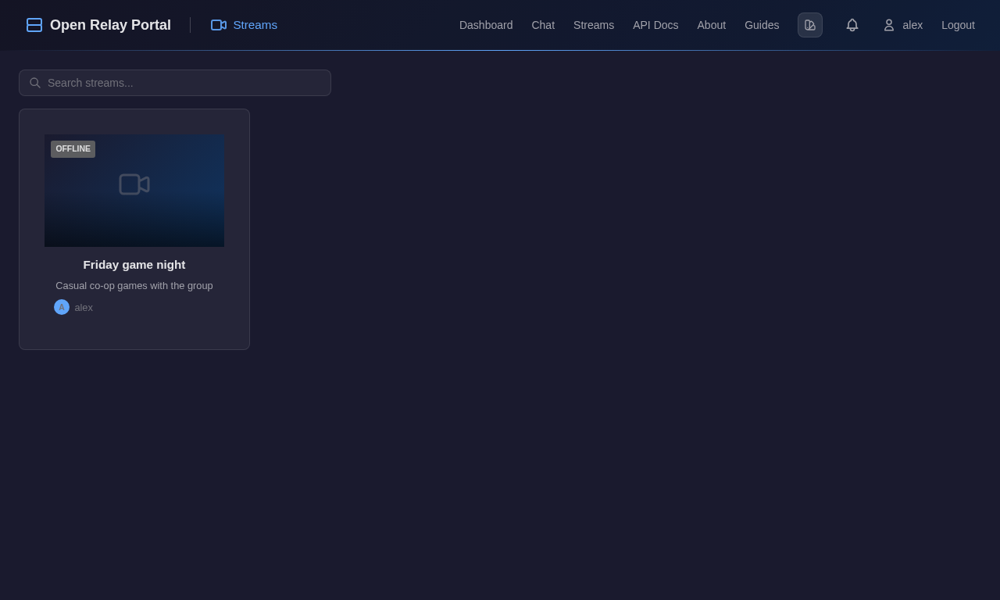
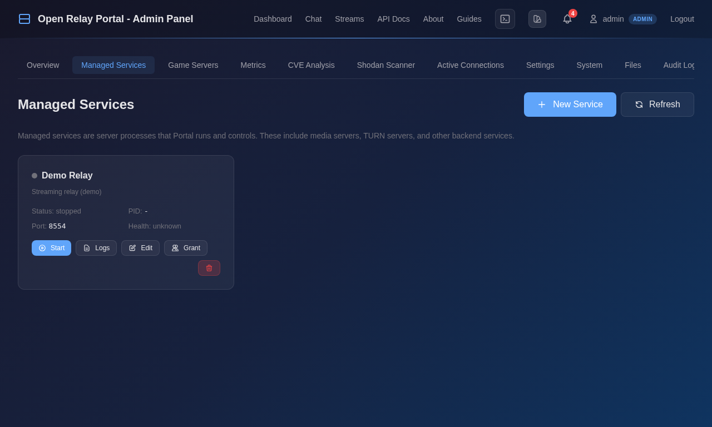

# Open Relay Portal

[](LICENSE)
[](https://python.org)
[](https://github.com/dustinm16/portal/releases)

A self-hosted, encrypted communication and infrastructure gateway. One server gives you everything — live streaming, encrypted chat, voice calls, remote access, and file management — all under your control, on your hardware, with zero third-party dependencies.

> **Your server. Your data. Your rules.** No accounts on someone else's platform. No content policies you didn't write. No subscription fees. Just your hardware running your portal.

> **Dev/example instance:** [https://portal.dddvm.xyz](https://portal.dddvm.xyz) — a live development server running the latest build.

## Why This Exists

Most of the tools people use every day for communication, streaming, and remote access are run by someone else. That means someone else holds your messages, your files, your audience, and your access credentials. If they change their terms, raise prices, or shut down — you lose everything.

Open Relay Portal puts all of it on a server you own. One installation gives you a complete communication platform, a streaming server, remote access to all your machines, and a file manager — with everything encrypted and under your control.

### For communities that want independence
- **Content creators** who want to own their platform, their audience, and 100% of their revenue
- **Organizations** that need secure internal communication without trusting their data to a third party
- **Friend groups and gaming communities** who want a private space they fully control

### For people in restrictive or dangerous environments
- **Journalists** in countries where press freedom is under attack — encrypted chat and streaming that no corporation can be compelled to hand over
- **Activists and organizers** who need communication infrastructure that can't be censored or monitored by outside parties
- **Aid workers and NGOs** operating in conflict zones where commercial services are blocked, unreliable, or under surveillance
- **Anyone in a region** where centralized infrastructure is destroyed — a single server (even a small VPS anywhere in the world) can restore communication

### For infrastructure operators
- **Homelab enthusiasts** who want a single portal to manage their entire setup from anywhere
- **Small businesses** that need remote access to internal services without maintaining a VPN
- **IT teams** who want browser-based SSH, VNC, and database access with centralized authentication

## What You Get

### Live Streaming
Broadcast video to your community — like having your own private TV channel. Stream from OBS or any RTMP-compatible app, with support for hardware-accelerated encoding (NVENC, AMF, x264). Viewers watch in their browser over HLS. Every stream is automatically recorded as VOD clips and uploaded to your own storage. Relay your stream simultaneously to Twitch, YouTube, Kick, or any custom RTMP destination. You keep full control — no platform cut, no algorithm deciding who sees your content, no surprise policy changes.

### Encrypted Chat
Message your team or community in real time — all messages are encrypted on the server so only your portal can read them. Organize conversations into channels, reply to specific messages, start threads, react with emoji, @mention people, share images, embed links and videos, and pin important messages. Scroll up to read older messages of a channel, and jump from a reply, a pin, a search result or a mention straight to that message in context. Search across everything with Ctrl+K. Enable desktop alerts to get browser notifications when someone mentions you or a stream goes live — even when the tab is in the background. It's a full-featured chat system that lives entirely on your hardware.

### Direct Messages
Have private conversations with one person or a small group (up to 10 people), all encrypted on the server. Supports reactions, replies, message editing, typing indicators, unread badges, and muting — everything you'd expect from a modern messaging experience, delivered instantly over WebSocket. If someone is offline, they'll see a notification when they return.

### Message Search
Find anything across your channels and DMs with full-text search. Filter by who sent it, when it was sent, or what type of content it contains. Use shortcuts like `from:user in:channel has:image before:date` to narrow results. DM search is private — you only see results from your own conversations.

### Voice Chat
Talk to people in real time with encrypted audio. Choose between push-to-talk or automatic voice detection. Audio travels directly between participants using WebRTC — it never passes through or gets stored on the server. True peer-to-peer, end-to-end encrypted voice.
A dropped connection (a Wi-Fi change, a brief outage) keeps your seat in the call for 20 seconds so you can rejoin it without starting over; a second tab of the same account cannot take it over.
The voice settings window (the Voice settings button next to the voice controls in chat) lets you pick your microphone and, in browsers that allow it, your speaker, shows a live level meter with the voice-detection threshold on it, can play your own microphone back to you as a test, and can keep the microphone open for a moment after you release the push-to-talk key. These choices stay in your own browser.

### Private Search
Search the web without the trackers. Portal can run [SearXNG](https://github.com/searxng/searxng) — a privacy-respecting metasearch engine that aggregates results from 70+ engines while stripping the profiling — as an optional managed service, reachable at `/search/` by logged-in users. No search history, no cookies handed to upstream engines, no ads. The SearXNG UI is re-skinned to your portal theme and carries the portal navbar, so it feels like a native page. The dashboard has a unified search bar with a **Portal** / **Internet** toggle — Portal searches your indexed chat history, Internet runs a private web search. It's a normal managed service: enable it from the Services panel to turn it on, disable it and the portal carries on exactly as before (the search bar quietly drops the Internet option). A JSON API (`/search/search?q=...&format=json`) is available for automation; scripts authenticate with a personal API key (`Authorization: Api-Key portal_...`), and any valid key can search.

### Remote Access
Control other computers from your browser — no special software needed on your end. Connect to SSH terminals, VNC desktops, SPICE consoles, databases, and more — all through a secure WebSocket connection. 75 connection types are supported across 17 categories, each with a setup guide. A Quick Add bar lets you create common connections (SSH, VNC, MySQL, PostgreSQL, Proxmox, HTTP Proxy) with one click.

On a phone or tablet the web terminal shows a **key bar** above the on-screen keyboard: Esc, Tab, sticky Ctrl and Alt (tap once, then type the next key), arrow keys, `|`, `~`, `/`, Paste and text size buttons. Pasting more than one line asks for confirmation first, and when the browser will not let the page read the clipboard a text box takes the paste instead. The bar is shown by default only on touch screens; the keyboard button in the terminal header turns it on or off and the choice is remembered in the browser.

For web-based services, Portal includes a built-in embedded browser with tabbed browsing and keyboard shortcuts (Ctrl+T for new tab, Ctrl+W to close, Alt+arrows for back/forward). Browse web dashboards, admin panels, or any website through Portal's secure proxy. Every user gets a default **Web Browser** connection; its home page is Portal's own private search (SearXNG) when that service is enabled, otherwise DuckDuckGo. From the private-search home, clicking a result opens it in a new tab *inside* the embedded browser (multi-site connections) or in a real browser tab (single-site connections). The embedded browser is session-aware — log out anywhere and any open browser window returns to the login page. Add it from the connection form's **Web Browser (private search)** preset. No VPN required — if you can reach your portal, you can reach everything behind it.

### Sharing Access
Give another Portal user access to a connection you set up — click **Share** on the connection card, type their username (multiple people allowed), and they'll see it on their own dashboard and can use it through the embedded browser, web shell, xterm or VNC. They can't edit or delete it, and access is revoked the moment you remove them. Admins can likewise grant a non-admin user the ability to **start / stop / restart**, **view logs**, or (for Portal-deployed game servers) **browse and edit the server's files and download backups** — jailed to that server's own directory tree — for a single managed service — no full admin rights needed. Every action they're allowed shows as a labelled button on that service's card on their own dashboard.

### File Management
Browse, upload, download, and edit files on your server or on remote machines through the web. The file manager works with your server's local filesystem (for admins) and with any SFTP connection you've set up. When you have multiple SFTP connections, a dual-pane commander-style view lets you move files between remote machines side by side.

### System Monitoring
See what's running on your server at a glance — active processes, systemd services, network interfaces, and open ports. Start, stop, or restart services. Kill runaway processes. All integrated directly into the admin panel as a tab, so you don't need to open a terminal for routine server management.

You can also promote any installed systemd unit — a game server, a database, a file share — to a **managed service** of type `systemd`. Portal then shows it alongside MediaMTX and SearXNG with the same start/stop/restart controls, health, and (journal) logs, and reflects the unit's state even when it's changed outside Portal. Portal only ever stops such a unit when you explicitly click Stop — never on its own restart or when you remove the entry.

### Game Servers
Deploy dedicated game servers straight from the admin panel. The **Game Servers** tab has a searchable catalog of ~85 games (Palworld, Valheim, Project Zomboid, Rust, ARK, CS2, Team Fortress 2, Arma 3, DayZ, Satisfactory, 7 Days to Die, and many more — admins can add their own entries too); pick a game, name the instance, and Portal runs the SteamCMD install, generates a systemd unit, and registers it as a managed service. From there you get start/stop/restart, live journal logs, a one-click **SteamCMD update** (with an "already up to date" check), an **editor for the launch arguments and stop signal** (no shell runs them — arguments reach the game verbatim), and a **commander-style file browser** jailed to that server's own directory tree — click the server's card to open it. Navigate the install dir (and, for games like Project Zomboid that store config elsewhere, the config/saves dir), sort the list by name, size, or modified date, right-click a file for a context menu to edit, download, rename, or delete it, upload new files (multi-select or drag-and-drop), or pull a full `.tar.gz` **backup** of the config and save/world files. The editor has syntax highlighting for the config formats you'll actually run into (INI/CFG, JSON, XML, YAML, TOML, Lua, properties). The game's known settings files are pinned at the top for quick access. Everything runs under the same unprivileged account as a hand-rolled setup would — and, as of the same tab's **Storage Locations** card, more than one disk: register additional directories, pick which one new deploys default to, or point an individual deploy at a specific one. No `.env` edit or restart needed to add a second disk once the first is configured.

Each server is a managed service, so you can **grant** a non-admin user `Control`, `Logs`, and/or `Files` — every action they're allowed shows up as a clearly-labelled button on that server's card on their own dashboard (start/stop/restart, view logs, edit config, download a backup), and nothing else. Already running servers via hand-rolled systemd units can be adopted onto this machinery without a reinstall.

Servers with no Linux build, such as Enshrouded, run under Wine in their own prefix. A deploy detects a Windows-only game and sets this up itself, including installing Wine on Debian-based hosts. Only some of these games have been tested; see [Windows-only game servers](docs/WINDOWS-GAME-SERVERS.md) for the limits.

### Device-Wide Metrics
The Metrics tab keeps a persisted, whole-host history — not just Portal's own traffic. Every 60 seconds Portal samples CPU and memory per service/process, every listening port and the connections sitting on it, and which remote IPs are talking to the box (with the ports they're hitting and the process serving them). Charts cover anywhere from 6 hours to 14 days; history survives restarts. Retention is configurable under Settings → Data Retention (default 14 days). Counts are point-in-time samples, so a connection that opens and closes between ticks won't appear.

### Data Retention
Set policies for how long chat messages, DMs, notifications, activity logs, security events, and expired tokens are kept. Automatic cleanup runs on a schedule (default every 6 hours) with optional database compaction. Run cleanup on demand anytime from the admin panel.

### Visual Theming
Twenty-eight built-in themes — switch with the palette icon in the navbar. The core set: **Dark** (navy, default), **Black** (OLED), **Grey**, **Slate**, **Light**, and **High Contrast**; accent hues **Blue**, **Purple**, **Cyan**, **Green**, **Red**, **Rose**, **Orange**, **Amber**; developer palettes **Nord**, **Dracula**, **Solarized** (dark & light), **Gruvbox**, **Tokyo Night**; light readers **Sepia** and **Nord Light**; vibrant **Synthwave**, **Matrix**, **Cyberpunk**; and three animated gradients — **Aurora**, **Nebula**, **Ember** (which hold a static mid-blend under `prefers-reduced-motion`). Your preference persists across sessions via localStorage and applies before the first paint so there's no flash. The theme follows you everywhere — the login page, every public page, and the SearXNG search UI, which is re-skinned to the active portal theme and wears the portal navbar.

### Administration
Manage users with a clear role hierarchy — Super Admin, Admin, Moderator, and User. Create invite codes to let people register (daily rotating, single-use, or time-limited). Require two-factor authentication. Issue API keys for automation. Manage SSH keys, monitor traffic patterns, and scan for vulnerabilities. All administration happens through the admin panel in your browser.

## Usage Examples

Here are a few ways people use Open Relay Portal:

- **"My friend needs help with their computer."** Open a VNC connection in your browser and see their screen in real time — walk them through the fix or take control directly.

- **"I need a file from my home server while I'm traveling."** Log into your portal from any browser, open the file manager, and download what you need. No VPN setup, no special app.

- **"Our team needs a private group chat with voice."** Create channels for different topics, invite your team with an invite code, and use voice chat when you need to talk. Everything stays on your server.

- **"I want to stream for my friends without a public platform."** Go live from OBS to your portal's RTMPS address. Your friends open your portal URL in their browser and watch. Recordings are saved automatically.

- **"I manage a home server with several services."** Add each service as a connection in Portal — Proxmox, Home Assistant, Grafana, Pi-hole, whatever you run. Access all of them through one authenticated dashboard in your browser, from anywhere.

- **"Our organization needs secure communication that we fully control."** Deploy Portal on your own infrastructure. All messages are encrypted at rest, voice never touches the server, and no third party can access your data — even if compelled.

## Screenshots


*Dashboard — Services, connections, streams, VODs, quick access, and system stats*


*Theme Switcher — 28 built-in themes (core, accent hues, developer palettes, light readers, vibrant, and animated gradients)*


*Light Theme — full light mode with dark text and blue accent*


*Encrypted Chat — Channels, reactions, threads, @mentions, voice chat*


*Direct Messages — Private 1:1 and group DMs with encryption at rest*


*Embedded Browser — Tabbed browsing with address bar, navigation controls, private-search home page, and multi-site proxy*


*Admin Panel — Server stats, traffic metrics, Shodan scanner, system resources*


*File Manager — Browse and manage server files*


*System Monitor — Processes, systemd services, network interfaces*


*Community Streams — Live streaming with HLS playback and VOD recording*


*API Documentation — Interactive endpoint reference*


*Connection Setup Guides — Step-by-step documentation for all 75 connection types*

<details>
<summary>More screenshots</summary>


*High Contrast Theme — maximum readability with yellow accent on pure black*


*Login page with TOTP 2FA support*


*Feature guide and documentation*


*Systemd service management*


*Guide detail — Requirements, setup steps, and security best practices per type*

</details>

## Quick Start

```bash
git clone https://github.com/dustinm16/portal.git
cd portal
sudo python3 server.py setup
```

That's it. The setup wizard handles everything automatically:
1. Creates a virtual environment and installs all dependencies
2. **Auto-generates a self-signed TLS certificate** (server starts immediately)
3. Generates a JWT secret and writes `.env` configuration
4. **Downloads MediaMTX** streaming server (for RTMPS/HLS live streaming)
5. Creates the database and initial admin user
6. Installs and starts a systemd service

Open `https://your-hostname` in a browser. Self-signed certs show a warning — click "Advanced" > "Proceed" to continue. Switch to Let's Encrypt or a custom certificate later via the Admin Panel or by re-running setup.

### Manual Setup

```bash
# Create virtual environment and install dependencies
python3 -m venv venv
source venv/bin/activate
pip install -r requirements.txt

# Configure (or copy .env.example and edit)
cp .env.example .env
chmod 600 .env
# Edit .env: set JWT_SECRET, HOSTNAME, SSL_CERT, SSL_KEY

# Generate a self-signed cert if you don't have one
python -c "import cert_manager; cert_manager.generate_self_signed_cert('localhost', 'certs')"

# Install MediaMTX for streaming (optional, Linux amd64)
sudo python server.py install-mediamtx

# Install fail2ban with an SSH jail (optional host hardening, Debian/Ubuntu)
sudo venv/bin/python server.py install-fail2ban --ignore-ip <your-ip>

# Install SearXNG for private web search (optional, Debian/Ubuntu)
sudo ./install-searxng.sh
# then, in the admin Services panel: add a managed service of type "searxng" and enable it

# Initialize database and create admin user
python server.py init

# Run (port 443 requires root)
sudo venv/bin/python server.py serve
```

### Requirements
- Python 3.11+
- Linux (systemd for service management features)
- Port 443 (HTTPS) — requires root, or use a higher port in `.env`

## Architecture

```
Python/aiohttp backend ──── SQLite database (FTS5 search)
       │                         │
       ├── WebSocket relay ──── Plugins (SSH, VNC, SPICE, ...)
       ├── HLS streaming ────── MediaMTX (managed process)
       ├── Private search ───── SearXNG (optional managed process)
       ├── Chat engine ──────── Fernet encryption at rest
       ├── Direct messages ──── Encrypted 1:1 & group DMs
       ├── Message search ───── FTS5 full-text index
       ├── Voice signaling ──── WebRTC P2P (no server-side audio)
       ├── File manager ─────── Local + remote SFTP
       ├── System monitor ───── psutil + systemd
       └── Data retention ───── Configurable auto-cleanup
```

Single binary. No Docker required. No microservices. No external databases. One Python process, one SQLite file, one `.env` config.

## Security

- **HTTPS only** — TLS 1.2+ with HSTS preload, no HTTP fallback
- **Encryption at rest** — Chat messages, connection configs, stream keys, TOTP secrets all encrypted (Fernet/PBKDF2)
- **Machine-bound keys** — Encryption keys derived from hardware ID + random salt; cloning the repo cannot decrypt data
- **Argon2id** password hashing
- **Zero-knowledge voice** — WebRTC DTLS-SRTP, audio never touches the server
- **Path traversal protection** — File manager validates all paths with `Path.resolve()`
- **Input validation** — All user input sanitized, no shell injection vectors
- **Upload content security** — Uploaded files sanitized: only safe types (images, video, audio, PDF) render inline; HTML/JS/SVG forced to download to prevent stored XSS
- **API credential redaction** — Passwords and keys never returned from API endpoints
- **Stream key encryption** — SHA-256 hashed for lookups, encrypted at rest
- **Opaque connection IDs** — URL-safe tokens replace sequential integers, preventing enumeration
- **Proxy isolation** — Embedded browser strips session cookies and auth headers from upstream requests; sandboxed iframe
- **Rate limiting** — Per-IP request throttling on all endpoints
- **Trusted proxies** — `CF-Connecting-IP` / `X-Forwarded-For` are honoured only from Cloudflare and `TRUSTED_PROXIES` (add `127.0.0.1,::1` for a reverse proxy on the same host); direct-to-origin clients cannot spoof their address
- **Lockout-safe blocking** — Every automatic block skips loopback, private networks, this host's own addresses, trusted proxies and Cloudflare, `NEVER_BAN_CIDRS` from `.env` and an admin-editable never-ban list (Admin > Settings > Never-ban list, which shows the effective list). An automatic block never shortens or overwrites a manual or permanent one. `sudo venv/bin/python server.py unblock <ip>` and `sudo venv/bin/python server.py clear-bans` lift blocks with the portal stopped
- **Scanner blocking (optional)** — Set `PROBE_BLOCK_STRIKES=3` to block non-browser clients for an hour (`PROBE_BLOCK_SECONDS`) after repeated requests for `.env`, `.git/config`, `*.php` and similar. Off by default because blocks are per IP and shared by everyone behind one NAT
- **Restart-safe terminal sessions** — Each local web-terminal shell runs in its own systemd scope, so `tmux`/`screen` sessions started from it survive a portal restart (`TERMINAL_OWN_SCOPE`)
- **Security headers** — HSTS, X-Frame-Options, X-Content-Type-Options, CSP on every response

See [ARCHITECTURE.md](docs/ARCHITECTURE.md) for the full security model, and
[SECURITY-AUDIT-2026-09.md](docs/SECURITY-AUDIT-2026-09.md) for the most recent
audit (releases v1.7.0 → v1.10.3, RCE / host-access focus).

## Backups and Rollback

```bash
sudo venv/bin/python server.py backup-archive            # backups/archives/portal-backup-<UTC time>.tar.gz
sudo venv/bin/python server.py restore-archive /path/to/portal-backup-<time>.tar.gz --into /path/to/empty-dir
sudo venv/bin/python server.py backup-db                 # database copy only: backups/portal-db-<timestamp>.db
sudo venv/bin/python server.py backup-db --out /path/to/copy.db
```

**Backup archives.** An archive is a `.tar.gz` with a `manifest.json` (portal version, schema marker, sha256 and size of every file), a consistent copy of the database made through the SQLite backup API (safe while the portal runs, integrity-checked), and the files needed to read it: `.env` (JWT secret), `.encryption_salt` and `.invite_code` when present. Without the salt and the JWT secret, encrypted chat messages, connection configs and two-factor secrets in the database cannot be read.

Because of that, an archive is as sensitive as root access to the portal. Archives are written owner-only (0600) into `backups/archives/` (0700), through a temporary name that is renamed when complete. Nothing is written when less than twice the database size is free; the refusal is logged and shown in the Backups card. Keep copies on storage you trust.

- **Schedule**: on by default, once a day, keeping the newest 7 archives. Change it in Admin > Settings > Backups (superadmin only): enabled, interval in hours (1 to 720), number to keep (1 to 100), and an optional extra destination directory. The scheduled job runs from the data cleanup loop, so it is checked every "cleanup interval" hours (Data Retention, default 6, at most 168); with a long cleanup interval a daily backup runs no more often than that. The due check also runs once about two minutes after the server starts, so an install that restarts more often than the cleanup interval still gets its backups; the first scheduled backup of a new install happens at that check. Use Back Up Now for an immediate one. Scheduled backups are skipped in staged test mode, Back Up Now still works.
- **Extra destination**: after each archive, a copy is written there (0600, renamed into place) and older copies beyond the keep count are removed from that directory, only files named like portal archives. The directory must exist, be absolute, and not be writable by group or others unless it has the sticky bit. Directories under `/tmp`, `/var/tmp` and `/dev/shm` are refused: the service runs with PrivateTmp, so a copy written there would be invisible to the host and deleted on every restart. The destination may not be the installation directory or anything under it, nor inside a directory the portal serves or exposes: a file-manager root other than `/`, a game-server storage root, `RECORDINGS_DIR` or the VOD temp directory; this is checked when the setting is saved and again before every copy. Changing the extra destination needs the superadmin's browser login session (like a download); lowering the number to keep needs it too, the other settings also work with an API key or token, and an extra destination that is left unchanged is not checked when saving, so an unmounted disk does not block editing them. A failed extra copy is reported and logged, the archive in `backups/archives/` is still kept.
- **Download and delete** are in the same card and need a superadmin logged in with the browser cookie; API keys, bearer tokens and `?token=` links are refused for download. Every download is written to the audit log. Archives are never served to anyone else.
- **Every update** (Apply in Admin > Updates, or `server.py update`) takes a backup archive first and does not start if the backup fails.

**Restore.** `restore-archive` verifies the manifest hashes of every file, then unpacks into a directory that is empty (or does not exist yet). It refuses a directory that has anything in it and never reads or writes the live installation. If anything is wrong, nothing is left in the target. To bring a portal back from the unpacked files:

1. Stop the damaged portal, or prepare a new host. Check out the same portal release as the manifest's `portal_version` (the command prints it) into a fresh directory with its virtual environment.
2. Copy `portal.db`, `.env`, `.encryption_salt` and `.invite_code` from the restored directory into it. Keep the files owner-only (`chmod 600`).
3. Edit `.env`: `DATABASE_PATH` and `RECORDINGS_DIR` must point inside the new directory (otherwise it opens the original database), and `SSL_CERT`, `SSL_KEY`, `HOSTNAME` and `PORT` must suit the new host. The command prints a warning for each of these that points outside the target.
4. Start the portal. Users, encrypted chat, connection configs and two-factor secrets work again because the JWT secret and the salt came with the database.

`backup-db` takes a consistent copy of the database only and runs an integrity check on it. It never overwrites an existing file, writes the copy owner-only (0600), needs free space of about twice the database size, and refuses a destination directory that other accounts can write to (a sticky directory such as `/tmp` is accepted).

Update snapshots (`backups/snapshots/`) are owner-only and contain the code plus an integrity-checked copy of the database. A rollback restores the code only: it does not restore the database, `.env`, the virtual environment or `backups/`, and it logs the `restore-archive` command and the newest archive instead of restoring anything. Rollback refuses to run if the snapshot or the backup directories are owned by another account or writable by group or others; fix the ownership and modes (`chown` to the portal's account, `chmod 700`) and retry.

### Upgrade notes for 1.10.8

- Accounts with two-factor authentication must send `totp_code` (a TOTP or backup code) with `POST /api/token`, or use an API key.
- Share links of private streams are replaced once on the first start. Send viewers the new link from the stream's details. Private streams send no go-live notification.
- Connection, relay, webhook and VOD storage targets are checked against the address they resolve to. Names that resolve to private, loopback, link-local or shared (100.64.0.0/10) addresses are refused with "Host not allowed".
- Media stream connections need an API URL and a WebRTC URL; user VPN bridge connections are SOCKS only.
- An admin password reset or a role change signs the user out everywhere, including API keys. A user changing their own password keeps their API keys.
- Tokens, stream keys and session values are redacted in the logs, so searching the logs for a key no longer finds it.
- WebRTC publish and playback sessions that were open across a restart are closed and have to reconnect.

### Upgrade notes for 1.11.0

- Existing SSH and SFTP connections, and admin SSH services, are refused until the owner (or an admin, for a service) accepts the host key once: connect, compare the fingerprint shown, and choose **Accept this key**. The `known_hosts` service setting is ignored. VOD storage is the exception: it is pinned automatically on its first connect and only prompts when the key changes.
- SSH agent authentication is removed, and user connections that name a key file path on the portal's disk are refused. Use a password or paste a private key into the connection.
- The portal no longer offers its own account's SSH keys or agent to remote hosts. Only credentials stored on the connection are sent.
- Terminal recordings are private (owner-only files in `RECORDINGS_DIR`), capped in size, and recordings older than 30 days are deleted at the first cleanup after the upgrade. The age is the `retention_recordings_days` data retention setting; set it to 0 to keep all recordings. Recordings are no longer copied into update snapshots or replaced by a rollback. A `RECORDINGS_DIR` that is a dangerous location or holds files other than `*.cast` is refused at start, left untouched, and recording stays off.
- Daily backup archives are on by default, keeping the newest 7 (Admin > Settings > Backups). Every update takes a backup archive first and does not start if that fails; it waits up to ten minutes for a backup that is already running.
- Desktop connections use the VNC protocol and default to port 5900. A Windows host needs a VNC server installed; RDP is not supported.
- Chunks of a VOD recording that are waiting to upload are staged in `data/vod_tmp` (private, kept across restarts and rollbacks) instead of `/tmp/portal_vods`. Chunks left in the old folder are moved there at the first start.

### Upgrade notes for 1.12.0

- Chat uploads are removed with their messages. Retention, clearing a channel and deleting a message now delete the image or attachment file too, unless another message still uses it, either in its image or attachment or by pasting the upload link into its text, a poll, a status message, a channel topic or description or a stream name or description (message text is decrypted for this check; if any message cannot be decrypted, no file is removed and the manual cleanup result and the admin page say so). Uploaded files of messages deleted before the upgrade are not removed. A daily sweep lists upload files that no message refers to (log lines starting `[Retention] Orphan chat uploads`, and `chat_orphan_sweep` in the manual cleanup result) but deletes nothing in this release. Files of a deleted channel, user or DM conversation also stay until the sweep is switched on in a later release. Deleted uploads are not in backup archives.
- Logging out, or revoking a session or an API key (also an admin revoking a member's session), now closes the sockets, voice call and in-flight proxied downloads opened with it. The account's other sessions are not affected.
- Proxied apps now receive `X-Forwarded-Proto` and the real client address (`X-Forwarded-For`, `X-Real-IP`); forwarding headers sent by the client are dropped. `X-Forwarded-Host` and `X-Forwarded-Prefix` are sent only to connections that have the new **Send Forwarded Host and Prefix** option (`forwarded_host`) on; it is off for every existing connection. A `?token=` parameter that authenticated a proxied request is no longer passed on to the upstream.
- Cookies in the embedded browser are scoped per site, so members may need to sign in to sites again.
- The connection `timeout` is now an idle timeout for downloads: a download continues as long as data keeps arriving, and only a silent upstream gives `504`. Rewritten HTML, CSS, JavaScript and JSON responses still must arrive within it in total.
- Automod now checks edited messages, and an edit passes the same ban, timeout, mute and rate-limit checks as a new message (slow mode does not apply to edits). Regex rules are length-limited and time-bounded, and an enabled rule that fails the new validation is shown as not enforced in the rule list (a disabled rule is not flagged, and a `spam_filter` rule is always shown as not enforced because nothing applies it).
- Regex rules see only the first 2000 characters of a message; text after that is not checked by them. A message or edit whose regex check runs over its 0.25 second budget is rejected for its author with a "could not be checked" error, with no penalty and no notice to others, and the pattern is tried again for the next message. The rule list shows the number of such timeouts in the last hour as "slow pattern".
- Proxied web interface connections follow at most 5 redirects (up to 10 before), and connecting to the upstream is limited to 10 seconds (it used the whole `timeout` before). An app that needs longer to answer a connection, for example a NAS that wakes up slowly, now gives `502` or `504`.
- A password or admin reset from the command line (`server.py init`, which resets the admin password, and `server.py set-admin` or `portaladmin grant` / `revoke`) revokes the sessions and API keys from a separate process. That process cannot close the sockets, voice calls and proxied downloads that the running portal already has open for them, so restart the service afterwards to end those at once.
- Cookies that the embedded browser stored before the upgrade are not scoped per site: they stay shared by all sites opened in that connection until they expire or are cleared. Clear the site data of the Web Browser connection (or ask members to) to remove them.
- Chat upload files are deleted with their messages; the orphan sweep only reports.
- ffmpeg (thumbnails, relays, recordings) runs at lower priority, and a thumbnail that cannot be captured answers 503 with `Retry-After`.
- A voice call is held for 20 seconds when its connection drops, so it can be resumed. Making a channel private removes the call members who may not stay.
- Member uploads (`static/uploads`: chat files, avatars, emotes, stream thumbnails) are no longer copied into update snapshots or replaced by a rollback, the same as recordings and the VOD staging folder. Older snapshots that still contain the folder do not restore it either. Upload files are therefore not part of any snapshot; back up `static/uploads` yourself if you need a copy.

### Upgrade notes for 1.13.0

Voice

- Voice calls have a per-person volume (0 to 200%) and a local mute. Right-click or long-press a name in the voice bar or the online-users list (the watch page has the voice bar only) to open it; with the keyboard, focus the name and press Enter (voice bar) or the context-menu key or Shift+F10. The settings are stored in each member's own browser (`localStorage`, one entry per account) and are never sent to the server, so nothing changes on the server, in the database or in the API, and they do not follow a member to another browser or device. Deafen still silences everyone. On iPhone and iPad the slider stops at 100%, and Safari there may ignore element volume, so below 100% only **Mute for me** is certain to work (the popover says so when the device refuses a volume).
- `voice.js` is now `?v=9` (chat and watch pages) and `admin.js` `?v=37`; browsers pick them up on the next page load. A call that is already open on an older page keeps the old behaviour until that page is reloaded.

Security event log

- A new security event log (table `security_events`, created at the first start) records sign-in and credential events together with the **IP address and user agent** of each one: logins and failures, 2FA required, passed, failed, throttled and backup-code use, logout, session sign-outs (a single session, "sign out other devices" as one event with the number ended, and an admin's sign-out of a user with actor and target), 2FA enable and disable, API key create, revoke and delete, password change and reset, user create and delete, role change, invite create and deactivate, manual IP block and unblock (also the `unblock` / `clear-bans` commands, recorded with the source `cli`), automatic scanner-probe blocks, rate-limit trips, SSH host key accepts, never-ban list changes (counts only, and the audit log entry `never_ban.update` holds counts only too, because moderators can read the audit log and the list is for superadmins) and the result of each Cloudflare range refresh (counts, or the reason it failed), a reset to the built-in list, and every change that weakens the log itself: a changed retention for the security events (old and new value), a manual cleanup run that deleted security events (the count) and the Cloudflare refresh being turned on or off. It is separate from the moderation audit log (which has no row for an unknown-user failure), and its rows are kept when an account is deleted. Backup runs, downloads, deletes and settings changes were already in the audit log and are not repeated there.
- **Retention is 180 days by default.** Only a superadmin can read the log, in Admin > Audit Log (extra buttons **Security**, every event, and **Auth**, sign-in and session events only, with filters and **Export CSV** / **Export JSON**). Change the retention with `retention_security_events_days` (Admin > Settings > Data Retention; `0` keeps everything). Existing installs get the default, and rows older than that are removed at the first cleanup after they exist. Each export is itself recorded, and the export answers GET only (a HEAD request is refused with 405). CSV cells that start with `=`, `+`, `-` or `@` get a leading apostrophe. The IP filter also finds the aggregated row of an IPv6 address when you type the full address, and a typed /64.
- Events an outsider can trigger (wrong passwords, bad 2FA codes, probe blocks, rate-limit trips) are counted in memory and written as one row per source address, event and minute with a `count`, at most every few seconds, so a flood does not become a flood of database writes; a write that fails is retried without counting anything twice. An IPv6 source is counted as its /64 network (shown as `2001:db8:1:2::/64`), because one subscriber can rotate through that many addresses. A minute creates at most 300 such rows however many sources send; once they are used, rows for further sources in that minute are added to one shared row per event and result with the address `*` and no user name or agent, so a flood cannot grow the table without bound. Rows for the same source and minute keep the first user name and user agent seen. Events written at once (sign-ins, sign-outs, key and role changes) are limited to 30 rows per minute for each account (or address, when there is no account) and event; the rest of that minute is counted in one aggregated row, so a signed-in member who loops sign-ins or sign-outs cannot flood the table. Control characters, zero-width characters and bidirectional override characters are removed from user names and user agents before they are stored. A failed login or registration records the typed name only when it is an existing account; for an unknown account the row says `(unknown account)` and the warning log line says "an unknown account", because people paste passwords into the user name box. Passwords, 2FA and backup codes, tokens, API keys and invite codes are never recorded.

Sessions

- New **Sessions** section in User Settings (Dashboard > Profile Settings): every browser login and every token made through `POST /api/token` of your account, with device (browser and system read from the User-Agent by a small local parser, nothing is looked up online), when it was signed in, when it was last used, its last IP address, a "This device" badge, and **Sign out** for one device or **Sign out other devices**. The current session cannot be signed out from the list (use Log out). API keys are not sessions and stay under API Keys; signing out other devices does not revoke them.
- **Sessions now store the IP address and user agent** they were created with (and the last IP address they were used from): the tokens table gains `ip`, `user_agent` and `last_ip` columns, added automatically at the first start (a second start changes nothing). Sessions that exist at the upgrade show "Unknown device" and no signing-in address until they are next used; the last IP fills in at the next request. The User-Agent is stored cut to 200 characters. The Sessions list shows these values only to the account that owns the session; the sign-in address and agent are also in the security event log, which only a superadmin can read.
- Admins (admin role and above, judged from the database role, with a full-scope credential) get **Sign out** on each manageable user in Manage Users (`POST /api/users/{id}/sessions/revoke`), subject to the same role hierarchy as password resets and written to the audit log (`sessions_revoke`). It revokes browser sessions and tokens only, not API keys. On the admin's own account it keeps the session in use.
- Signing a session out closes the sockets, voice call and in-flight proxied downloads opened with it at once (close code 4001); the account's other sessions are not affected.
- Stream keys and API keys, including narrowly scoped ones, get `403` from the sessions routes; only a browser session or an all-scope (`*`) credential can list and sign out sessions.
- The last-used time (and last IP) of a session, and the last-used time of an API key, are now written at most once a minute per session or key (the portal wrote them on every request before). They are kept in memory between writes, so after a restart the first request of each one writes again.

Blocking and trusted proxies

- Every automatic block now asks one exemption helper first. It always skips loopback, private and link-local addresses, this host's own addresses (those the configured host names resolve to and every interface address), trusted proxies and Cloudflare ranges, the networks in the new `NEVER_BAN_CIDRS` setting in `.env` (comma separated, works without the database) and the never-ban list saved on **Admin > Settings > Never-ban list**. **Scanner blocking (`PROBE_BLOCK_STRIKES`) is still off by default**; set it yourself to turn it on. This release only makes it lockout-safe. Rate limiting and the two-factor limiter are throttles, not blocks, and are not exempted.
- The never-ban list is edited by a superadmin only. It takes at most 100 addresses or CIDR networks, written strictly (`203.0.113.0/24`, no host bits set), and refuses `0.0.0.0/0`, `::/0`, any IPv4 prefix shorter than /8, any IPv6 prefix shorter than /16 and the IPv4-mapped range, so it cannot switch protection off. `NEVER_BAN_CIDRS` follows the same rules (a bad entry is skipped with a log warning). Saving the list tells you whether your own current address is covered, and drops scanner strikes and blocks already held for covered addresses. An exempt address can still be blocked by hand.
- The `blocked_ips` table gets a `source` column (`manual` or `auto`; existing rows become `manual`). An automatic block never overwrites or shortens a manual block, never shortens an automatic one and never turns a permanent block into a timed one; it can replace a block whose own expiry has passed. No automatic block is written to the database yet: the scanner-probe block lives in memory and clears on restart.
- Blocks are now stored and matched in canonical address form, so `2001:DB8::1` and `2001:db8::1` (and an IPv4-mapped address and its IPv4 form) are one block. At the first start existing rows are rewritten to that form; when several rows turn out to be one address they are merged into one, keeping the manual one and the longest expiry, so nothing is blocked for less time than before.
- To lift a block while locked out, stop the portal and run `sudo venv/bin/python server.py unblock <ip>` (every database block for that address, matched whatever its spelling) or `sudo venv/bin/python server.py clear-bans` (all of them). They open the database directly, run no migration, never create a missing database, print what they removed (with non-printable characters left out) and record the removal as a security event when the database already has the event table. A running portal keeps its block list in memory until it restarts.
- The portal now watches for a likely `TRUSTED_PROXIES` mistake: when most of the last 100 requests come from a loopback or private address that carries Cloudflare headers while that address is not trusted, it logs one warning and the admin Overview shows a Proxy Trust note (`GET /api/admin/proxy-trust`). It also logs a warning at start when the portal listens on loopback only but loopback is not trusted, and one for every `TRUSTED_PROXIES` entry broader than /8 (IPv4) or /16 (IPv6): such an entry exempts every address in it from automatic blocking and lets any of them choose the visitor address with forwarding headers. The portal never changes trust itself. Before adding an address to `TRUSTED_PROXIES` (for example `127.0.0.1,::1`, then restart), check that the peer really is your own proxy: a tunnel, VPN or other local program can send the same headers, and trusting a peer that is not a proxy lets anyone choose the address they are seen as.

Cloudflare ranges

- A weekly job (setting `cf_ranges_refresh`, on by default; **turn it off** with the switch under **Admin > Settings > Cloudflare ranges**, which stores `false`) fetches Cloudflare's two published lists, `https://www.cloudflare.com/ips-v4` and `https://www.cloudflare.com/ips-v6`, and replaces the built-in trusted list. This is the only scheduled outbound request this release adds. The two that already existed are not new: with deployed game servers a build check asks Steam every six hours, and the optional `portal-update.timer` asks GitHub once a day. The refresh sends no portal data: it is two GETs over HTTPS with certificate verification, a 10 second timeout, a 64 KB cap, no cookies, a generic user agent, redirects only within the same host, and nothing about the portal, its users or its address list. A list is refused (the current list stays, and the admin page shows the failure) unless every line is a network, there are at least 10 IPv4 and 5 IPv6 ranges, nothing is private, loopback or reserved, nothing is broader than the broadest built-in range of its family (/13 IPv4, /29 IPv6), at most 5 ranges per family are new compared with the list trusted now (the built-in list at the first refresh), and for each family it still covers at least half of the built-in ranges and at least half of the current ones. The same checks run when the saved list is loaded at start (except the count of new ranges), and a saved list that fails them is ignored. A good list takes effect at once without a restart and the last good list is kept in settings across restarts. The job checks about five minutes after each start and then every six hours, and fetches when no refresh has run yet or the last attempt is a week old (a failed attempt is retried after a day). It does not run in a staged instance. The `TRUSTED_PROXIES` entries are not affected. Every result is also a security event. **Way back to the built-in list:** with the refresh switched off the saved list is kept but not applied at the next start (the built-in list is used, and the panel says so); **Use the built-in list** in the same panel (superadmin, `POST /api/admin/cf-ranges/reset`) clears the saved list and switches to the built-in list at once, and `sudo venv/bin/python server.py cf-ranges-reset` does the same with the portal stopped (no migration, never creates a database; it takes effect at the next start). Each is recorded as a `cf_ranges_reset` security event (the button also as the audit log entry `cf_ranges.reset`; the command line writes no audit log entry, which needs an account as its actor).
### Upgrade notes for 1.14.0

Chat history

- Members can now read older messages of a channel. Scrolling to the top of a channel loads the next older page (50 messages) until the start; the page keeps what you were reading in place and never shows a message twice. Clicking a reply preview, a pinned message, a search result or a mention notification opens that message in context, even when it is hundreds of messages back (Shift-click on a reply preview still opens the thread panel, which the plain click used to open). While you look at an older part, new messages wait in a buffer and a **Jump to present** bar brings you back (sending a message from there brings you back too, and the jump marks the newest page as read; an edit, reaction or poll vote that arrives for a waiting message is applied to it). Messages loaded this way are not marked as read and raise no notification. Direct messages are unchanged (they already had their own paging), and so is the pop-out chat on the watch page.
- **Messages older than the chat retention are gone and cannot be scrolled back to.** The retention is one setting for all channels, `retention_chat_days` (default 7 days; Admin > Settings > Data Retention), not a per-channel setting. Pinned messages are kept by the cleanup as before.
- New WebSocket message `history_page` (answers `history_older` or `history_around`, or `history_error`) and new route `GET /api/chat/channels/{id}/messages` (`before_id`, `around_id`, `limit`; the page size defaults to 50 and is capped at 100). Both return 30 requests per minute per member at most, counted together over all of the member's sockets and the route (`429` with `Retry-After`, or a `history_error` with `rate_limited`). The join reply (`history`) still carries the newest 50 messages and now also `channel_id` and `has_more`. Details are in the API documentation.
- A message id (`before_id`, `around_id`) outside 1 to 9223372036854775807, and a channel id outside that range on the route, is refused (`400` or `history_error` with `invalid`; `404` for the channel id) instead of reaching the database. Before, such an id made the route answer `500` and made the member's own chat socket close.
- Reading older messages follows the same rules as joining a channel, from one shared check: a private channel needs membership (admins and superadmins read every channel, moderators do not), and a member banned from a stream's chat reads nothing. The check runs on every request, so a member removed from a private channel gets nothing on the socket they already had open. The route answers `404` for a channel the caller cannot read, the same as for one that does not exist.
- The chat of a stream that is not public can now be read, joined and written to only by the stream's owner and admins (the rule of the stream detail route); before, any member who knew the channel id could join it or page its history. Everyone else gets the answer for a missing channel, also when joining with a playback key. The thread route (`GET /api/chat/thread/{id}`) follows the same check (removed members, stream bans and closed stream chats now get `404`, not `403`, as for a missing message) and returns messages in the same shape as the history. Both routes now send `Cache-Control: private, no-store`. Streams are not public unless the owner makes them public, so this closes the chat of every such stream to ordinary members at the upgrade; making the stream public opens its chat again. Message search follows the same rule: the messages of such a chat are not found by other members (before, search returned their text). The channel is also left out of the channel list (`GET /api/chat/channels`) of everyone but the stream's owner and admins, so its name, stream, live state and owner are not shown to other members. Sockets that are already in the room when access is lost are put out at once: when the stream is made not public, a member is removed from a private channel, a member is banned from a stream's chat (in the chat or by the route) or a channel is made private, every socket in its room that can no longer read it is removed from the room, receives one `Channel not found` error and nothing more from the room (no messages, edits, reactions or typing), and its voice call in that room ends. A refused join leaves the socket in no channel (it has already left the old room), so a send that follows goes nowhere instead of into the room just left. On a socket whose channel was closed to the member after it joined, sending, editing, reactions, new polls, poll votes, closing a poll, typing, deleting, pinning and unpinning, timeouts, mutes and unmutes, are all refused too, and so is joining or resuming the channel's voice call (`voice_denied`, or `voice_resume_failed` for a resume).
- Anonymous posts stay anonymous on every older page: join, `history_page` and the route build their messages in one shared function, so ordinary members never receive an anonymous author's account id, role, nickname, avatar or name (including in reactions, reply previews, polls and edit markers), while moderators, admins and the author still get the id they need to edit or moderate.
- A reply preview now shows the nickname of the original author wherever the reply is loaded (it used to fall back to the account name when the original was not in the same 50 messages). Reply previews are looked up in the same channel only.
- A reader who has scrolled up is no longer pulled to the bottom by every new message; the page follows new messages only when you are near the bottom or wrote the message yourself.
- Database: one index, `idx_chat_messages_channel_id_id` on `chat_messages(channel_id, id)`, is created at the first start (`CREATE INDEX IF NOT EXISTS`, so a second start changes nothing). On a large chat table the first start takes a moment longer. SQLite already answered these queries from the older per-channel index, so the new index is not needed for speed today; it costs a little disk and write time. It can be dropped by hand without effect on the answers, but it is created again at the next start.
- `portal.js` is now `?v=45` on every page (the notification click needs it); browsers pick it up on the next page load. The scrollback code is in `chat.html`, which is not cached.

Search operators

- The chat search (**Search** button or Ctrl+K) now understands operators, parsed on the server: `from:name` and `-from:name` (account name or nickname), `in:channel` and `-in:channel`, `has:link`, `has:file`, `has:image`, `is:pinned`, `before:2026-11-01` and `after:2026-11-01` (UTC dates; `before:` and `after:` together cover every message), and `"quoted phrases"`. A search made only of operators is allowed: newest first, at most 200 results (the panel says so). **Load more** keeps paging through all 200 (25 at a time) and disappears after the last one. Suggestion chips under the search box offer the operators, the loaded channel names and the people in the room list; they use only what the page already has loaded. Clicking a result opens that message in context, the same jump as from a reply or a pin.
- An unknown operator, an unknown `has:` or `is:` value or a bad date is refused with `400` and a message. A word such as `12:30` or an address such as `https://example.com` is still searched as text; to search for another `name:value` literally, put it in double quotes. `-` works only before `from:` and `in:`. The separate `from`, `has`, `before` and `after` request parameters still work and are checked the same way. `GET /api/chat/search` answers `has_more`, `capped`, `terms`, `index_complete` and, per channel result, the same masked author fields as history (see the API documentation); the search limit stays 10 per minute per member.
- Access: a channel is searched only when the member may read it, by the same check as joining and scrolling back. A private channel the member is not in, or a stream chat they are banned from, matches nothing and looks exactly like a channel that does not exist (`in:` with its name is not an error). This also closes two gaps of the old search: the stream-chat ban was applied to nobody (a banned member could still search that chat, and admins searched every channel with no filter at all), and an error while looking up a member's channels searched without any filter. The search now fails closed: if the member's readable channels cannot be worked out, the route answers `503` and searches nothing, and a search with no read check of its own that cannot look them up finds no channel messages.
- Anonymous posts: a positive `from:` never matches an anonymous post for an ordinary member (not even their own), a negated `-from:` never removes one, and results use the history masking, so no operator and no count shows who wrote an anonymous post. Moderators, admins and superadmins, who already receive the author's id, can match it.
- What the index stores: nothing new. As before, the full-text index holds the words of every message in plaintext tokens next to the encrypted text (the existing design, listed in the API documentation); this release adds only three yes/no flags per message (`has_image`, `has_file`, `has_link`). The author filter reads the account name and nickname from the user table; no author name is copied into new places.
- Attachment-only posts (an image or a file with no text) are now indexed, so `has:image` and `has:file` find them. `has:image` now means an image or an image attachment; `has:file` any other attachment. Editing a message no longer loses its attachment flags.
- **Backfill.** Messages written before the upgrade have no link or file flags and attachment-only posts are missing from the index. A one-time background task starts about 20 seconds after each start until it has finished: it reads all stored messages (channels, then DMs) in batches of 200, decrypting each; each batch is read, written, committed and its position stored in one uninterrupted step on the database connection (so a rollback or an edit elsewhere can neither undo a finished batch nor be overwritten with flags of the earlier text), pauses briefly between batches, stores its position in the settings `search_backfill_channel_last_id` and `search_backfill_dm_last_id`, and sets `search_backfill_done` to `1` at the end (it then never runs again). It can be interrupted by a restart and resumes where it stopped. It logs at most one progress line a minute (`Search index backfill: ...`). It is never part of a request (a background task beside the server, not something a search waits for), and it does not start in a staged instance. It adds index rows only for attachment-only posts, with no words; a message with text that has no index row is left to **Rebuild search index**. Until it is done a search answers `index_complete: false` and `has:` queries can miss old messages, and the panel says so. On a large database the first start decrypts every stored message in small slices on the same CPU; to run it again from the start delete the three settings rows. **Rebuild search index** (superadmin) writes the flags itself and marks the backfill done; it takes the backfill's lock, so a backfill never runs beside it, and while a backfill or another rebuild is running the route answers `409` at once instead of holding the request for minutes (try again when it has finished).
- A word search in the default `all` scope is now ordered newest first (it was ranked per source, then merged by date, so a later page could repeat results and leave others unreachable). **Load more** now continues exactly where the page ended. `scope=channels` and `scope=dms` still order by relevance.
- The search `offset` is limited to 2000 (a search reads `offset` plus `limit` rows from each source, so deep paging is expensive and no one pages that far); a larger value, including one past the 64-bit integer range (which used to answer an empty `200` and log a warning), is refused with `400` and the message `offset must not exceed 2000`. `has_more` is false for a page that ends beyond that limit (offset plus the number returned above 2000), although more matches exist, so a client that follows it is never sent to a page that would be refused. `channel_id` and `conversation_id` must be between 1 and 9223372036854775807; anything else, including `0` (which used to mean no filter), answers `400`, like an out-of-range id in the history routes. A search with `scope=dms` no longer looks up the readable channels. A refused request (a bad query, id or offset) does not count against the limit. **Load more** ignores a second click while its request is running.
- Database: four columns, `has_link` and `has_file` on `chat_fts_map` and on `dm_fts_map` (`ALTER TABLE ... ADD COLUMN`, skipped when they exist, so a second start changes nothing).
- The search needed no static script change: its code is in `chat.html`, which is not cached.
- Search can be slightly slower for the first minute or so after the upgrade while the backfill (above) runs its first batches on the same database.

Voice

- The voice settings window in chat is now a working setup panel (chat page only; the watch page has no settings window but uses the saved choices on its next join). There is no server change, no database change and no new API: nothing about it is sent to the server.
- **Input device**: the choice is used on the next join and switched at once during a call (the new microphone replaces the old one in every connection without dropping anyone, and the call is not left or rejoined). A device that has been unplugged since it was chosen falls back to the default with a message, and the choice is kept. A microphone that disappears during a call is replaced by the default one.
- **Voice detection (VAD) now really closes the microphone**: while nobody speaks the track sent to the others is disabled, and it opens when the level passes the threshold and stays open for 750 ms after the last loud moment. Before, the threshold only changed the speaking indicator. A disabled track sends silence; browsers may still send the small packets that keep the connection alive, so "no sound" is guaranteed and "no packets at all" is not. The first few tens of milliseconds of a word can be cut when the gate opens; lower the threshold if that bothers you. If the level cannot be read (the browser keeps the audio context suspended or does not support it) the microphone stays open instead of muting you.
- **Level meter** with a red threshold line in the settings window. During a call it reads the call's own microphone (no second device is opened); outside a call, opening the settings window opens the microphone, so the browser may ask for permission and show its recording indicator, and closing the window (button, backdrop or Escape) releases it.
- **Hear my own microphone (test)** is off every time the window opens, plays only through your own speakers, is not available during a call and is never sent to anyone. Use headphones, otherwise it echoes.
- **Output device** is offered only where the browser can set the speaker of an audio context (Chrome, Edge and other Chromium browsers); it is hidden where the browser does not offer it (as far as the portal can detect: Safari, iPhone and iPad and Firefox did not offer it when this was written, and the picker appears in any browser that adds it). A speaker that cannot be used falls back to the default with a message.
- **Push-to-talk release delay**, 0 to 1000 ms (default 0): the microphone stays open that long after the key is released, and pressing again within it cancels the close.
- A voice-detection threshold saved while it did nothing (the slider goes up to -20 dBFS, which is strict) now decides whether others hear you. If people cannot hear you after the update, lower the threshold (move the slider left) in the chat voice settings, where the meter shows your level against the red line; the watch page has no settings window. The saved value is kept, not changed. The first time the voice settings window is opened after the update with a saved threshold stricter than -35 dBFS (-34 to 0), the window says so in a short plain-text notice with how to lower it; it is shown once (a marker is stored in the browser, see below) and not again.
- The gate is read on a timer, and browsers may slow timers in a background tab, which could cut the start of words when chat is open in a hidden tab (during a game, for example). Try it that way; push-to-talk is not affected.
- Unmuting in push-to-talk mode no longer leaves the microphone open until the key is pressed.
- The choices (device ids, threshold, delay, mode and key) are stored in your browser's `localStorage` under `voice_prefs` (one entry per browser, as before), checked for type and range when read, and never sent to the server. A second entry, `voice_gate_notice_seen` (value `1`, no setting), records that the one-time threshold notice has been dealt with. Device ids are specific to a browser, so the choices do not follow you to another browser or device.
- `voice.js` is now `?v=13` (chat and watch pages); browsers pick it up on the next page load. A call already open on an older page keeps the old behaviour until that page is reloaded.
- A chat reconnect during a call no longer reloads the saved voice settings over the ones in use; a change made in another tab applies after the call ends, at the next page load or chat reconnect.
- The saved voice settings are read when the page loads, so changing one setting in the voice settings window before the chat connection is up no longer overwrites the others (threshold, delay, devices, key) with defaults.
- Clicking Join twice quickly (or changing the input device or opening the settings window while the first join waits for the microphone prompt) no longer opens the microphone a second time; the call uses the one microphone and the level meter reads it.
- Push-to-talk no longer stops working when a button has the focus unless the key is Space or Enter: with a push-to-talk key such as V or Control you can talk right after clicking a button. Space and Enter on a focused button still press that button (and do not transmit), and typing in a text field never transmits.

Streams

- Updating a stream's settings (`PUT /api/streams/{id}`) now takes only the fields the settings screen sends: `name`, `description`, `is_public`, `allow_unauthenticated` and `rtmp_enabled`. Server-owned fields in the request (`chat_channel_id`, `is_live`, `viewer_count`, `started_at`, `ended_at`) are ignored, and a request with none of the editable fields answers `400`. Before, a member could point their stream at another channel. A chat channel that is a default channel, or that more than one stream points at, is also never hidden by a stream binding and never deleted with a stream. After any update that leaves a stream not public, members who can no longer read its chat are put out of the room (before, only the change from public to private did that). A mention notification is sent only to members who can read the channel, and a socket handles at most one typing signal per second (the others are dropped).

- Stream settings are now checked by type, on create (`POST /api/streams`) and update: `is_public`, `allow_unauthenticated` and `rtmp_enabled` take only `true`, `false`, `0` or `1`, `name` must be a non-empty string of at most 100 characters and `description` a string of at most 2000 characters or `null`; anything else answers `400` before anything is written.
- A stream bound to a default channel or to a channel that another stream also uses no longer has power over it: its going offline does not clear the channel's messages, and the stream owner cannot ban, unban or list bans there over the chat socket (admins can). A non-default channel bound to several streams is closed to members unless every one of those streams is public (owners of any of them, and admins, still read it). After a stream settings update that leaves the stream not public, members who can no longer read its chat are put out of the room whether or not the request carried `is_public`. The chat error `Channel not found` now names its channel (`channel` field), and the chat page acts on it only for the channel it has open.

Rollback

- Version 1.13.0 runs on a database migrated by 1.14.0 (the added columns and the index are ignored by it). After going forward to 1.14.0 again, press **Rebuild search index** or delete the three `search_backfill_*` settings rows, so the flags of messages written meanwhile are filled in.

Security fixes carried from 1.13.0

- **Cloudflare ranges: a refused list is held, not lost.** A published list that only fails the automatic limits (more than 5 new ranges in a family, or too many built-in or current ranges dropped) used to be refused again every day. The limits are unchanged, but the refused list is now stored as a pending list with the reason, the fetch time and the exact added and removed ranges. **Admin > Settings > Cloudflare ranges** shows it, and a superadmin can **Approve** it or **Dismiss** it (`POST /api/admin/cf-ranges/pending/approve` and `POST /api/admin/cf-ranges/pending/dismiss`, which take `{"id": ...}` and need the superadmin's browser session; an API key or token is refused). Approving checks again the rules that cannot be overridden (every range public, none broader than /13 IPv4 or /29 IPv6, 10 to 100 IPv4 and 5 to 100 IPv6 ranges), applies the list at once and saves it; an approved list is loaded at the next start by those rules only. The same refused list fetched again writes no new failure event (one event per distinct list). A dismissed list is not held again. A fetched list identical to the saved list a superadmin approved (for example after a restart with the refresh off, then the refresh switched on again) is accepted at once and not held a second time; the saved list keeps its approval. The pending list and the dismissed one are kept in two settings keys, `cf_ranges_pending` and `cf_ranges_dismissed`, which do not exist until the first list is held or dismissed. Approval and dismissal are security events (`cf_ranges_approved`, `cf_ranges_dismissed`) and audit entries (`cf_ranges.approve`, `cf_ranges.dismiss`) that hold counts only. A list that fails a hard rule is still refused outright and cannot be approved. `server.py cf-ranges-reset` also clears a pending list.
- **Cloudflare ranges: a reset wins over a running refresh.** The result of a refresh that was fetching while **Use the built-in list** (or the reset route) ran is discarded. With the weekly refresh on, a fetched list returns at the next scheduled refresh, not at once. A refresh discarded this way is recorded as discarded (`discarded` in the last result) and shown as such in the panel, not as "Last refresh failed". The panel also says whether a saved list is ignored because the refresh was off when the portal started or because the list failed the checks then.
- **Security events: admin and configuration events keep every row.** Role changes, user deletes, admin password resets, never-ban changes, every Cloudflare range event, retention changes, manual cleanups, log exports and an administrator's IP block or unblock are no longer held to the 30 rows per minute or folded into the shared overflow row; they need a staff session. Sign-ins, sign-outs and key events keep the cap, and a capped row of a signed-in account that is folded into an overflow row keeps its account (the row for the address `*` is per account, not shared). Deleting a user is now also an audit log entry (`user_delete`).
- **Sign-in and registration.** A sign-in for a name that is not an account now runs the same password hash as one for a real account, so the answer time no longer tells the two apart. A refused registration (invite refused, address limit, account not created) writes "an unknown account" to the journal instead of the typed name; the name is logged only when the account was created.

### Upgrade notes for 1.15.0

Notification channels

- Outgoing webhooks gain a **format**: `generic` (what every existing webhook is and stays, still signed with HMAC-SHA256), `ntfy`, `gotify`, `discord` and `slack`. A webhook created by an older version behaves exactly as before after the upgrade.
- ntfy, Gotify, Discord and Slack hooks are not signed and need no secret (none is stored for them; switching a hook to `generic` creates one, to be read with the regenerate-secret route, and switching away from `generic` removes it). What leaves the machine in these formats is minimal by default: an event title, a one-line summary and the portal name (the `TOTP_ISSUER` name). No message text, no IP addresses, no email addresses and no tokens. A per-hook **include_details** switch (default off) adds a short allow-listed set of fields of the event (for example the stream title and streamer, or a member name); message text is cut to 200 characters. Discord and Slack text is cut to the services' limits and stripped of `@everyone`, `@here` and mention syntax; Discord payloads set `allowed_mentions` to none, and markdown link and formatting syntax in Discord text is shown literally (a message containing `[text](url)` does not render as a link).
- **Third parties see what you subscribe to.** In a non-generic format `message.created` is off unless the hook lists it by name (`*` does not include it; the same holds for `user.connected` and `user.disconnected`, which are also never sent for a member whose status preference is appear-offline), and it is never sent for a private channel, a direct message or the chat of a stream that is not public (anonymous posts are shown as "Anonymous" and never name the author). `stream.live` and `stream.offline` are sent only for public streams. The generic format keeps its old behaviour for every event, which means a generic hook receives full event payloads including the text of messages in private channels: point it only at a receiver you control (Admin > Webhooks says so under the format select). A user hook can subscribe only to the events on one allow-list (the seven documented ones), so an event added in the future is system-only until it is added there on purpose. A new hook in the Admin > Webhooks form starts with no events selected.
- Credentials (a Gotify application token, an ntfy token or login) and the destination of a non-generic hook (a Discord or Slack webhook URL is a credential; an ntfy topic is effectively a password) are stored encrypted and are never returned again by any route, shown in a log or written to a delivery record. The API shows only that they are set and the scheme and host of the destination. A failed delivery of such a hook records only a short reason without the URL. Delivery records of these hooks hold no payload and no response body.
- A `429` answer from a receiver is honoured: the portal waits for `Retry-After` (at most 10 minutes, at most 3 waits in all for one delivery, the later retries after a failure included), drops further deliveries to that hook while it waits, and never counts a 429 toward the automatic disable after 10 failures. Other failures keep the old rules (retries after 10 s, 60 s and 5 minutes, 10 failures disable the hook). Redirects are not followed for the new formats (generic hooks still follow them, each hop checked). Before every resend after a wait the portal reloads the hook and applies the rules again: a hook that was switched off, deleted, re-aimed, unsubscribed, given new credentials, or whose channel became private gets nothing more.
- Stored credentials stay with the destination they were saved for. An edit that changes the scheme, host or port of a hook's URL (or switches `allow_private` off together with a URL change) and sends no `format_config` drops the stored token or login; for Gotify, which cannot work without its token, the request is refused with 400 and the token must be sent again. A change of the path alone keeps them. The admin form says so next to the URL field.
- Switching a hook from a non-generic format to `generic` needs a new `url` in the same request (a generic hook's URL is shown by the API, so the stored Discord, Slack, ntfy or Gotify address is never carried over); without one the request is refused with 400.
- Every delivery, including redirect hops, goes through the same resolve-and-recheck host blocking as before, so a hook cannot be aimed at loopback, a private address, link-local or a cloud metadata address.

Reaching a server on your own network

- New per-hook flag **allow_private** (default off) lets a hook reach loopback and private (LAN) addresses, for a self-hosted ntfy or Gotify. **Only a superadmin using a browser login session can turn it on** (an API key, a bearer token or an ordinary admin gets `403`, even when the same request also carries a superadmin's cookie: the authority is read from the one credential the request authenticated with); any editor can turn it off at any time (turning it off alone is never re-checked against the address), and changing the URL or format of such a hook needs the same superadmin session. Link-local addresses, cloud metadata addresses (including 100.100.100.200 and fd00:ec2::254), the whole 0.0.0.0/8 block, multicast, reserved space and the 6to4 (2002::/16) and Teredo (2001::/32) tunnel ranges stay blocked, and so do the portal's own listening ports (the same port on another machine is allowed). This is checked when the hook is saved and again at every connection, so a name that later resolves elsewhere is still refused. Turning it on or off writes a `webhook_allow_private` security event and an audit entry (neither contains the URL or a token).
- With allow_private a plain `http://` URL is accepted only when every address it resolves to is private or loopback; `http://` to a public address is refused when the hook is saved and at every connection (use `https://` for a public host). A discord, slack, ntfy or Gotify hook whose allow_private was switched off after it was saved with a plain `http://` URL is not delivered at all until its URL is changed to `https://` (switching allow_private off is always allowed; the rule is applied at every delivery). Such a refusal sets the hook's last failure reason to a fixed text ("needs an https:// URL unless allow_private is on", no URL) so the admin list shows why the hook is silent, and counts toward the 10 failures at most once per hour, however many events it refuses. A hook is re-checked against the default policy only when it is created, when its URL or format changes, or when allow_private is switched on; saving it with the same URL and format (rename, disable, other events, allow_private off) is not a change of destination and is never refused for the address.
- A hook with allow_private may also reach public addresses. It can reach anything else that listens on this machine (other services bound to localhost), so give it only to a superadmin's own hook.

System webhooks and the admin section

- New **Admin > Webhooks** section (superadmins only): list, create, edit, enable or disable, delete, **Test** (shows the HTTP status the receiver answered), recent deliveries (status, event, time; no payloads) and a new signing secret for generic hooks. Routes are `/api/admin/webhooks` (see the API documentation).
- A **system webhook** has no owner: it is not removed when the account that created it is deleted, only superadmins can see or change it, and the per-user routes `/api/webhooks/{id}` treat it as missing. Events in the new system-only class (`webhook.test` and the alert events described under Alert events below) can be delivered to system webhooks only, never to a user webhook, not even through `*`. At most 20 system webhooks.
- The **Test** button (user and system hooks) now waits for the receiver and returns its status code, using the format of the hook; a 429 is reported at once.

Alert events

- Fifteen ops, security and moderation **alert events** (Admin > Webhooks groups them as Security, Operations and Moderation): `auth.login_failed_burst`, `2fa.disabled`, `apikey.created`, `role.changed`, `ip.blocked`, `update.available`, `service.health_changed`, `cert.expiring`, `cert.renewal_failed`, `gameserver.crashed`, `backup.ok`, `backup.failed`, `moderation.action`, `automod.triggered` and `alerts.suppressed`. **Nothing is subscribed after the upgrade: no alert leaves the machine until a superadmin creates a system webhook and picks events.** `*` never includes an alert, and a user webhook cannot subscribe to one.
- What an alert says: a title and a one-line summary. Account names may appear in the summary of an admin or moderation event (a role change, a block, a timeout); the failed-sign-in burst, 2FA and API key alerts name the account only in the details, so a brute-force target is not announced to a chat channel. IP addresses, user agents, reasons and rule names are sent only to a hook with `include_details`. A member who posts anonymously is never named in a moderation or automod alert (it says "an anonymous member"). A generic hook's body for an alert holds only these fields, so the details are absent unless that switch is on.
- Alert storms are bounded. Five failed sign-ins within a minute for one address (an IPv6 address counts as its /64) or one existing account (account names are case-sensitive, so 'Boss' and 'boss' are two accounts) send one alert, and that key then rests for ten minutes; automatic IP blocks are reported once a minute with a count; a service sends one `down` alert after three consecutive failed health checks (an enabled service that is stopped counts as failing) and one `up` alert after two good ones, so a flapping service sends nothing; a certificate sends one alert at each of 14, 7 and 1 days left per certificate serial; an update is announced once per version; automod once per rule and member per minute; moderation actions once per moderator, member and action per minute. All alerts together are capped at 30 per 10 minutes, after which the rest are held back until the window has room, and an `alerts.suppressed` notice is due (it counts in the window too, so a window holds at most 30 alerts plus that notice). What a stranger or an ordinary member can set off has a smaller cap of its own in the same window, so it cannot use up the room of the other alerts: 5 failed-sign-in burst alerts and 5 automatic-block alerts per 10 minutes, 5 in all for the moderation alerts any signed-in member can set off (`moderation.action` and `automod.triggered` share that one cap), 3 `2fa.disabled` and 2 `apikey.created` alerts (each with a cap of its own, so a stream owner who bans raiders cannot silence the alert for a turned-off two-factor sign-in), which leaves room for at least 9 others. These caps bind only alerts caused by non-staff accounts: an alert whose actor is a moderator, admin or superadmin, one about a staff account (a failed-sign-in burst against a staff account name, 2FA turned off or an API key created on one) and every operations alert (service, certificate, backup, update, game server) bypasses them and is limited only by its own cooldown or transition rule and the global cap, and the global cap keeps a reserve of 10 of the 30 that an alert subject to a sub-cap can never use, so a member cannot use up the room an administrator's action needs. One exception, because a stranger can set it off by guessing staff account names: failed-sign-in bursts against staff account names may use at most 5 of the 10 reserved slots in a 10-minute window (they are held back once 25 of the 30 slots are used), so the other 5 slots stay for operations alerts and alerts caused by staff. Whenever anything is held back a notice is due, whatever the reason: the first is sent 30 seconds after the first refusal, then at most one per 10 minutes, so a member who keeps a limit tripped for hours cannot keep later refusals (a staff alert, an outage) from being reported. Each notice names every kind of alert held back since the previous notice with its count (the commonest first; kinds that do not fit in the summary are counted as "and N more kinds") and then clears those counts. It says which limit held them back: the global limit of 30 alerts in 10 minutes, the reserve of 10 slots, or a per-kind limit (per kind when the reasons are mixed). It is never held back by a cap itself and goes to every system hook that has any alert event subscribed, not only hooks that list it. `role.changed` rests 60 seconds per account and role change, so a second, different change of the same account (user to admin, then admin to superadmin) is still sent. An alert held back by a cap is lost to the hooks; the security event log still holds the event behind it. A failed-sign-in burst held back by its cooldown or a cap is still written to the security event log, once. Wrong second-factor codes count toward the burst like wrong passwords. A moderation or automod alert from a private channel, a conversation or the chat of a stream that is not public (whatever channel that stream's chat is bound to, a shared or default one included) says "in a private channel" in the non-generic formats (ntfy, Gotify, Discord, Slack) and leaves the channel or stream name out of their details; a generic hook still gets them. A backup whose extra copy failed sends `backup.failed` (the local archive was written, the extra copy was not), not `backup.ok`. `update.available` counts as announced only when a hook was sent it or the in-portal notice was raised, otherwise the next check tries again. If the certificate file cannot be read, the administrators get one in-portal notice a day (besides the log line). A game server stopped by the portal itself, for a SteamCMD update or because an administrator destroys it, is not reported as a crash. The counters are in memory and start empty after a restart.
- In-portal copy: each alert can also create a notification for every administrator (a per-event switch under Admin > Webhooks; default on for the security and operations alerts, off for `backup.ok` and the two moderation events). This stays inside the portal.
- The security event log records the failed-sign-in burst, the certificate alerts and the existing role, key, 2FA and block events; an alert never writes a second row for an event that is already logged.
- The daily certificate check reads the served certificate file (`SSL_CERT`) and sends nothing outbound; its first run is five minutes after start. `cert.renewal_failed` is sent when a Let's Encrypt certificate request through the portal fails, and (a heuristic, since certbot renews outside the portal) once per certificate serial when a Let's Encrypt certificate has less than 20 days left. `update.available` is raised whenever the update check runs (the Updates page) and by a daily check that runs only while a system webhook lists `update.available`, so the portal makes no new scheduled outbound request unless you ask for it. `gameserver.crashed` means a game server unit that was running ended in the failed state, or that systemd restarted on its own (the unit the portal writes has `Restart=on-failure`, so after a crash it is usually running again within ten seconds and never rests in the failed state; the portal reads systemd's restart count on each 30 second check), without a stop or restart asked for through the portal. A crash that is followed by a restart is reported at the next check, at most once per ten minutes per game server; systemd older than v235 does not report the count and only the failed state is seen.
- A staged instance (`PORTAL_STAGE_MODE`) sends alerts nowhere except to the loopback test receiver; it skips the daily certificate and update checks, and has a stage-only route and a `stage_health_interval` setting that tests use.

Upgrade

- Database: six columns are added to `webhooks` (`kind`, `format`, `format_config`, `include_details`, `allow_private`, `created_by`, defaults that leave every existing hook unchanged), and the table is rebuilt once so `user_id` can be empty for system webhooks. Ids, tokens and delivery records are kept; the rebuild is repeatable and runs inside a transaction. On a very large `webhook_logs` table it is quick (that table is not copied). Take a backup first as for any release.
- Static files: no script or style file changed (the admin section and the alert event groups are in `admin.html`, which is not cached), so no `?v=` number moved. No database change beyond the webhook columns above: alert state (the announced update versions, the certificate thresholds sent, the notification switches) is kept in the settings table.
- A staged instance (`PORTAL_STAGE_MODE`) still sends nothing to any outside address; the only exception is the loopback test receiver a smoke check sets up (the `stage_webhook_sink_port` setting, honoured only in stage mode and only for an allow_private hook aimed at 127.0.0.1 and that port).
- Rollback: 1.14.0 runs on a database migrated by 1.15.0 (it ignores the added columns), with two things to know before going back. A non-generic hook is stored with no signing secret, and 1.14.0 skips a hook without one, so it sends nothing to ntfy, Gotify, Discord or Slack hooks made or switched by 1.15.0 (a hook switched to generic has a secret and is sent every event it lists as a signed generic body). 1.14.0 does not know formats, so its webhook list shows the full destination URL of every user hook to any administrator, and for a Discord or Slack hook that URL is a credential; a system webhook is a hook with no owner and, if it is generic, is sent events as before. Delete or disable the non-generic and system hooks before going back, or at least keep administrator access closed until you are on 1.15.0 again.

## Streaming

Publish from OBS or any RTMP client:

| Method | URL | Auth |
|--------|-----|------|
| RTMPS (recommended) | `rtmps://your-domain:1936/live` | Stream key (`live_xxx`) |
| RTMP (optional) | `rtmp://your-domain:1935/live` | Temporary token |

Playback is HLS over HTTPS. The watch page and the public live page have a picture-in-picture button that floats the video above other windows; it is shown only in browsers that support it (Chrome, Edge, Safari; Firefox has its own toggle on the video). Browsers that play HLS natively without the portal's player (for example iPhone Safari) show a reduced control bar with only that button, and the native video controls offer picture in picture as well. On the watch page, "Pop out" in the chat header opens the chat alone in a small window (`/watch/<id>?chat=only`), for example on a second screen; it follows the same access rules as the watch page and does not announce you twice or add a second entry to the users list. VODs are automatically recorded as 5-minute MKV chunks and uploaded to your configured SFTP storage. Multi-platform relay supports Twitch, YouTube, Kick, and custom RTMP destinations (up to 10 per stream). Chunks wait in a local staging folder until they are uploaded (`data/vod_tmp` in the project folder by default, mode 0700; set `VOD_TEMP_DIR` in `.env` to change it). The folder is not under `/tmp`, so a portal restart does not delete chunks that have not uploaded yet: on the next start they are uploaded, and a chunk is never overwritten on the storage side (a name that is already taken gets a `_recovered` suffix). If the storage could not be reached, the upload is tried again every data cleanup interval (6 hours by default). A custom `VOD_TEMP_DIR` must be a folder of its own: the portal refuses the filesystem root, a mount point, `/tmp`, `/var/tmp` and anything below them, a home directory, the project folder and any existing folder that is not empty and was not created by the portal (it marks its own folder with a `.portal_vod_staging` file; an empty folder is adopted and marked). A refused folder is left untouched, the reason is written to the log, and the default folder is used instead. Update snapshots skip the staging folder and a rollback leaves it alone, also when it is a custom folder inside the project folder. Chunks that can never be delivered (the session record is missing, or the owner or the owner's storage was removed) are kept for 14 days and then deleted; the log line names the number of chunks and bytes. Chunks of a reachable storage that is merely failing are never deleted. A folder left in the old `/tmp/portal_vods` location is moved over on start, which only applies to installs without `PrivateTmp` (the generated service unit sets `PrivateTmp`, so there the old folder is not visible to the portal). A new recording is not started when less than 1 GB is free in the staging folder; the reason is written to the log and to the stream owner's activity feed. Relays are self-healing: a background health monitor automatically restarts any relay that dies without a reconnect event, and individual relays that crash after running for 30+ seconds are auto-restarted with exponential backoff (10s → 30s → 60s, 3 attempts). When a relay fails, the last ffmpeg error is persisted and viewable from the stream management panel. The ffmpeg processes the portal starts (thumbnails, relays, recordings) run at `nice 10`, and thumbnails and relays also in the idle I/O class (recordings: best-effort class, priority 7) when `nice` and `ionice` are installed; MediaMTX keeps normal priority. Thumbnail capture runs once per stream at a time and at most twice in parallel; a stuck capture is killed after 10 seconds, and when no new frame can be made the last good frame is served if it is at most 5 minutes old (otherwise 503 with `Retry-After`, also when the capture failed or timed out). The stream cards retry a failed thumbnail 3 times (after 2, 4 and 8 seconds) before they show the placeholder.

## Reverse Proxy Configuration

Web interface connections (`http_proxy` plugin) support the following per-connection config options, all configurable from the connection form:

| Field | Type | Description |
|-------|------|-------------|
| `auth_header` | string (masked) | Authorization header value injected into every upstream request (e.g. `Bearer token123` or `Basic dXNlcjpwYXNz`) |
| `timeout` | integer (5–300) | Longest the upstream may stay silent, in seconds (default: 60; values outside the range are adjusted). Connecting is limited to 10 s. A download that is passed through as it arrives has no total time limit and continues while data keeps arriving; an HTML, CSS, JavaScript or JSON response is rewritten in memory and must arrive within this time in total. A silent upstream gives `504`. Revoking a member's sessions (password change, admin reset, role change, deletion, signing out, revoking one session or an API key) ends the in-progress downloads opened with them. |
| `path_rewrite_rules` | array | Regex match/replace pairs applied to the upstream request path before forwarding (e.g. strip a prefix, rewrite versioned paths) |
| `forward_headers` | array | Header names or glob patterns forwarded from the client to upstream (e.g. `X-User-*`, `X-Request-ID`). `Authorization`, the portal session cookie, the `X-API-Key` and `X-Stream-Key` portal credentials, `Host`, `Forwarded`, `X-Real-IP`, `CF-Connecting-IP`, `True-Client-IP`, `X-Client-IP` and every `X-Forwarded-*` header are never copied from the client regardless of this setting. Max 20 entries. |
| `forwarded_host` | boolean | Send `X-Forwarded-Host` (the portal's host name) and `X-Forwarded-Prefix` (`/proxy/<id>`) to the app (default: false). Turn it on only for an app that builds its links from both, for example one with a base path setting: an app that honours the host but not the prefix writes links outside the proxy path. Not used in general-browsing mode. |
| `verify_ssl` | boolean | Verify upstream SSL certificates (default: false — useful for self-signed internal certs) |

Every proxied request carries `X-Forwarded-For` and `X-Real-IP` (the client's address, resolved as for rate limiting) and `X-Forwarded-Proto` (the scheme the client used; `CF-Visitor` / `X-Forwarded-Proto` are believed only from a trusted proxy). With `forwarded_host` on, it also carries `X-Forwarded-Host` (the portal's configured `HOSTNAME`, with the client's port when it reached the portal by that name; never a name the client chose) and `X-Forwarded-Prefix` (`/proxy/<id>`, for apps that support a base path); without it neither is sent. Values sent by the client are always dropped. A `?token=` parameter that authenticated the request is not passed on to the upstream. In general-browsing mode only `X-Forwarded-Proto` is sent. Every upstream `Set-Cookie` is kept, with its `Path` moved under the proxy path (in general-browsing mode under that site's own path, so one site's cookies are never sent to another) and its `Domain` removed; a cookie named like the portal's own session cookie is dropped. Upstream redirects are followed by the portal itself (at most 5 hops, every hop dialled through the outbound host policy, so a redirect to a blocked address is refused). A `Location` on the portal's own host, or under `/proxy/<id>/`, as an app that honours `X-Forwarded-Host` or `X-Forwarded-Prefix` builds it, is mapped back onto the upstream (prefix removed) instead of being dialled; a hop to another origin carries no cookie, `auth_header`, `extra_headers`, forwarded host or prefix; a `Set-Cookie` sent by an intermediate hop is not passed on to the browser. No further hop is made once the member's session was revoked. In general-browsing mode the `3xx` goes to the browser instead, with its `Location` kept under that site's own path (a protocol-relative `//host/path` names that host, with the current site's scheme). A `Location` that still reaches the browser from a single-site connection (a `201`, a `300`) is kept under `/proxy/<id>/`: a value already under it is left as is, an absolute URL on the portal's own host is mapped to its path, and one on the upstream's host with another scheme or port is returned unchanged. The old `rewrite_urls` and `preserve_host` options did nothing and are gone; a stored value is ignored.

## Connection Types

75 types across 17 categories: Remote Access (SSH, VNC, SPICE, SFTP, Telnet), Media Servers, *arr Stack, Download Clients, Files & Photos, Virtualization, Home Automation, Security, Monitoring, Dashboards, Dev Tools, Databases, Networking, and more. Each type has a dedicated [setup guide](/guides) with requirements, configuration steps, and security best practices. When creating a connection from a preset, inline links to both the software's official documentation and the Portal setup guide are shown directly in the modal.

## API

Full REST API with JWT authentication, API keys, and session cookies. See [API.md](docs/API.md) for the complete reference.

API keys are created from the dashboard (**API Keys** card) or `POST /api/api-keys`, are shown once, and stored only as a hash. Send them as `Authorization: Api-Key portal_...` or `X-API-Key: portal_...` (not `Bearer`, which is for JWTs). For example, a private web search:

```bash
curl -H "Authorization: Api-Key $PORTAL_KEY" \
  "https://your-domain/search/search?q=debian&format=json"
```

Interactive API documentation is available at `/api-docs` when the server is running.

## Contributing

Contributions welcome. The codebase is vanilla Python and vanilla JS — no frameworks, no build steps, no transpilation.

```bash
# Lint
pip install flake8
flake8 server.py database.py auth.py --max-line-length=120
```

### Staged smoke test (developer notes)

`tools/stage_smoke.py` copies the working tree into a private temporary directory (mode 0700), starts the portal there on `127.0.0.1` with its own database, `.env`, encryption salt and self-signed certificate, runs every check in `tools/smoke_checks/`, prints one line per check and exits non-zero if any check failed. It never touches the real database, `.env`, service or port 443. Run it with the project's interpreter:

```bash
venv/bin/python tools/stage_smoke.py                  # fresh database, port 8461
venv/bin/python tools/stage_smoke.py --only baseline  # one check module
venv/bin/python tools/stage_smoke.py --keep           # keep the stage directory for inspection
venv/bin/python tools/stage_smoke.py --selftest-fail  # adds a check that always fails: must exit 1 and name it
```

The runner starts the staged server, stops it and starts it again on the same database, and fails if either start logs a traceback or a skipped migration or if the schema changed on the second start. Exit status: 0 all checks passed, 1 a check failed, 2 the runner could not set up or start the stage (it prints the tail of the staged server log), 130 interrupted (Ctrl-C), 143 terminated (SIGTERM), 129 hangup (SIGHUP). The staged server is stopped and the directory removed on a normal exit and on SIGINT, SIGTERM and SIGHUP (not on SIGKILL, which cannot be caught).

To test against a copy of existing data, pass a database, and optionally its `.env` and `.encryption_salt` (the database is copied through the SQLite backup API, opened read-only, and the runner compares checksums of the source files before and after):

```bash
venv/bin/python tools/stage_smoke.py --from-db /path/to/portal.db --env /path/to/.env \
    --salt /path/to/.encryption_salt [--admin-password '...']
```

Point it at a copy, not at a database that is in use. HOST, PORT, HOSTNAME, SSL_CERT, SSL_KEY, DATABASE_PATH, RECORDINGS_DIR and VOD_TEMP_DIR are overridden in the staged `.env`, other settings that hold an absolute path and the Shodan and NVD API keys are dropped, and the checks that need the admin password are reported as SKIP unless `--admin-password` is given.

The staged server runs with `PORTAL_STAGE_MODE=1`, which skips managed-service autostart, outgoing webhooks, update, rollback and restart actions, game-server background work and MediaMTX polling. It is for testing only; the server refuses to start with it on a non-loopback address or on port 80/443. It does not block an explicit admin action that runs a host command (for example starting a systemd-backed service from the admin panel), so do not click through the staged UI against real data.

A check is a file `tools/smoke_checks/check_<name>.py` with `async def run(ctx) -> None`. The `ctx` object offers `base_url`, `stage_dir`, `admin_user`, `admin_password`, `http()` (an aiohttp session with TLS verification off), `await login(session, user, password, totp_code=None)`, `await run_py(code)` (runs Python against the staged database), `ok(name, passed, detail)` and `skip(name, reason)`. A check must only talk to `base_url`. One that has to stop the server (the lockout recovery check does) uses `await stop_server()` and `await start_server(wait_healthy=True)` and must leave it running and healthy; `server_log()` returns the staged server log so far.

## Third-Party Components

Portal is a single Python/aiohttp application, but it can download and manage a few
external open-source servers as optional local processes. They run on your hardware,
bound to localhost, and Portal is the only thing that talks to them.

| Component | Role | License | Source |
|-----------|------|---------|--------|
| [MediaMTX](https://github.com/bluenviron/mediamtx) | RTSP/RTMP/HLS/WebRTC media server behind the live-streaming feature | MIT | github.com/bluenviron/mediamtx |
| [SearXNG](https://github.com/searxng/searxng) | Privacy-respecting metasearch engine behind `/search/` (optional) | AGPL-3.0 | github.com/searxng/searxng |
| [uWSGI](https://github.com/unbit/uwsgi) | WSGI application server that hosts SearXNG | GPL-2.0-with-linking-exception | github.com/unbit/uwsgi |

Windows-only game servers use [Wine](https://www.winehq.org/) (LGPL-2.1-or-later),
installed from your distribution's packages the first time one is deployed.

SearXNG is installed with `install-searxng.sh` (creates a dedicated `searxng`
system user, clones the upstream source, builds a virtualenv). Portal generates its
`settings.yml` and runs it under uWSGI on `127.0.0.1:8890`; the `/search/` route
reverse-proxies to it behind Portal authentication. Enable or disable it like any
other managed service — Portal is fully functional without it, and the `/search/`
route and the dashboard's Search link go dark until it is enabled and running.

All third-party components retain their own licenses and copyrights. Portal itself
is AGPL-3.0.

## License

AGPL-3.0 — If you run a modified version as a network service, you must share your source code. This ensures the software stays free and open for everyone, especially the communities that need it most.

See [LICENSE](LICENSE) for the full text.
